# 长夜守灯

《鸣潮》原创活动系统策划方案，围绕灯具模组、自动战斗、协奏接力和波间整备，设计六个主线关卡与三个险境关卡。

[下载原始 Word 文档](%E5%90%8C%E6%B5%8E%E5%A4%A7%E5%AD%A6%E9%97%AB%E5%93%B2%E7%A5%AF_%E9%B8%A3%E6%BD%AE%E9%95%BF%E5%A4%9C%E5%AE%88%E7%81%AF%E6%B4%BB%E5%8A%A8%E8%AE%BE%E8%AE%A1%E6%96%87%E6%A1%A3.docx?raw=1)

## 目录

- [一、活动概述](#section-001)
- [二、自动战斗与协奏接力](#section-002)
- [三、波间整备与通关规则](#section-003)
- [四、灯具模组与战场分工](#section-005)
- [五、角色技能与灯具协同](#section-007)
- [五、角色技能与灯具协同（续）](#section-008)
- [六、解锁进程与敌人规则](#section-009)
- [七、主线关卡｜第一关](#section-012)
- [七、主线关卡｜第二关](#section-014)
- [七、主线关卡｜第三关](#section-016)
- [七、主线关卡｜第四关](#section-018)
- [七、主线关卡｜第五关](#section-020)
- [七、主线关卡｜第六关](#section-022)
- [八、险境复演｜第一关](#section-024)
- [八、险境复演｜第二关](#section-026)
- [八、险境复演｜第三关](#section-028)

## 文档正文

长夜守灯

《鸣潮》活动系统策划设计文档

## 一、活动概述

残象潮逼近今州转运哨线，灯路与通信中断。普通夜归士兵程望留下检修线路、推车和发送人数确认。漂泊者协助他守住防线，直到最后一批伤员抵达后方。活动将这份交接记录复现为独立虚拟战场，驻灯角色以演练投影参与守卫。

玩家为每灯选择一种攻击模组，即决定灯具攻击方式的功能组件，再配置三名活动角色，组成“驻灯小队”。三人自动战斗，共同积累驱动本灯的协奏能量；满能量后按预设顺序轮流担任“主奏”，即本次驱动灯具的角色。每次接任都发动灯具攻击及该角色的协同技能。

每波结束后进入不限时整备。玩家查看下一波情报，免费调整灯效、队员、站位和接力顺序，确认后再开战。六个主线由两灯、四灯扩展到六灯，三个险境组合多路进攻、故障与并行任务。角色由活动统一提供，胜负取决于布阵而非账号培养程度。

图1　活动流程

| 设计项目 | 活动规则 |
| --- | --- |
| 战斗单元 | 每灯配置一种模组和三名不同角色；六灯满编18人，六支小队同时作战。 |
| 角色配置 | 25名候选人物、26套活动配置；不读取账号角色持有情况、等级、装备、声骸或共鸣链。 |
| 玩法规模 | 六关主线与三关险境；不设竞速排行、塔防金币、随机抽取或局内属性升级。 |
| 场景与叙事 | 夜归背景沿用设定\[1\]；程望、哨线及活动玩法为原创。复用今州资产，独立制作地图及事件。 |

## 二、自动战斗与协奏接力

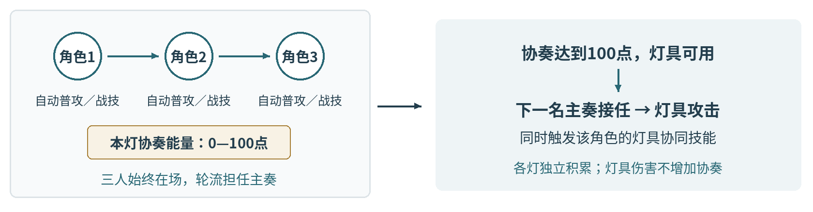

图2　协奏接力

| 规则项目 | 执行方式 |
| --- | --- |
| 驻守范围 | 三人站位在灯周6米内；近战最多追至灯周8米，远程射程14米。不跨灯追敌，不以身体堵路。 |
| 攻击与闪避 | 两个战斗技能分别冷却6秒、10秒。有目标时优先使用技能二，再用技能一，否则普攻。自动闪避间隔至少4秒，不增加协奏。 |
| 协奏积累 | 每灯独立拥有0—100点协奏，每波初始40点。三人普攻命中每秒合计最多增加15点，战技命中每3秒合计最多增加20点。多段不重复计数，灯具与协同技能不增加协奏。 |
| 主奏轮换 | 协奏满100点、灯无故障且至少两人可行动时，按站位①→②→③轮换并消耗100点。同灯触发间隔至少8秒，首轮由①接任，跳过无法行动者。 |
| 灯具触发 | 射程内有敌人、来袭箭矢或待点亮的任务灯时触发，否则保留满额协奏。灯光持续本波，故障或本队全员倒下时熄灭；六灯可同时点亮。 |
| 协同效果 | 只触发本次主奏适配当前灯型的协同效果，不匹配仍有基础灯击。常驻变奏、延奏、共鸣回路、共鸣解放及装备效果关闭。 |

触发节奏　设计目标为接敌后约3—5秒完成首次触发，此后约8—10秒触发一次。

攻击目标　波前选择突破、拆灯或远程优先，同类目标选更靠近防线出口者；技能专属选敌规则优先。范围外不追击，无目标不空放。

接力准备　协奏达到80点后，下一主奏优先使用冷却结束的标记或聚敌技能。灯击最多等动作1秒，不等冷却；两个战斗技能均有伤害。

## 三、波间整备与通关规则

一波可分多批来敌。全部批次处理完且本波任务完成后进入整备；批次之间不能改阵。

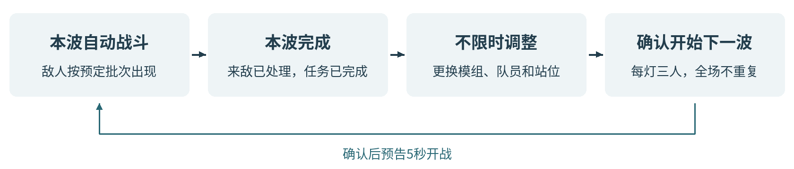

图3　波间整备

| 整备内容 | 操作与限制 |
| --- | --- |
| 查看情报 | 公开下一波来敌入口、数量、批次间隔、所需灯组和预定故障位置。 |
| 更换灯具效果 | 免费更换已解锁模组，同型可重复装备；贯阵灯可改方向，灯座不移动。 |
| 调换角色 | 可换入替补、跨灯换人或整队交换。每灯三人，同一人物全场唯一，不同形态共用名额。 |
| 调整站位 | 站位①②③决定主奏顺序；调整可撤回，确认时检查人数与重复人物。 |
| 状态恢复 | 保留防线耐久与已完成任务；全员满生命，灯等待点亮，技能冷却结束，协奏40点。换人不额外增加生命或能量。 |
| 开始下一波 | 整备不限时，战场与任务计时暂停。确认后预告5秒开战；波内只能观察、暂停或退出，不能施技或改阵。 |

### 通关、失败与进度保存

防线初始100，轻波级敌人突破扣10点，巨浪级扣20点并离场，归零失败；程望、伤员和车辆无独立生命值。角色倒下8秒后满生命恢复，本队全员倒下时灯熄灭，恢复后需协奏点亮。

任务灯未亮，或作业点、伤员、车辆周围3米有敌人时，任务暂停、进度保留。没有在场敌人且任务灯未亮时，本队每秒自动增加20点协奏。各关完成全部波次与任务，防线耐久大于0时通关。

波后保存进度。失败或断线回到当前波开战前，可改阵重试，前波保留；整备退出原样保存。新关防线重置。主线辅助模式将突破损失减半，险境无辅助。

## 四、灯具模组与战场分工

图4　四种灯具的攻击方式

| 模组 | 协奏触发效果 | 适用场景与限制 |
| --- | --- | --- |
| 聚焰灯 | 在18米内选取爆炸中心，造成半径6米的爆炸，并留下4秒灼烧区域。 | 清理密集的轻波级敌人。敌人离开燃烧区域会减少后续伤害，适合与牵引、定身技能配合。 |
| 贯阵灯 | 沿波前选定的通道发射长28米、宽3米的贯穿光束；对巨浪级敌人追加一次集中打击。 | 处理重型敌人或直线敌群。攻击方向整波固定，侧路绕行会降低命中效率。 |
| 震域灯 | 灯周10米内在触发时、1秒后、2秒后各震爆一次。首次将轻波级敌人推回3米，并削减巨浪级敌人15%的最大共振度。 | 近处拦截与打断。每轮仅首次震爆削减共振度，不能处理范围外的射手。 |
| 返照灯 | 立即向18米内目标发射3枚光矢；灯周8米形成持续6秒的防护区域，拦截箭矢并取消、阻止本灯被拆解。每拦一箭反击一矢，基础上限3次。 | 对抗远程火力并保护灯具。没有箭矢时仍有主动攻击；近战敌人可进入区域，关卡预定故障仍会发生。 |

伤害目标　以同级审判战士为测试基准：聚焰灯清理成群轻波，贯阵灯约两轮配合战技处理巨浪，震域全中伤害接近聚焰，返照三矢重创一名轻波。伤害独立配置，不按敌人生命百分比扣除。

组合关系　角色聚敌或标记后由灯主攻。震域将突破者推回聚焰燃烧区，返照保护灯座，贯阵处理重型敌人。

### 效果叠加与灯具故障

灯具独立计算伤害，追加攻击只触发一次，不增加协奏或再次追加。效果不穿墙；同名持续区域重叠时强度不叠加，直接命中分别计伤。

拆灯者在灯周3米内连续拆解4秒，令灯故障6秒、取消灯效；角色仍积累协奏，恢复后再次点亮。轻波不能被推拉穿过障碍，巨浪不受位移，8秒内只受一次强制打断。共振度为敌人的受制条，耗尽后暂时受制。

## 五、角色技能与灯具协同

活动提供25名今州关联人物、26套配置，秧秧两形态不能同时上场。每人有两个攻击战技和一个灯具协同技能。\[3\] 技能表中的“轻波”“巨浪”分别指轻波级、巨浪级敌人。

| 角色与特点 | 战斗技能一 冷却6秒 | 战斗技能二 冷却10秒 | 灯具协同技能 接任主奏时生效 |
| --- | --- | --- | --- |
| [漂泊者·衍射](https://mc.appfeng.com/avatar/1501) 光刃 | 凝光扫：扇形斩击，使轻波定身2秒。 | 破隙：标记最接近防线出口的敌人。 | 聚焰灯：爆炸中心转向标记。 贯阵灯：命中标记后追加短光刃。 |
| [今汐](https://mc.appfeng.com/avatar/1304) 龙息 | 浮光：直线攻击，贯穿前方敌人。 | 点曜：标记巨浪，优先拆灯者。 | 贯阵灯：对标记目标追加龙息。 返照灯：首枚光矢命中标记后产生小范围溅射。 |
| [长离](https://mc.appfeng.com/avatar/1205) 心眼 | 炎步：突进斩击最前方的轻波。 | 截翎：斩击并打断拆灯者。 | 聚焰灯：爆炸中心留下4秒十字火带。 震域灯：最后一震沿来敌方向追加回斩。 |
| [秧秧](https://mc.appfeng.com/avatar/1402) 风场 | 回风：将轻波拉到灯前。 | 风线：风刃命中，使轻波减速2秒。 | 聚焰灯：爆炸前聚拢一次敌人。 贯阵灯：在选定通道内对准最密集敌群。 |
| [炽霞](https://mc.appfeng.com/avatar/1202) 连续射击 | 压枪：优先射击并压制射手2秒。 | 燃印：点射并标记巨浪。 | 贯阵灯：引爆命中目标的燃印。 返照灯：追加3发主动追射。 |
| [白芷](https://mc.appfeng.com/avatar/1103) 忧昙 | 冻尘：忧昙喷射，使轻波减速。 | 羽袭：打断最接近本灯的敌人。 | 聚焰灯：爆炸中心留下2秒冷凝区域。 返照灯：首次反击恢复本队15%生命。 |
| [散华](https://mc.appfeng.com/avatar/1102) 冰棘 | 霜棘：攻击前方，留下冰线阻滞轻波。 | 碎冰：引爆冰棘，造成伤害并打断敌人。 | 聚焰灯：引爆冰棘，追加小范围爆破。 贯阵灯：沿冰线延伸一段短光束。 |
| [桃祈](https://mc.appfeng.com/avatar/1601) 防御反击 | 御反：近身反斩并推开轻波。 | 破阵：重斩，使拆灯进度暂停2秒。 | 震域灯：首次震爆取消本灯正在进行的拆解。 返照灯：防护区域延长2秒。 |
| [渊武](https://mc.appfeng.com/avatar/1303) 雷楔 | 楔震：在近处留下持续4秒的雷击。 | 断雷：优先打断拆灯者。 | 震域灯：每次震爆追击一名巨浪。 贯阵灯：命中雷楔内目标时追加电爆。 |
| [忌炎](https://mc.appfeng.com/avatar/1404) 青龙 | 横阵：横扫并推回轻波。 | 龙势：贯刺本路最前方的敌人。 | 聚焰灯：将爆炸区域边缘的轻波推向中心。 震域灯：最后一震的推回距离增至6米。 |
| [鉴心](https://mc.appfeng.com/avatar/1405) 化劲 | 回掌：反击并推开近身轻波。 | 归涡：将轻波牵引至身前。 | 聚焰灯：爆炸前生成一次聚敌漩涡。 返照灯：拦截反击上限由3次增至5次。 |
| [吟霖](https://mc.appfeng.com/avatar/1302) 傀儡丝线 | 缚丝：攻击一名轻波，使其定身2秒。 | 罚雷：标记最多两名敌人。 | 贯阵灯：在两个标记目标间传导一次。 震域灯：最后一震使带标记的轻波定身2秒。 |
| [莫特斐](https://mc.appfeng.com/avatar/1204) 火羽 | 火羽：优先点射远程敌人。 | 爆签：攻击巨浪并附着爆签。 | 聚焰灯：引爆爆签，形成连锁爆炸。 返照灯：光矢附带火羽，最多3次。 |

沿用角色原有动作，技能效果按活动规则配置。

## 五、角色技能与灯具协同（续）

每名角色适配两类灯具。

| 角色与特点 | 战斗技能一 冷却6秒 | 战斗技能二 冷却10秒 | 灯具协同技能 接任主奏时生效 |
| --- | --- | --- | --- |
| [相里要](https://mc.appfeng.com/avatar/1305) 解析机械臂 | 重拳：打断正在拆灯的目标。 | 解构：标记最近巨浪的破绽。 | 贯阵灯：对标记目标追加集中打击。 震域灯：最后一震额外削减其20%共振度。 |
| [凌阳](https://mc.appfeng.com/avatar/1104) 舞狮 | 跃击：跃至突破者前方攻击。 | 狮踏：连击并推回轻波。 | 震域灯：最后一震留下4秒减速冰径。 返照灯：防护区域前缘追加一次撞击。 |
| [丹瑾](https://mc.appfeng.com/avatar/1602) 绯刃 | 绯锋：优先连斩生命较低的目标。 | 追刃：标记本路巨浪。 | 聚焰灯：优先生命较低且密集的敌群。 贯阵灯：对生命低于30%的标记目标追加追斩。 |
| [折枝](https://mc.appfeng.com/avatar/1105) 鹤影 | 飞鹤：优先点射远程目标。 | 墨痕：标记本路最前方的敌人。 | 聚焰灯：在标记处追加3米小范围爆破。 贯阵灯：追击附近第二个目标一次。 |
| [维里奈](https://mc.appfeng.com/avatar/1503) 植物 | 藤拍：缠住近身轻波2秒。 | 叶矢：标记本灯附近敌人。 | 聚焰灯：燃烧区域长出藤蔓，首次进入者定身2秒。 返照灯：防护区域每秒恢复本队2%生命。 |
| [釉瑚](https://mc.appfeng.com/avatar/1106) 冰器 | 鼎击：冰器落地攻击，使轻波减速。 | 如意：挥击并打断单个目标。 | 震域灯：最后一震碎裂冰器，追加范围打击。 返照灯：拦箭时触发冰刺，最多2次。 |
| [灯灯](https://mc.appfeng.com/avatar/1504) 领航疾驰 | 闪行：迎击轻波后返回站位。 | 追光：优先射击侧路射手。 | 贯阵灯：射线末端追加追光弹。 返照灯：主动光矢可分别攻击两路敌人。 |
| [卜灵](https://mc.appfeng.com/avatar/1307) 雷卦 | 落雷：标记最近巨浪。 | 雷符：攻击轻波，使其定身2秒。 | 聚焰灯：爆炸中心2秒后追加一道雷。 贯阵灯：命中雷符目标时分出一次雷束。 |
| [秋水](https://mc.appfeng.com/avatar/1403) 雾替身 | 雾弹：攻击射手，使其失去目标2秒。 | 雾饵：诱导轻波3秒，结束时爆炸。 | 聚焰灯：爆炸前短暂引敌至爆炸中心。 返照灯：首矢使被命中的射手再次失准2秒。 |
| [安可](https://mc.appfeng.com/avatar/1203) 双羊咩 | 白咩弹：造成小范围爆破。 | 黑咩踏：打断本灯附近敌人。 | 聚焰灯：1.5秒后追加一次回响爆破。 震域灯：第二震留下2秒后引爆的爆点。 |
| [椿](https://mc.appfeng.com/avatar/1603) 藤蔓 | 缠枝：将轻波拉近本灯。 | 花旋：留下持续4秒的旋转斩击区域。 | 聚焰灯：燃烧区域结束时发生藤花爆破。 震域灯：最后一震改为聚拢轻波。 |
| [卡卡罗](https://mc.appfeng.com/avatar/1301) 杀意虚影 | 影斩：优先追击巨浪。 | 逐猎：标记正在拆灯的目标。 | 贯阵灯：在最远命中点追加投影斩击。 返照灯：光矢命中标记后追加一次反斩。 |
| [秧秧·玄翎](https://mc.appfeng.com/avatar/1610) 苍翎剑式 | 苍剑：横斩并打断拆灯者。 | 羽剑：将轻波牵引至攻击线上。 | 贯阵灯：沿同一路线追加羽刃。 震域灯：最后一震沿来敌路线追加羽刃。 |

统一规则：未另列范围时，选敌14米、近身6米；标记6秒、减速40%、推拉3米。同名标记刷新时长、不叠层；协同效果受灯具范围与墙体限制。

组合示例　秧秧、长离、安可驻聚焰灯，依次聚敌、留下十字火带、回响爆破。换入莫特斐则增加标记连锁爆炸；灯型相同，接力效果不同。

## 六、解锁进程与敌人规则

| 关卡阶段 | 灯具与人数 | 开放内容 |
| --- | --- | --- |
| 主线第一关 | 2灯／6人 | 初始9人：漂泊者、今汐、长离、秧秧、炽霞、白芷、散华、桃祈、渊武；开放聚焰灯、贯阵灯。 |
| 主线第二关 | 4灯／12人 | 新增忌炎、鉴心、吟霖、莫特斐、相里要、凌阳、丹瑾、折枝、维里奈，共18人；开放震域灯。 |
| 主线第三关 | 6灯／18人 | 新增釉瑚、灯灯、卜灵、秋水、安可、椿、卡卡罗，以及秧秧·玄翎形态；开放返照灯。 |
| 主线第四至六关 | 均为6灯／18人 | 全部角色与模组可用，依次组合故障应对、分段护送和三路发信；完成前关后进入下一关。 |
| 险境复演 | 6灯／18人 | 完成主线第六关后，三个险境同时开放。首次完成只解锁不同挑战条件，不增加角色强度。 |

角色与模组随关卡进度开放，无材料或付费条件；每波可免费更换。

### 敌人分类与活动任务

| 敌人 | 图鉴分类与原有特点 | 活动中的行动规则 |
| --- | --- | --- |
| 审判战士 | 轻波级；巨镰近战。 | 突进：沿路线前往防线出口；近身遇到角色时短暂交战，脱离3秒后继续前进。 |
| 鸣泣战士 | 轻波级；利刃近战。 | 可承担突进或牵制任务。牵制者攻击最近的驻灯角色，不主动突破防线。 |
| 惊蛰猎手 | 轻波级；持弓射出雷矢。 | 牵制：停在射击位置攻击角色；每个射击位置至少处于一盏灯的攻击范围内。 |
| 冥渊守卫 | 巨浪级；重型近战。 | 拆灯：接近最近的可用灯具并尝试拆解，成功后转为突进。 |
| 磐石守卫 | 巨浪级；重型近战。 | 拆灯：同灯最多一名敌人进行拆解，其余改选邻灯；没有目标时转为突进。 |

分类沿用图鉴\[4\]。只用轻波级、巨浪级普通个体，保留攻击动作与共振度；不使用怒涛级、海啸级首领或梦魇变体。拆灯与等级由活动配置。

各批来敌提前5秒预警。主线同场最多24名、险境32名；超额整批延后，再次预警。所有批次已出现且敌人被击败或突破离场，才算处理完本波。

图中圆圈为灯座，入口为敌人出现位置；推荐队伍按主奏顺序排列。

### 参考资料

[\[1\] 夜归军设定（官方）](https://www.bilibili.com/opus/992096299631247368)　　[\[2\] 仿声战略活动（官方）](https://www.taptap.cn/moment/742460935892895858) [\[3\] 角色游戏文本整理](https://mc.appfeng.com/avatar)　　[\[4\] 敌人游戏文本整理](https://mc.appfeng.com/monster)

## 七、主线关卡｜第一关

### 断哨留火 · 双灯教学

敌人70级　｜　2灯／6人　｜　可选9人　｜　2波

程望在哨仓后门校线。半程听到伤员回应；双灯稳定后，他打开桥头通道。

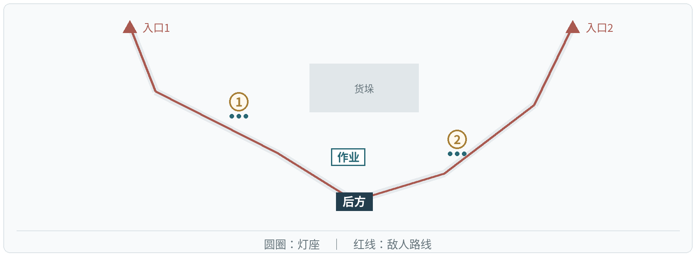

图5　断哨留火布局

场景布局　两条来敌路线在后方出口汇合。灯1守弯口，灯2覆盖直道。单灯教学固定使用漂泊者·衍射、今汐和长离；进入正式双灯战斗后，可从9名角色中配队。

任务目标　第一波点亮灯1，第二波点亮灯2；各自在作业点累计完成10秒校线。作业点周围3米内有敌人时暂停。

| 灯位与模组 | 首波推荐阵容 | 灯位与模组 | 首波推荐阵容 |
| --- | --- | --- | --- |
| 灯1 · 聚焰 | 漂泊者·衍射／长离／秧秧 | 灯2 · 贯阵 | 今汐／散华／炽霞 |

| 波次与任务 | 来敌时间与配置 | 数量 |
| --- | --- | --- |
| 第1波 灯1校线 | 开战时：入口1 审判战士×6（突进）；入口2 鸣泣战士×4（突进） | 10 |
| 第2波 灯2校线 | 开战时：入口2 惊蛰猎手×4（牵制） 开战后10秒：入口1 审判战士×8（突进） | 12 |

来敌合计：22名。

波间调整　东侧射手出现前，将炽霞调为灯2首位主奏；灯1保留聚焰灯守弯口。

完成解锁　开放第二关：新增9名角色、四灯布局和震域灯。

## 七、主线关卡｜第二关

### 桥头让路 · 双桥接力

敌人75级　｜　4灯／12人　｜　可选18人　｜　3波

两桥担架交替撤离。程望每接到一批，就在旗杆系上确认布；后排灯队拦住越过前排的残象。

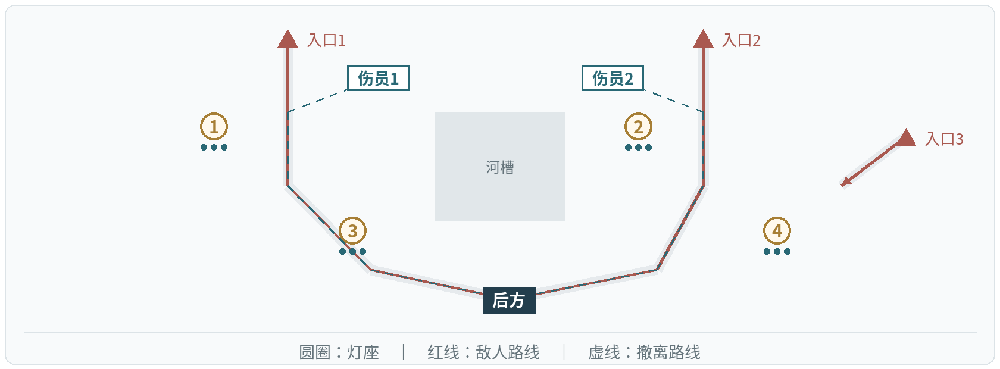

图6　桥头让路布局

场景布局　两桥各设前后两灯，中间河槽不可通行。灯4可以攻击入口3的射手；灯3的震域效果可将突破者推回灯1的燃烧区域。

任务目标　三波依次护送西桥、东桥、西桥各一批伤员，每批累计行进12秒。西桥需要灯1、3点亮，东桥需要灯2、4点亮；伤员周围3米有敌人时暂停。

| 灯位与模组 | 首波推荐阵容 | 灯位与模组 | 首波推荐阵容 |
| --- | --- | --- | --- |
| 灯1 · 聚焰 | 秧秧／长离／白芷 | 灯2 · 贯阵 | 今汐／相里要／散华 |
| 灯3 · 震域 | 忌炎／凌阳／鉴心 | 灯4 · 贯阵 | 漂泊者·衍射／吟霖／折枝 |

| 波次与任务 | 来敌时间与配置 | 数量 |
| --- | --- | --- |
| 第1波 西桥 | 开战时：入口1 审判战士×8（突进）；入口3 惊蛰猎手×2（牵制） 开战后12秒：入口2 鸣泣战士×8（突进） | 18 |
| 第2波 东桥 | 开战时：入口2 鸣泣战士×8（突进）；入口1 审判战士×6（突进）；入口3 冥渊守卫×1（拆灯） 开战后12秒：入口3 惊蛰猎手×3（牵制） | 18 |
| 第3波 西桥 | 开战时：入口1 审判战士×6（突进）；入口2 鸣泣战士×6（突进） 开战后10秒：入口3 惊蛰猎手×4（牵制） | 16 |

来敌合计：52名。

波间调整　第二波前交换两桥小队，把单体打断转向东桥；第三波保留灯3拦截越过前排的敌人。

完成解锁　开放第三关：六灯、返照灯与全部角色配置。

## 七、主线关卡｜第三关

### 仓前十步 · 六灯协防

敌人80级　｜　6灯／18人　｜　全部角色可选　｜　3波

程望将首箱线缆横放作掩体，再去取箱；巨浪逼近时抱箱躲避，作业区域清空后继续。

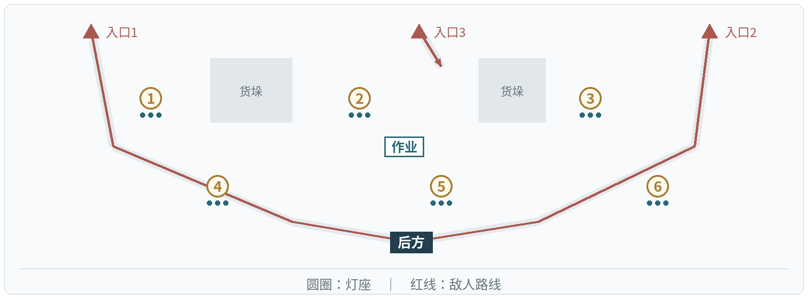

图7　仓前十步布局

场景布局　作业点位于前沿，灯1、2、3先接敌，灯4、5、6负责后方拦截。拆灯者从不同路线接近前排，单一控制区域不能覆盖全部目标。

任务目标　每波搬一箱。灯2、5点亮，且作业点周围3米无敌人时，累计作业10秒；处理完当波来敌后进入整备。三箱到位即完成搬运任务。

| 灯位与模组 | 首波推荐阵容 | 灯位与模组 | 首波推荐阵容 |
| --- | --- | --- | --- |
| 灯1 · 聚焰 | 秧秧／长离／白芷 | 灯2 · 贯阵 | 今汐／相里要／散华 |
| 灯3 · 震域 | 忌炎／凌阳／鉴心 | 灯4 · 返照 | 桃祈／炽霞／秋水 |
| 灯5 · 聚焰 | 安可／椿／莫特斐 | 灯6 · 贯阵 | 卡卡罗／吟霖／折枝 |

| 波次与任务 | 来敌时间与配置 | 数量 |
| --- | --- | --- |
| 第1波 第1箱 | 开战时：入口1 审判战士×8（突进）；入口3 惊蛰猎手×4（牵制） 开战后12秒：入口2 鸣泣战士×8（突进） | 20 |
| 第2波 第2箱 | 开战时：入口1 磐石守卫×1（拆灯）；入口2 冥渊守卫×1（拆灯）；入口3 惊蛰猎手×4（牵制） 开战后14秒：入口1 审判战士×8（突进）；入口2 鸣泣战士×6（突进） | 20 |
| 第3波 第3箱 | 开战时：入口2 冥渊守卫×2（拆灯）；入口1 审判战士×8（突进） 开战后12秒：入口2 鸣泣战士×8（突进）；入口3 惊蛰猎手×4（牵制） | 22 |

来敌合计：62名。

波间调整　首波后将灯4返照小队与灯3交换，加强前排保护和打断；同时保留清理敌群的范围攻击。

完成解锁　开放第四关与六灯阵容保存；不再新增角色或模组。

## 七、主线关卡｜第四关

### 隔岸应答 · 故障补位

敌人85级　｜　6灯／18人　｜　全部角色可选　｜　3波

程望在桥南重发位置。第二段接头冒烟，他报出灯号并留守终端；信号恢复后，对岸逐段回应。

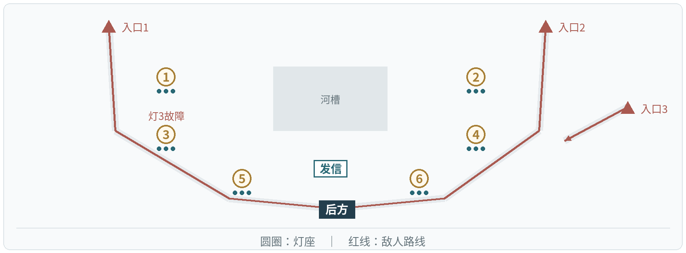

图8　隔岸应答布局

场景布局　双桥后排设置斜向火力。灯1、5可覆盖灯3故障时留下的缺口。关卡预定故障不受返照灯防护效果影响。

任务目标　三波依次点亮灯1、2，灯3、4，灯5、6，每波累计发信12秒，发信点周围3米无敌人时推进。第二波开战12秒后，灯3故障6秒，提前3秒预警。

| 灯位与模组 | 首波推荐阵容 | 灯位与模组 | 首波推荐阵容 |
| --- | --- | --- | --- |
| 灯1 · 贯阵 | 今汐／相里要／卡卡罗 | 灯2 · 聚焰 | 秧秧／长离／安可 |
| 灯3 · 返照 | 桃祈／炽霞／白芷 | 灯4 · 震域 | 忌炎／凌阳／鉴心 |
| 灯5 · 返照 | 维里奈／莫特斐／秋水 | 灯6 · 贯阵 | 散华／吟霖／折枝 |

| 波次与任务 | 来敌时间与配置 | 数量 |
| --- | --- | --- |
| 第1波 灯1、2发信 | 开战时：入口1 审判战士×8（突进）；入口3 惊蛰猎手×6（牵制） 开战后12秒：入口2 鸣泣战士×6（突进） | 20 |
| 第2波 灯3、4发信；灯3停6秒 | 开战时：入口1 冥渊守卫×2（拆灯）；入口2 鸣泣战士×6（突进）；入口3 惊蛰猎手×4（牵制） 开战后14秒：入口2 审判战士×8（突进） | 20 |
| 第3波 灯5、6发信 | 开战时：入口1 磐石守卫×2（拆灯）；入口2 冥渊守卫×1（拆灯） 开战后10秒：入口2 鸣泣战士×8（突进）；入口3 惊蛰猎手×6（牵制） | 17 |

来敌合计：57名。

波间调整　第二波由灯1、5覆盖灯3桥口，第三波主力转灯5、6。故障自动解除，协奏重新点灯，无需跑图维修。

完成解锁　开放第五关的分段转运；故障补位用于险境第二关。

## 七、主线关卡｜第五关

### 接力不熄 · 转运换防

敌人90级　｜　6灯／18人　｜　全部角色可选　｜　3波

程望推最后一车伤员离哨，途中停车检查绑带；玩家利用整备将主力调至下一路段。

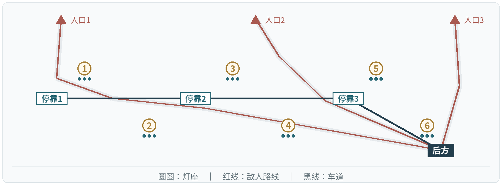

图9　接力不熄布局

场景布局　三对固定灯沿车道排列，车辆在每波末停靠。整备时可交换整队位置；车辆前移后，旧路仍需要保留拦截火力。

任务目标　三波分别从停靠1到停靠2、停靠2到停靠3、停靠3到后方。每段累计行进16秒，依次要求灯1、2，灯3、4，灯5、6点亮；车辆周围3米有敌人时暂停。

| 灯位与模组 | 首波推荐阵容 | 灯位与模组 | 首波推荐阵容 |
| --- | --- | --- | --- |
| 灯1 · 聚焰 | 秧秧／长离／安可 | 灯2 · 返照 | 桃祈／白芷／秋水 |
| 灯3 · 贯阵 | 今汐／相里要／散华 | 灯4 · 震域 | 忌炎／凌阳／鉴心 |
| 灯5 · 贯阵 | 灯灯／卡卡罗／吟霖 | 灯6 · 返照 | 莫特斐／维里奈／釉瑚 |

| 波次与任务 | 来敌时间与配置 | 数量 |
| --- | --- | --- |
| 第1波 停靠1→停靠2 | 开战时：入口1 审判战士×8（突进）；入口2 惊蛰猎手×4（牵制） 开战后12秒：入口2 鸣泣战士×6（突进） | 18 |
| 第2波 停靠2→停靠3 | 开战时：入口3 冥渊守卫×2（拆灯）；入口2 鸣泣战士×8（突进）；入口3 惊蛰猎手×4（牵制） 开战后14秒：入口1 审判战士×6（突进） | 20 |
| 第3波 停靠3→后方 | 开战时：入口3 磐石守卫×1（拆灯）；入口2 冥渊守卫×1（拆灯）；入口1 审判战士×8（突进） 开战后12秒：入口2 鸣泣战士×8（突进）；入口3 惊蛰猎手×4（牵制） | 22 |

来敌合计：60名。

波间调整　第二波交换灯1、2与灯3、4小队，第三波主力转灯5、6；旧路保留聚焰或震域小队。

完成解锁　开放第六关，组合运用已学机制。

## 七、主线关卡｜第六关

### 最后一束信号 · 信号交接

敌人90级　｜　6灯／18人　｜　全部角色可选　｜　3波

程望核对位置、批次与人数；收到“人员到齐”的回应后签下交接单，结束守卫。

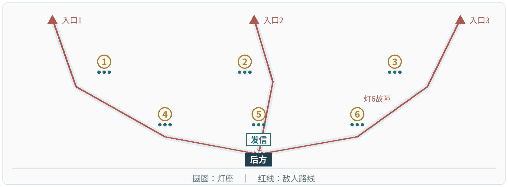

图10　最后一束信号布局

场景布局　三条路线各经过前后两灯，后排交叉覆盖发信点。六灯均可点亮，防守重点随本波所需灯组变化。

任务目标　三波依次使用灯1、4，灯2、5，灯3、6发送12秒灯码；所需灯点亮、发信点周围3米无敌人时推进。第三波开战12秒后，灯6故障6秒。三波与灯码完成后收到回应，结束交接。

| 灯位与模组 | 首波推荐阵容 | 灯位与模组 | 首波推荐阵容 |
| --- | --- | --- | --- |
| 灯1 · 贯阵 | 今汐／相里要／散华 | 灯2 · 聚焰 | 秧秧／长离／安可 |
| 灯3 · 震域 | 忌炎／凌阳／卜灵 | 灯4 · 返照 | 桃祈／白芷／秋水 |
| 灯5 · 聚焰 | 椿／莫特斐／维里奈 | 灯6 · 贯阵 | 卡卡罗／吟霖／折枝 |

| 波次与任务 | 来敌时间与配置 | 数量 |
| --- | --- | --- |
| 第1波 灯1、4灯码 | 开战时：入口1 审判战士×8（突进）；入口2 鸣泣战士×8（突进） 开战后12秒：入口3 惊蛰猎手×4（牵制） | 20 |
| 第2波 灯2、5灯码 | 开战时：入口1 冥渊守卫×2（拆灯）；入口2 磐石守卫×1（拆灯）；入口3 惊蛰猎手×4（牵制） 开战后14秒：入口1 审判战士×8（突进）；入口2 鸣泣战士×6（突进） | 21 |
| 第3波 灯3、6灯码；灯6停6秒 | 开战时：入口1 磐石守卫×2（拆灯）；入口3 冥渊守卫×2（拆灯） 开战后10秒：入口1 审判战士×8（突进）；入口2 鸣泣战士×8（突进）；入口3 惊蛰猎手×4（牵制） | 24 |

来敌合计：65名。

波间调整　巨浪波调整贯阵方向，混合敌群保留聚焰；灯6故障时由灯5补足火力。

完成解锁　三个险境同时开放，可自由组合全部角色与四种模组。

## 八、险境复演｜第一关

### 双桥叠压 · 双路同时撤离

敌人95级　｜　6灯／18人　｜　全部角色可选　｜　4波

复演主线第二关的双路撤离，增加中桥交汇与两侧射台，形成新的演练条件。

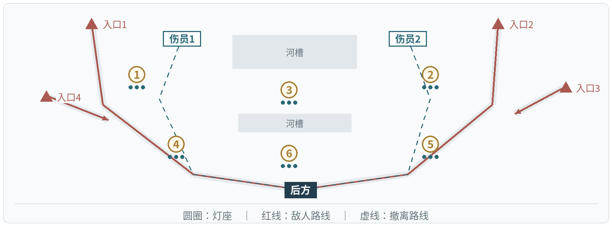

图11　双桥叠压布局

场景布局　两桥前后与中桥交汇处共设六灯，入口3、4形成交叉射击。整备情报提前公开下一波来向。

任务目标　四波依次完成西桥、东桥、双路、双路撤离，每批累计行进12秒。西桥需灯1、4点亮，东桥需灯2、5点亮；双路波两批都抵达后方才完成。灯3、6可提供交叉火力。

| 波次与任务 | 来敌时间与配置 | 数量 |
| --- | --- | --- |
| 第1波 西桥 | 开战时：入口1 审判战士×10（突进）；入口3 惊蛰猎手×4（牵制） 开战后10秒：入口2 鸣泣战士×10（突进） | 24 |
| 第2波 东桥 | 开战时：入口1 冥渊守卫×2（拆灯）；入口2 磐石守卫×2（拆灯） 开战后10秒：入口2 鸣泣战士×12（突进）；入口4 惊蛰猎手×4（牵制） | 20 |
| 第3波 双路 | 开战时：入口1 审判战士×10（突进）；入口2 鸣泣战士×10（突进） 开战后8秒：入口3 惊蛰猎手×4（牵制）；入口4 惊蛰猎手×4（牵制） | 28 |
| 第4波 双路 | 开战时：入口1 冥渊守卫×2（拆灯）；入口2 磐石守卫×2（拆灯） 开战后8秒：入口1 审判战士×10（突进）；入口2 鸣泣战士×10（突进） | 24 |

来敌合计：96名。

均衡布阵　两桥各配贯阵灯、返照灯，灯3、6用聚焰灯清交汇区。两侧稳定，但前排爆发较分散。

前排清场　前沿双聚焰分别配秧秧、鉴心，后排贯阵拦巨浪。清群快，但更怕两侧箭雨。

完成解锁　解锁“撤离镜像”：左右撤离目标对调，敌量与角色强度不变。

## 八、险境复演｜第二关

### 断线重发 · 故障与拆灯

敌人100级　｜　6灯／18人　｜　全部角色可选　｜　4波

复演主线第四关，发信点前移，新增背面入口4；故障与拆灯同波出现，考验邻灯支援。

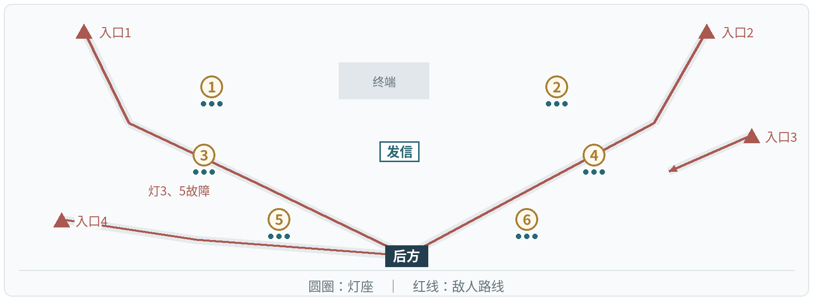

图12　断线重发布局

场景布局　六灯围绕中台，入口4直接压向发信点。关卡预定故障不能免疫，敌人的拆灯动作仍可被打断。

任务目标　四波分别使用灯1、2，灯3、4，灯5、6，灯1、6发信12秒。第二波开战12秒后灯3停机，第三波开战12秒后灯5停机；均持续6秒、提前3秒预警。

| 波次与任务 | 来敌时间与配置 | 数量 |
| --- | --- | --- |
| 第1波 灯1、2 | 开战时：入口1 审判战士×10（突进）；入口3 惊蛰猎手×4（牵制） 开战后8秒：入口4 鸣泣战士×10（突进） | 24 |
| 第2波 灯3、4；灯3停6秒 | 开战时：入口1 冥渊守卫×2（拆灯）；入口2 磐石守卫×2（拆灯） 开战后10秒：入口4 鸣泣战士×12（突进）；入口3 惊蛰猎手×4（牵制） | 20 |
| 第3波 灯5、6；灯5停6秒 | 开战时：入口2 审判战士×10（突进）；入口4 鸣泣战士×10（突进） 开战后8秒：入口3 惊蛰猎手×6（牵制）；入口1 冥渊守卫×2（拆灯） | 28 |
| 第4波 灯1、6 | 开战时：入口1 磐石守卫×2（拆灯）；入口4 冥渊守卫×2（拆灯） 开战后8秒：入口2 审判战士×10（突进）；入口3 惊蛰猎手×6（牵制） | 20 |

来敌合计：92名。

拦截补位　故障灯旁配震域灯，以忌炎、渊武控制补位。近处安全，但处理远程敌人的效率较低。

防护反击　两侧返照配秋水、莫特斐，中后贯阵配今汐、相里要。箭雨增加反击，背面仍需范围攻击。

完成解锁　解锁“故障换侧”：故障由灯3、5改为灯4、6，其余波次不变。

## 八、险境复演｜第三关

### 长夜接班 · 前后双任务

敌人100级　｜　6灯／18人　｜　全部角色可选　｜　4波

综合主线第五、六关记录，车道绕仓房，发信点留后方；同波完成护送和发信。

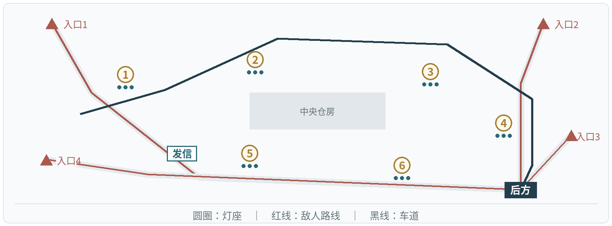

图13　长夜接班布局

场景布局　敌人从四向进入，车辆分段停靠。小队在本波内不能更换驻守灯，前后两处任务都需要预先分配火力。

任务目标　第一波由灯1、2护送16秒；第二波由灯3、4护送16秒，同时灯5、6发信12秒；第三波由灯5、6护送16秒，同时灯1、2发信12秒；第四波由灯1、6发送终报码12秒。双任务波必须完成两项目标。

| 波次与任务 | 来敌时间与配置 | 数量 |
| --- | --- | --- |
| 第1波 灯1、2送车 | 开战时：入口1 审判战士×12（突进）；入口2 鸣泣战士×10（突进） 开战后8秒：入口3 惊蛰猎手×4（牵制） | 26 |
| 第2波 灯3、4送车＋灯5、6发信 | 开战时：入口3 冥渊守卫×2（拆灯）；入口4 磐石守卫×2（拆灯） 开战后8秒：入口1 审判战士×12（突进）；入口2 惊蛰猎手×6（牵制） | 22 |
| 第3波 灯5、6送车＋灯1、2发信 | 开战时：入口2 鸣泣战士×12（突进）；入口4 审判战士×12（突进） 开战后8秒：入口3 冥渊守卫×2（拆灯）；入口1 惊蛰猎手×4（牵制） | 30 |
| 第4波 灯1、6终报码 | 开战时：入口1 磐石守卫×2（拆灯）；入口4 冥渊守卫×2（拆灯） 开战后8秒：入口2 审判战士×12（突进）；入口3 鸣泣战士×10（突进） | 26 |

来敌合计：104名。

分区防守　前排聚焰、贯阵护车，后排返照、震域保护发信点。职责稳定，但前段清场较慢。

交叉火力　贯阵朝车道与后路交汇处射击，配合折枝的追加攻击与吟霖的标记传导。火力集中，但需随车段调整方向。

完成解锁　解锁“反向转运”：车段改为灯5、6→灯3、4→灯1、2，信号任务镜像调整；三险境变体独立选择。
