# 长夜守灯

《鸣潮》原创限时战术守线活动设计作品。以灯具模组、驻灯自动战斗、协奏接力和波间整备为核心，设计六个主线关卡与三个险境关卡，分别从系统、数值和战斗三个方向展开。

## 选择设计文档

  
  
  

点击上方按钮即可跳到本页对应正文。也可使用下表文字入口，或下载保留原始排版的 Word 文档。

| 文档 | 主要内容 | 在线阅读 | 原文下载 |
| --- | --- | --- | --- |
| 系统设计 | 活动目标、系统闭环、波间整备、关卡解锁、界面与经济系统，以及系统验收指标。 | [阅读正文](#system) | [Word](documents/%E9%95%BF%E5%A4%9C%E5%AE%88%E7%81%AF_%E7%B3%BB%E7%BB%9F%E8%AE%BE%E8%AE%A1%E6%96%87%E6%A1%A3.docx?raw=1) |
| 数值设计 | 固定伤害、协奏结算、模组与协同预算、敌人等级、关卡压力、奖励及数值标定方案。 | [阅读正文](#balance) | [Word](documents/%E9%95%BF%E5%A4%9C%E5%AE%88%E7%81%AF_%E6%95%B0%E5%80%BC%E8%AE%BE%E8%AE%A1%E6%96%87%E6%A1%A3.docx?raw=1) |
| 战斗设计 | 角色3C、自动战斗AI、动作提交、命中与状态时序、敌人反制及战斗制作接口。 | [阅读正文](#combat) | [Word](documents/%E9%95%BF%E5%A4%9C%E5%AE%88%E7%81%AF_%E6%88%98%E6%96%97%E8%AE%BE%E8%AE%A1%E6%96%87%E6%A1%A3.docx?raw=1) |

[前往 Release 下载三份完整文档](https://github.com/s1encisi/wuthering-waves-nightwatch-event-design/releases/latest)

> 基于《鸣潮》背景创作的个人游戏策划作品，活动规则与关卡方案为原创设计。

---

## 系统设计

活动目标、系统闭环、波间整备、关卡解锁、界面与经济系统，以及系统验收指标。

[下载系统设计 Word 原文](documents/%E9%95%BF%E5%A4%9C%E5%AE%88%E7%81%AF_%E7%B3%BB%E7%BB%9F%E8%AE%BE%E8%AE%A1%E6%96%87%E6%A1%A3.docx?raw=1) · [返回文档选择](#document-navigation)

展开本篇目录

- [活动目标与系统闭环](#system-01)
  - [通用战斗与任务规则](#system-02)
  - [波间整备与关卡进度](#system-03)
  - [四类模组统一参数](#system-04)
  - [敌人参数与行为](#system-05)
  - [角色技能与灯具适配清单](#system-06)
  - [关卡解锁表](#system-07)
- [九关关卡与出敌制作表](#system-08)
  - [主线1  断哨留火  双灯教学](#system-09)
  - [主线2  桥头让路  双桥接力](#system-10)
  - [主线3  仓前十步  六灯协防](#system-11)
  - [主线4  隔岸应答  故障补位](#system-12)
  - [主线5  灯火接力  转运换防](#system-13)
  - [主线6  最后一束信号  信号交接](#system-14)
  - [险境1  双桥叠压  双路撤离](#system-15)
  - [险境2  断线重发  故障与拆灯](#system-16)
  - [险境3  长夜接班  前后双任务](#system-17)
- [界面和经济系统](#system-18)
  - [活动开放与一次性奖励](#system-19)
  - [数据接口与制作交付](#system-20)
  - [系统验收与体验指标](#system-21)

闫哲祯  &#124;  游戏策划投递作品  &#124;  2026年10月

围绕多灯驻守、三人接力与波间调度形成完整活动系统，给出角色解锁、关卡体验、交互闭环与制作交付规格。

作品定位：基于《鸣潮》夜归背景创作的限时战术守线活动。本文完整定义活动规则、九关配置、复现所需字段与验收指标。

### 活动目标与系统闭环

剧情发生于今州转运哨线。普通夜归士兵程望负责检修、推车与发信，漂泊者统筹驻灯小队，使防线守卫与普通士兵的交接行动产生连贯体验。

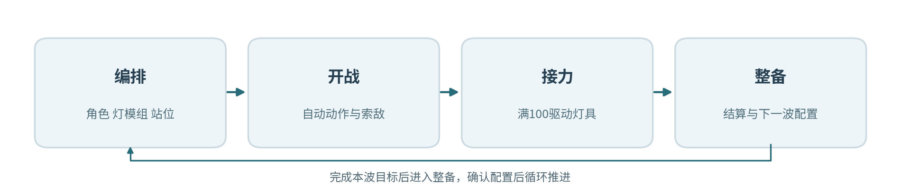

图  活动核心流程

战前玩家选择模块、角色与站位；战斗内三名角色围绕灯座自动行动，攻击命中汇入本灯协奏；满能量由一名主奏接任，驱动模组攻击及个人协同；战后进入整备调整配置。

| 维度 | 系统规格 |
| --- | --- |
| 活动内容 | 6关主线＋3关险境，共29波、610名敌人；25名人物、26套配置；2灯、4灯、6灯逐层解锁。 |
| 关键选择 | 模组类型、灯位分工、每灯三人、接力顺序、贯阵朝向及波前索敌优先级。 |
| 活动成长 | 解锁模块与角色，围绕阵容、阵位、任务与敌人组合形成策略成长。 |
| 波次流程 | 开放下波情报→调整配队与灯组→5秒预告→战斗与任务结算→整备或通关。 |

#### 通用战斗与任务规则

| 对象 | 规则与参数 |
| --- | --- |
| 配置 | 每灯配1种模组与3名角色；同一人物在全场占1个名额，秧秧及玄翎形态共享人物名额；站位①②③决定主奏顺序。 |
| 动作 | 角色自动完成普攻、战技一、战技二及闪避。普攻30点/1秒；战技一90点/6秒冷却；战技二150点/10秒冷却。 |
| 协奏 | 每灯独立0至100点；每波初始40点；普攻命中5点、战技命中10点；普攻15点/秒、战技20点/3秒滚动上限。 |
| 灯击 | 满100、灯具运行、至少2名队员可行动并具备合法目标时按①②③主奏轮换，消耗100点；相邻灯击至少8秒。 |
| 故障 | 拆灯者靠近灯座3米连续作业4秒，造成6秒故障；故障结束后由协奏再次点亮。 |
| 任务 | 所需灯点亮且任务点3米半径清场时累计任务秒数；波次全批次离场且任务达成后进入整备。 |
| 结算 | 防线100点，轻波突破扣10点、巨浪扣20点；防线剩余1点起满足通关条件；主线辅助模式突破扣除系数0.5。 |
| 恢复 | 角色倒下8秒后满生命归队；波间全员生命与冷却复位，协奏设为40点，防线耐久继承。 |
| 节奏 | 批次提前5秒预告；主线同时在场上限24名，险境上限32名，超额批次整体顺延并重新预告。 |

接力提交优先检查生命状态、强控状态、有效目标、故障与8秒间隔。任务灯等待点亮且全场敌人清空时，本灯每秒自动获得20点协奏。合法目标包括攻击范围内敌人、飞行箭矢与当前任务灯。

每名角色以灯座为中心布阵，标准位置偏移依次为(-2,0)、(0,-2)、(2,0)米。普通战斗驻守半径6米，近战追击最远8米，远程攻击最远14米，角色移动速度4.5米/秒。

拆解目标采用可达路径距离最短的运行灯，同距依灯号升序选择；每灯同时接收1名拆解者，其余巨浪改选下一盏可达灯。全灯拆解名额占用时，巨浪沿所在路径推进出口。

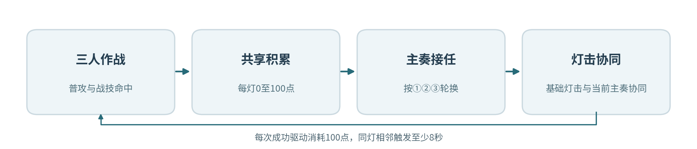

图  协奏积累与主奏接力

#### 波间整备与关卡进度

整备页面公布下一波入口、批次、数量、任务灯、预定故障与推荐选敌。玩家即时更换已开放模组、调整贯阵方位角、替换角色、交换整队并保存阵容方案，确认配置后启动5秒预告。

战斗时任务点以状态机驱动：等待点灯→任务推进→敌人靠近时暂停→条件恢复后续计→任务完成。已到场与计划批次全部处理，且任务完成时触发整备。失败或断线后加载当前波开战前整备记录，已完成的前波进度保留；整备退出时保存当前方案。

#### 四类模组统一参数

| 模组 | 射程与作用区 | 触发伤害 | 控制与功能 |
| --- | --- | --- | --- |
| 聚焰 | 选点18米，爆炸半径6米，灼烧4秒 | 爆炸600；每秒100×4；全中1000 | 适配聚敌、定身与持续灼烧；同名区域逐点取最大强度。 |
| 贯阵 | 光束28米×3米；波内固定方向 | 光束600；命中巨浪额外900 | 单轮额外集中打击至多作用于1名巨浪。 |
| 震域 | 灯座10米半径，0/1/2秒三震 | 每震330；全中990 | 首震推轻波3米，削巨浪最大共振度15点。 |
| 返照 | 主动射程18米，防护半径8米/6秒 | 主动3矢×250；拦箭反击250/次，基础3次 | 形成箭矢拦截区，清空拆解进度并维持防护。 |

灯击基础伤害和当前主奏的适配协同分别结算。协同追加采用单次240点预算，范围协同按每个被命中目标计240点上限；连锁追加结算1层。协奏产出仅由角色普攻与战技有效命中产生。

返照主动三矢依本灯目标优先级分配，单体场景三矢集中命中；拦截到来的有效箭矢时立即销毁来袭弹体并发出反击光矢，标准上限为每次灯击3次。贯阵额外900点集中打击锁定本次光束命中的首名巨浪。

#### 敌人参数与行为

| 单位 | 职责 | 70级生命 | 攻击/间隔 | 移速 | 行动接口 |
| --- | --- | --- | --- | --- | --- |
| 审判战士 | 轻波·突破 | 1000 | 80/2.0秒 | 2.0米/秒 | 近战2.5米；交战3秒后续行 |
| 鸣泣战士 | 轻波·突破 | 900 | 70/1.5秒 | 2.2米/秒 | 近战2.5米；交战3秒后续行 |
| 惊蛰猎手 | 轻波·牵制 | 800 | 90/3.0秒 | 2.0米/秒 | 射点停驻；射程14米；弹速16米/秒 |
| 冥渊守卫 | 巨浪·拆灯 | 3200 | 150/2.5秒 | 1.5米/秒 | 灯周3米拆解4秒；故障6秒 |
| 磐石守卫 | 巨浪·拆灯 | 3600 | 180/3.0秒 | 1.2米/秒 | 灯周3米拆解4秒；故障6秒 |

关卡等级为70、75、80、85、90、90、95、100、100。生命倍率H(L)=H70×\[1+0.01×(L−70)\]；攻击倍率A(L)=A70×\[1+0.005×(L−70)\]。移速与攻击间隔采用固定底值，伤害计算保留小数、界面显示取整。

巨浪共振上限100点；普攻每动作削1点，战技每动作削4点，震域首震削15点，相里要协同额外削20点。归零后受制2秒并回满；强制打断保护期8秒。拆灯者进入灯座3米圈后启动4秒进度，成功触发6秒故障。

#### 角色技能与灯具适配清单

活动提供25名人物与26套战斗配置。全角色生命1000点，普攻及战技伤害采用统一底值；技能文字所述控制与选敌条件在统一动作模板上实现。

| 角色 | 适配灯型 | 两项战技 | 主奏协同 |
| --- | --- | --- | --- |
| 漂泊者·衍射 | 聚焰/贯阵 | 凝光扫：扇形斩击，轻波定身2秒；破隙：标记出口最近敌人6秒 | 聚焰：爆心追踪标记；贯阵：命中标记追加光刃 |
| 今汐 | 贯阵/返照 | 浮光：直线贯穿；点曜：标记巨浪，优先拆灯者 | 贯阵：标记目标追加龙息；返照：首矢命中标记产生3米溅射 |
| 长离 | 聚焰/震域 | 炎步：突进斩击前沿轻波；截翎：重斩打断拆灯者 | 聚焰：附带4秒十字火带；震域：末震沿来向追加回斩 |
| 秧秧 | 聚焰/贯阵 | 回风：牵引4米内轻波；风线：风刃附带40%减速2秒 | 聚焰：爆炸前牵引；贯阵：光束内调整密集目标 |
| 炽霞 | 贯阵/返照 | 压枪：压制射手2秒；燃印：命中巨浪并标记 | 贯阵：引爆燃印；返照：追射3发各80 |
| 白芷 | 聚焰/返照 | 冻尘：轻波减速40%持续2秒；羽袭：打断最近敌人 | 聚焰：生成2秒冷凝区域；返照：首次反击恢复本队15%生命 |
| 散华 | 聚焰/贯阵 | 霜棘：形成4米冰线并减速；碎冰：引爆冰棘并打断 | 聚焰：引爆冰棘；贯阵：沿冰线延展短光束 |
| 桃祈 | 震域/返照 | 御反：近战反斩并推轻波3米；破阵：重斩中止拆解 | 震域：首震清空拆解进度；返照：防护延长2秒 |
| 渊武 | 震域/贯阵 | 楔震：4秒雷击区域；断雷：优先打断拆灯者 | 震域：每震追击一名巨浪；贯阵：命中雷楔内目标产生电爆 |
| 忌炎 | 聚焰/震域 | 横阵：横扫并推轻波3米；龙势：贯刺本路前沿目标 | 聚焰：将边缘轻波推向爆心；震域：末震推回6米 |
| 鉴心 | 聚焰/返照 | 回掌：反击并推轻波3米；归涡：牵引4米内轻波 | 聚焰：爆炸前聚敌；返照：反击上限增至5次 |
| 吟霖 | 贯阵/震域 | 缚丝：轻波定身2秒；罚雷：标记至多两名敌人 | 贯阵：两标记间传导；震域：末震使标记轻波定身2秒 |
| 莫特斐 | 聚焰/返照 | 火羽：远程点射射手；爆签：攻击巨浪并附着爆签 | 聚焰：爆签连锁爆炸；返照：光矢附带火羽至多3次 |
| 相里要 | 贯阵/震域 | 重拳：打断拆灯者；解构：标记最近巨浪破绽 | 贯阵：标记目标追加集中打击；震域：额外削减巨浪20点共振 |
| 凌阳 | 震域/返照 | 跃击：跃至突破者前沿攻击；狮踏：连击并推轻波3米 | 震域：末震留下4秒减速径；返照：防护前缘追加撞击 |
| 丹瑾 | 聚焰/贯阵 | 绯锋：优先攻击低生命目标；追刃：标记本路巨浪 | 聚焰：优先密集残血敌群；贯阵：低于30%生命的标记目标追斩 |
| 折枝 | 聚焰/贯阵 | 飞鹤：优先攻击射手；墨痕：标记本路最前沿敌人 | 聚焰：标记位置附加3米爆破；贯阵：追击次近目标 |
| 维里奈 | 聚焰/返照 | 藤拍：缠住轻波2秒；叶矢：标记本灯近处敌人 | 聚焰：燃区进入者首次定身2秒；返照：防护每秒回复本队2%生命 |
| 釉瑚 | 震域/返照 | 鼎击：冰器砸击并减速；如意：挥击打断单体 | 震域：末震附加范围碎冰；返照：拦箭触发冰刺至多2次 |
| 灯灯 | 贯阵/返照 | 闪行：迎击轻波并归位；追光：优先射击侧路射手 | 贯阵：束端追加追光弹；返照：主动矢分配两路目标 |
| 卜灵 | 聚焰/贯阵 | 落雷：标记最近巨浪；雷符：攻击轻波并定身2秒 | 聚焰：爆炸后2秒追加落雷；贯阵：命中雷符后分出雷束 |
| 秋水 | 聚焰/返照 | 雾弹：射手失准2秒；雾饵：诱导轻波3秒后爆炸 | 聚焰：爆炸前短暂引敌；返照：首矢使射手失准2秒 |
| 安可 | 聚焰/震域 | 白咩弹：小范围爆破；黑咩踏：打断近处敌人 | 聚焰：1.5秒后回响爆破；震域：第二震设延时2秒爆点 |
| 椿 | 聚焰/震域 | 缠枝：轻波牵引至灯侧；花旋：4秒旋转攻击区域 | 聚焰：燃烧结束时藤花爆破；震域：末震牵引轻波 |
| 卡卡罗 | 贯阵/返照 | 影斩：优先追击巨浪；逐猎：标记正在拆灯的目标 | 贯阵：束端投影斩击；返照：标记命中后追反斩 |
| 秧秧·玄翎 | 贯阵/震域 | 苍剑：横斩并打断拆灯者；羽剑：轻波牵引至攻击线 | 贯阵：同线羽刃追击；震域：末震沿路线羽刃追击 |

#### 关卡解锁表

| 阶段 | 灯数 | 候选配置 | 开放模组 |
| --- | --- | --- | --- |
| 主线1 | 2 | 9套 | 聚焰 贯阵 |
| 主线2 | 4 | 18套 | 聚焰 贯阵 震域 |
| 主线3至6 | 6 | 26套 | 聚焰 贯阵 震域 返照 |
| 险境1至3 | 6 | 26套 | 四类全部 |

### 九关关卡与出敌制作表

场景统一采用局部平面坐标，X轴向右、Y轴向前，原点位于画面后方左角；1坐标单位对应1米。地图展示固定灯座、入口、任务节点与障碍，敌人沿各入口路径折点行进。

#### 主线1  断哨留火  双灯教学

70级敌人  &#124;  2盏灯  &#124;  6名上场角色  &#124;  2波  &#124;  22名敌人

程望在哨仓后门修复线路，漂泊者以两盏灯建立第一道拦截区。教学环节通过固定三人展示协奏触发，随后开放正式配队。

入关教学：以漂泊者·衍射①、今汐②、长离③驻守聚焰灯，对固定生命训练投影演示协奏积累与一次灯击；训练投影完成后自动打开双灯配队界面，教学演示独立于正式29波出敌记录。

开放角色：第一批：漂泊者·衍射、今汐、长离、秧秧、炽霞、白芷、散华、桃祈、渊武

开放模组：聚焰、贯阵。各灯座均可选已开放模组，支持同型重复；下表为可直接试玩的首波预设。

图  主线1灯位、入口与任务示意图

灯座：L1(28,36)、L2(72,36)

入口：E1(10,58)、E2(90,58)

任务点：T1(50,20)；出口：(50, 5)

阻挡体：矩形(43,35)至(57,48)

敌人行进路线：E1：(10,58)→(18,45)→(32,27)→(50,5)；E2：(90,58)→(82,45)→(68,27)→(50,5)。路线走廊宽6米；巨浪靠近驻灯区时转为拆解子目标。

射手驻射点：E1(18,44)、E2(82,44)。惊蛰猎手沿本入口路径抵达对应驻射点后锁定射击；出怪同入口依表内顺序每隔0.35秒生成1名，多入口批次并行执行。

| 灯位 | 首波模组 | 上场①②③及接力顺序 | 索敌与方向 |
| --- | --- | --- | --- |
| L1 | 聚焰 | 漂泊者·衍射／长离／秧秧 | 突破优先 |
| L2 | 贯阵 | 今汐／散华／炽霞 | 远程优先；贯阵方位80° |

任务：逐波完成校线；灯1与灯2分别承担10秒作业。 任务累计计时；所需灯持续点亮且任务点3米范围完成清场时推进。

| 波次 | 目标与事件 | 出敌时间、入口和种类 | 敌量 |
| --- | --- | --- | --- |
| 1 | 灯1校线 需亮灯L1，任务10秒 | 0秒：E1 审判战士×6；E2 鸣泣战士×4 | 10 |
| 2 | 灯2校线 需亮灯L2，任务10秒 | 0秒：E2 惊蛰猎手×4 10秒：E1 审判战士×8 | 12 |

波间调度：第2波将炽霞调整为灯2的首位主奏，贯阵方向转向东侧射点。

关卡推进：开放4灯、震域灯及第二批9名角色。

#### 主线2  桥头让路  双桥接力

75级敌人  &#124;  4盏灯  &#124;  12名上场角色  &#124;  3波  &#124;  52名敌人

两桥担架依序撤离；前排灯负责入口清场，后排灯照顾越过前排的目标。

开放角色：第一批：漂泊者·衍射、今汐、长离、秧秧、炽霞、白芷、散华、桃祈、渊武；第二批：忌炎、鉴心、吟霖、莫特斐、相里要、凌阳、丹瑾、折枝、维里奈

开放模组：聚焰、贯阵、震域。各灯座均可选已开放模组，支持同型重复；下表为可直接试玩的首波预设。

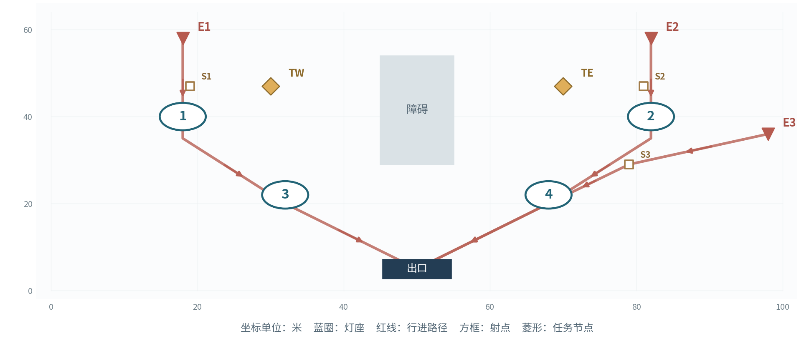

图  主线2灯位、入口与任务示意图

灯座：L1(18,40)、L2(82,40)、L3(32,22)、L4(68,22)

入口：E1(18,58)、E2(82,58)、E3(98,36)

任务点：TW(30,47)、TE(70,47)；出口：(50, 5)

阻挡体：矩形(45,29)至(55,54)

敌人行进路线：E1：(18,58)→(18,35)→(32,20)→(50,5)；E2：(82,58)→(82,35)→(68,20)→(50,5)；E3：(98,36)→(79,29)→(68,20)→(50,5)。路线走廊宽6米；巨浪靠近驻灯区时转为拆解子目标。

射手驻射点：E1(19,47)、E2(81,47)、E3(79,29)。惊蛰猎手沿本入口路径抵达对应驻射点后锁定射击；出怪同入口依表内顺序每隔0.35秒生成1名，多入口批次并行执行。

| 灯位 | 首波模组 | 上场①②③及接力顺序 | 索敌与方向 |
| --- | --- | --- | --- |
| L1 | 聚焰 | 秧秧／长离／白芷 | 突破优先 |
| L2 | 贯阵 | 今汐／相里要／散华 | 拆灯优先；贯阵方位90° |
| L3 | 震域 | 忌炎／凌阳／桃祈 | 突破优先 |
| L4 | 贯阵 | 漂泊者·衍射／吟霖／折枝 | 远程优先；贯阵方位25° |

任务：西桥、东桥、西桥依次完成12秒撤离；西桥使用灯1与3，东桥使用灯2与4。 任务累计计时；所需灯持续点亮且任务点3米范围完成清场时推进。

| 波次 | 目标与事件 | 出敌时间、入口和种类 | 敌量 |
| --- | --- | --- | --- |
| 1 | 西桥撤离 需亮灯L1+L3，任务12秒 | 0秒：E1 审判战士×8；E3 惊蛰猎手×2 12秒：E2 鸣泣战士×8 | 18 |
| 2 | 东桥撤离 需亮灯L2+L4，任务12秒 | 0秒：E2 鸣泣战士×8；E1 审判战士×6；E3 冥渊守卫×1 12秒：E3 惊蛰猎手×3 | 18 |
| 3 | 西桥撤离 需亮灯L1+L3，任务12秒 | 0秒：E1 审判战士×6；E2 鸣泣战士×6 10秒：E3 惊蛰猎手×4 | 16 |

波间调度：第2波将单体打断角色转向东桥；第3波由灯3衔接返身敌人。

关卡推进：开放6灯、返照灯、第三批角色及秧秧的玄翎形态。

#### 主线3  仓前十步  六灯协防

80级敌人  &#124;  6盏灯  &#124;  18名上场角色  &#124;  3波  &#124;  62名敌人

程望分三批搬运线缆，前排负责拆灯者，后排清理突破残敌。

开放角色：第一批：漂泊者·衍射、今汐、长离、秧秧、炽霞、白芷、散华、桃祈、渊武；第二批：忌炎、鉴心、吟霖、莫特斐、相里要、凌阳、丹瑾、折枝、维里奈；第三批：釉瑚、灯灯、卜灵、秋水、安可、椿、卡卡罗、秧秧·玄翎

开放模组：聚焰、贯阵、震域、返照。各灯座均可选已开放模组，支持同型重复；下表为可直接试玩的首波预设。

图  主线3灯位、入口与任务示意图

灯座：L1(17,40)、L2(50,40)、L3(83,40)、L4(29,22)、L5(50,22)、L6(71,22)

入口：E1(12,58)、E2(88,58)、E3(50,58)

任务点：T(50,31)；出口：(50, 5)

阻挡体：矩形(30,47)至(40,54)、矩形(60,47)至(70,54)

敌人行进路线：E1：(12,58)→(17,37)→(29,20)→(50,5)；E2：(88,58)→(83,37)→(71,20)→(50,5)；E3：(50,58)→(50,41)→(50,22)→(50,5)。路线走廊宽6米；巨浪靠近驻灯区时转为拆解子目标。

射手驻射点：E1(15,48)、E2(85,48)、E3(50,50)。惊蛰猎手沿本入口路径抵达对应驻射点后锁定射击；出怪同入口依表内顺序每隔0.35秒生成1名，多入口批次并行执行。

| 灯位 | 首波模组 | 上场①②③及接力顺序 | 索敌与方向 |
| --- | --- | --- | --- |
| L1 | 聚焰 | 秧秧／长离／白芷 | 突破优先 |
| L2 | 贯阵 | 今汐／相里要／散华 | 拆灯优先；贯阵方位90° |
| L3 | 震域 | 忌炎／凌阳／桃祈 | 突破优先 |
| L4 | 返照 | 鉴心／炽霞／秋水 | 远程优先 |
| L5 | 聚焰 | 安可／椿／莫特斐 | 突破优先 |
| L6 | 贯阵 | 卡卡罗／吟霖／折枝 | 拆灯优先；贯阵方位90° |

任务：每波搬运1箱；灯2与5点亮、作业点清场后累积10秒。 任务累计计时；所需灯持续点亮且任务点3米范围完成清场时推进。

| 波次 | 目标与事件 | 出敌时间、入口和种类 | 敌量 |
| --- | --- | --- | --- |
| 1 | 第1箱 需亮灯L2+L5，任务10秒 | 0秒：E1 审判战士×8；E3 惊蛰猎手×4 12秒：E2 鸣泣战士×8 | 20 |
| 2 | 第2箱 需亮灯L2+L5，任务10秒 | 0秒：E1 磐石守卫×1；E2 冥渊守卫×1；E3 惊蛰猎手×4 14秒：E1 审判战士×8；E2 鸣泣战士×6 | 20 |
| 3 | 第3箱 需亮灯L2+L5，任务10秒 | 0秒：E2 冥渊守卫×2；E1 审判战士×8 12秒：E2 鸣泣战士×8；E3 惊蛰猎手×4 | 22 |

波间调度：第2波将灯4与灯3的队员、模组和索敌优先级同步交换，保留灯5的范围清场能力。

关卡推进：开放阵容预设存档及主线4。

#### 主线4  隔岸应答  故障补位

85级敌人  &#124;  6盏灯  &#124;  18名上场角色  &#124;  3波  &#124;  57名敌人

桥南终端重新发送分段灯码，玩家通过邻灯交叉火力覆盖预定故障缺口。

开放角色：第一批：漂泊者·衍射、今汐、长离、秧秧、炽霞、白芷、散华、桃祈、渊武；第二批：忌炎、鉴心、吟霖、莫特斐、相里要、凌阳、丹瑾、折枝、维里奈；第三批：釉瑚、灯灯、卜灵、秋水、安可、椿、卡卡罗、秧秧·玄翎

开放模组：聚焰、贯阵、震域、返照。各灯座均可选已开放模组，支持同型重复；下表为可直接试玩的首波预设。

图  主线4灯位、入口与任务示意图

灯座：L1(18,40)、L2(82,40)、L3(27,27)、L4(73,27)、L5(38,15)、L6(62,15)

入口：E1(15,58)、E2(85,58)、E3(98,36)

任务点：T(50,12)；出口：(50, 5)

阻挡体：矩形(45,30)至(55,54)

敌人行进路线：E1：(15,58)→(18,39)→(38,15)→(50,5)；E2：(85,58)→(82,39)→(62,15)→(50,5)；E3：(98,36)→(84,29)→(62,15)→(50,5)。路线走廊宽6米；巨浪靠近驻灯区时转为拆解子目标。

射手驻射点：E1(17,49)、E2(83,49)、E3(84,30)。惊蛰猎手沿本入口路径抵达对应驻射点后锁定射击；出怪同入口依表内顺序每隔0.35秒生成1名，多入口批次并行执行。

| 灯位 | 首波模组 | 上场①②③及接力顺序 | 索敌与方向 |
| --- | --- | --- | --- |
| L1 | 贯阵 | 今汐／相里要／卡卡罗 | 拆灯优先；贯阵方位90° |
| L2 | 聚焰 | 秧秧／长离／安可 | 突破优先 |
| L3 | 返照 | 桃祈／炽霞／白芷 | 拆灯优先 |
| L4 | 震域 | 忌炎／凌阳／渊武 | 突破优先 |
| L5 | 返照 | 维里奈／莫特斐／秋水 | 远程优先 |
| L6 | 贯阵 | 散华／吟霖／折枝 | 突破优先；贯阵方位90° |

任务：三波依次以灯1、2，灯3、4，灯5、6发送灯码，每波12秒。 任务累计计时；所需灯持续点亮且任务点3米范围完成清场时推进。

| 波次 | 目标与事件 | 出敌时间、入口和种类 | 敌量 |
| --- | --- | --- | --- |
| 1 | 灯1与2发信 需亮灯L1+L2，任务12秒 | 0秒：E1 审判战士×8；E3 惊蛰猎手×6 12秒：E2 鸣泣战士×6 | 20 |
| 2 | 灯3与4发信 需亮灯L3+L4，任务12秒；第12秒L3故障6秒 | 0秒：E1 冥渊守卫×2；E2 鸣泣战士×6；E3 惊蛰猎手×4 14秒：E2 审判战士×8 | 20 |
| 3 | 灯5与6发信 需亮灯L5+L6，任务12秒 | 0秒：E1 磐石守卫×2；E2 冥渊守卫×1 10秒：E2 鸣泣战士×8；E3 惊蛰猎手×6 | 17 |

预定故障：对应波开战第12秒触发L3故障，持续6秒，第9秒显示灯号预告；故障结束后按协奏条件重新点亮。

波间调度：第2波以灯1与5交叉覆盖灯3区域；第3波将主力转向灯5与6。

关卡推进：开放主线5的分段转运。

#### 主线5  灯火接力  转运换防

90级敌人  &#124;  6盏灯  &#124;  18名上场角色  &#124;  3波  &#124;  60名敌人

程望护送最后一车伤员，车辆分段停靠，每波整备完成一次换防。

开放角色：第一批：漂泊者·衍射、今汐、长离、秧秧、炽霞、白芷、散华、桃祈、渊武；第二批：忌炎、鉴心、吟霖、莫特斐、相里要、凌阳、丹瑾、折枝、维里奈；第三批：釉瑚、灯灯、卜灵、秋水、安可、椿、卡卡罗、秧秧·玄翎

开放模组：聚焰、贯阵、震域、返照。各灯座均可选已开放模组，支持同型重复；下表为可直接试玩的首波预设。

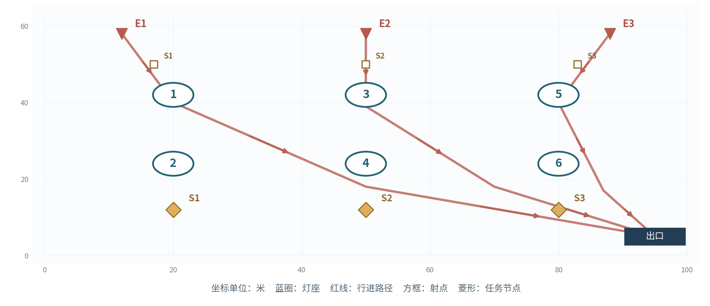

图  主线5灯位、入口与任务示意图

灯座：L1(20,42)、L2(20,24)、L3(50,42)、L4(50,24)、L5(80,42)、L6(80,24)

入口：E1(12,58)、E2(50,58)、E3(88,58)

任务点：S1(20,12)、S2(50,12)、S3(80,12)；出口：(95, 5)

阻挡体：空地

敌人行进路线：E1：(12,58)→(20,40)→(50,18)→(95,5)；E2：(50,58)→(50,39)→(70,18)→(95,5)；E3：(88,58)→(80,40)→(87,17)→(95,5)。路线走廊宽6米；巨浪靠近驻灯区时转为拆解子目标。

射手驻射点：E1(17,50)、E2(50,50)、E3(83,50)。惊蛰猎手沿本入口路径抵达对应驻射点后锁定射击；出怪同入口依表内顺序每隔0.35秒生成1名，多入口批次并行执行。

| 灯位 | 首波模组 | 上场①②③及接力顺序 | 索敌与方向 |
| --- | --- | --- | --- |
| L1 | 聚焰 | 秧秧／长离／安可 | 突破优先 |
| L2 | 返照 | 桃祈／白芷／秋水 | 远程优先 |
| L3 | 贯阵 | 今汐／相里要／散华 | 拆灯优先；贯阵方位90° |
| L4 | 震域 | 忌炎／凌阳／渊武 | 突破优先 |
| L5 | 贯阵 | 灯灯／卡卡罗／吟霖 | 拆灯优先；贯阵方位90° |
| L6 | 返照 | 莫特斐／维里奈／釉瑚 | 远程优先 |

任务：沿停靠1→2→3→后方逐段行进，每段16秒；对应灯组为1、2，3、4，5、6。 任务累计计时；所需灯持续点亮且任务点3米范围完成清场时推进。

| 波次 | 目标与事件 | 出敌时间、入口和种类 | 敌量 |
| --- | --- | --- | --- |
| 1 | 停靠1→2 需亮灯L1+L2，任务16秒 | 0秒：E1 审判战士×8；E2 惊蛰猎手×4 12秒：E2 鸣泣战士×6 | 18 |
| 2 | 停靠2→3 需亮灯L3+L4，任务16秒 | 0秒：E3 冥渊守卫×2；E2 鸣泣战士×8；E3 惊蛰猎手×4 14秒：E1 审判战士×6 | 20 |
| 3 | 停靠3→后方 需亮灯L5+L6，任务16秒 | 0秒：E3 磐石守卫×1；E2 冥渊守卫×1；E1 审判战士×8 12秒：E2 鸣泣战士×8；E3 惊蛰猎手×4 | 22 |

波间调度：第2波将灯1、2与灯3、4的队员、模组及优先级同步交换；第3波将主力转向灯5、6，前段保留范围火力。

关卡推进：开放主线6的交接结局。

#### 主线6  最后一束信号  信号交接

90级敌人  &#124;  6盏灯  &#124;  18名上场角色  &#124;  3波  &#124;  65名敌人

程望核对伤员人数，完成三路灯码并获得后方回应。

开放角色：第一批：漂泊者·衍射、今汐、长离、秧秧、炽霞、白芷、散华、桃祈、渊武；第二批：忌炎、鉴心、吟霖、莫特斐、相里要、凌阳、丹瑾、折枝、维里奈；第三批：釉瑚、灯灯、卜灵、秋水、安可、椿、卡卡罗、秧秧·玄翎

开放模组：聚焰、贯阵、震域、返照。各灯座均可选已开放模组，支持同型重复；下表为可直接试玩的首波预设。

图  主线6灯位、入口与任务示意图

灯座：L1(18,42)、L2(50,42)、L3(82,42)、L4(18,22)、L5(50,22)、L6(82,22)

入口：E1(12,58)、E2(50,58)、E3(88,58)

任务点：T(50,12)；出口：(50, 5)

阻挡体：空地

敌人行进路线：E1：(12,58)→(18,41)→(18,20)→(50,5)；E2：(50,58)→(50,41)→(50,20)→(50,5)；E3：(88,58)→(82,41)→(82,20)→(50,5)。路线走廊宽6米；巨浪靠近驻灯区时转为拆解子目标。

射手驻射点：E1(16,50)、E2(50,50)、E3(84,50)。惊蛰猎手沿本入口路径抵达对应驻射点后锁定射击；出怪同入口依表内顺序每隔0.35秒生成1名，多入口批次并行执行。

| 灯位 | 首波模组 | 上场①②③及接力顺序 | 索敌与方向 |
| --- | --- | --- | --- |
| L1 | 贯阵 | 今汐／相里要／散华 | 拆灯优先；贯阵方位90° |
| L2 | 聚焰 | 秧秧／长离／安可 | 突破优先 |
| L3 | 震域 | 忌炎／凌阳／渊武 | 突破优先 |
| L4 | 返照 | 桃祈／白芷／秋水 | 远程优先 |
| L5 | 聚焰 | 椿／莫特斐／维里奈 | 突破优先 |
| L6 | 贯阵 | 卡卡罗／吟霖／折枝 | 拆灯优先；贯阵方位90° |

任务：三波依次以灯1、4，灯2、5，灯3、6发送灯码，各12秒。 任务累计计时；所需灯持续点亮且任务点3米范围完成清场时推进。

| 波次 | 目标与事件 | 出敌时间、入口和种类 | 敌量 |
| --- | --- | --- | --- |
| 1 | 灯1与4灯码 需亮灯L1+L4，任务12秒 | 0秒：E1 审判战士×8；E2 鸣泣战士×8 12秒：E3 惊蛰猎手×4 | 20 |
| 2 | 灯2与5灯码 需亮灯L2+L5，任务12秒 | 0秒：E1 冥渊守卫×2；E2 磐石守卫×1；E3 惊蛰猎手×4 14秒：E1 审判战士×8；E2 鸣泣战士×6 | 21 |
| 3 | 灯3与6灯码 需亮灯L3+L6，任务12秒；第12秒L6故障6秒 | 0秒：E1 磐石守卫×2；E3 冥渊守卫×2 10秒：E1 审判战士×8；E2 鸣泣战士×8；E3 惊蛰猎手×4 | 24 |

预定故障：对应波开战第12秒触发L6故障，持续6秒，第9秒显示灯号预告；故障结束后按协奏条件重新点亮。

波间调度：巨浪波为贯阵重新定向，灯6故障时由灯5的聚焰覆盖出口。

关卡推进：同时开放全部3关险境复演。

#### 险境1  双桥叠压  双路撤离

95级敌人  &#124;  6盏灯  &#124;  18名上场角色  &#124;  4波  &#124;  96名敌人

复演双桥记录，加入中桥交汇区与两侧射台。

开放角色：第一批：漂泊者·衍射、今汐、长离、秧秧、炽霞、白芷、散华、桃祈、渊武；第二批：忌炎、鉴心、吟霖、莫特斐、相里要、凌阳、丹瑾、折枝、维里奈；第三批：釉瑚、灯灯、卜灵、秋水、安可、椿、卡卡罗、秧秧·玄翎

开放模组：聚焰、贯阵、震域、返照。各灯座均可选已开放模组，支持同型重复；下表为可直接试玩的首波预设。

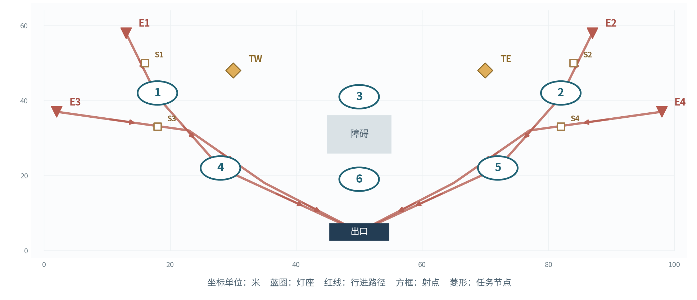

图  险境1灯位、入口与任务示意图

灯座：L1(18,42)、L2(82,42)、L3(50,41)、L4(28,22)、L5(72,22)、L6(50,19)

入口：E1(13,58)、E2(87,58)、E3(2,37)、E4(98,37)

任务点：TW(30,48)、TE(70,48)；出口：(50, 5)

阻挡体：矩形(45,26)至(55,36)

敌人行进路线：E1：(13,58)→(18,41)→(28,22)→(50,5)；E2：(87,58)→(82,41)→(72,22)→(50,5)；E3：(2,37)→(23,32)→(35,18)→(50,5)；E4：(98,37)→(77,32)→(65,18)→(50,5)。路线走廊宽6米；巨浪靠近驻灯区时转为拆解子目标。

射手驻射点：E1(16,50)、E2(84,50)、E3(18,33)、E4(82,33)。惊蛰猎手沿本入口路径抵达对应驻射点后锁定射击；出怪同入口依表内顺序每隔0.35秒生成1名，多入口批次并行执行。

| 灯位 | 首波模组 | 上场①②③及接力顺序 | 索敌与方向 |
| --- | --- | --- | --- |
| L1 | 贯阵 | 今汐／相里要／卡卡罗 | 拆灯优先；贯阵方位90° |
| L2 | 贯阵 | 散华／吟霖／折枝 | 拆灯优先；贯阵方位90° |
| L3 | 聚焰 | 秧秧／长离／安可 | 突破优先 |
| L4 | 返照 | 桃祈／炽霞／白芷 | 远程优先 |
| L5 | 返照 | 维里奈／莫特斐／秋水 | 远程优先 |
| L6 | 聚焰 | 椿／卜灵／丹瑾 | 突破优先 |

任务：依次完成西桥、东桥、双路、双路撤离；西桥依赖灯1、4，东桥依赖灯2、5；每路12秒。 任务累计计时；所需灯持续点亮且任务点3米范围完成清场时推进。

| 波次 | 目标与事件 | 出敌时间、入口和种类 | 敌量 |
| --- | --- | --- | --- |
| 1 | 西桥撤离 需亮灯L1+L4，任务12秒 | 0秒：E1 审判战士×10；E3 惊蛰猎手×4 10秒：E2 鸣泣战士×10 | 24 |
| 2 | 东桥撤离 需亮灯L2+L5，任务12秒 | 0秒：E1 冥渊守卫×2；E2 磐石守卫×2 10秒：E2 鸣泣战士×12；E4 惊蛰猎手×4 | 20 |
| 3 | 双路撤离 需亮灯L1+L4,L2+L5，任务12秒,12秒 | 0秒：E1 审判战士×10；E2 鸣泣战士×10 8秒：E3 惊蛰猎手×4；E4 惊蛰猎手×4 | 28 |
| 4 | 双路终段 需亮灯L1+L4,L2+L5，任务12秒,12秒 | 0秒：E1 冥渊守卫×2；E2 磐石守卫×2 8秒：E1 审判战士×10；E2 鸣泣战士×10 | 24 |

波间调度：在双路波分别保留贯阵与返照，交汇灯6优先处理集群。

关卡推进：首次完成后开放左右撤离目标镜像变体。

#### 险境2  断线重发  故障与拆灯

100级敌人  &#124;  6盏灯  &#124;  18名上场角色  &#124;  4波  &#124;  92名敌人

复演分段发信，增加背面入口与前移终端。

开放角色：第一批：漂泊者·衍射、今汐、长离、秧秧、炽霞、白芷、散华、桃祈、渊武；第二批：忌炎、鉴心、吟霖、莫特斐、相里要、凌阳、丹瑾、折枝、维里奈；第三批：釉瑚、灯灯、卜灵、秋水、安可、椿、卡卡罗、秧秧·玄翎

开放模组：聚焰、贯阵、震域、返照。各灯座均可选已开放模组，支持同型重复；下表为可直接试玩的首波预设。

图  险境2灯位、入口与任务示意图

灯座：L1(25,42)、L2(75,42)、L3(25,24)、L4(75,24)、L5(42,14)、L6(58,14)

入口：E1(12,58)、E2(88,58)、E3(2,36)、E4(98,36)

任务点：T(50,28)；出口：(50, 5)

阻挡体：空地

敌人行进路线：E1：(12,58)→(25,42)→(42,14)→(50,5)；E2：(88,58)→(75,42)→(58,14)→(50,5)；E3：(2,36)→(25,28)→(42,14)→(50,5)；E4：(98,36)→(75,28)→(58,14)→(50,5)。路线走廊宽6米；巨浪靠近驻灯区时转为拆解子目标。

射手驻射点：E1(22,50)、E2(78,50)、E3(16,35)、E4(84,35)。惊蛰猎手沿本入口路径抵达对应驻射点后锁定射击；出怪同入口依表内顺序每隔0.35秒生成1名，多入口批次并行执行。

| 灯位 | 首波模组 | 上场①②③及接力顺序 | 索敌与方向 |
| --- | --- | --- | --- |
| L1 | 贯阵 | 今汐／相里要／卡卡罗 | 拆灯优先；贯阵方位90° |
| L2 | 聚焰 | 秧秧／长离／安可 | 突破优先 |
| L3 | 返照 | 桃祈／炽霞／白芷 | 远程优先 |
| L4 | 震域 | 忌炎／凌阳／渊武 | 突破优先 |
| L5 | 返照 | 维里奈／莫特斐／秋水 | 远程优先 |
| L6 | 贯阵 | 散华／吟霖／折枝 | 突破优先；贯阵方位90° |

任务：四波依次由灯1、2，灯3、4，灯5、6，灯1、6发送灯码，各12秒。 任务累计计时；所需灯持续点亮且任务点3米范围完成清场时推进。

| 波次 | 目标与事件 | 出敌时间、入口和种类 | 敌量 |
| --- | --- | --- | --- |
| 1 | 灯1与2发信 需亮灯L1+L2，任务12秒 | 0秒：E1 审判战士×10；E3 惊蛰猎手×4 8秒：E4 鸣泣战士×10 | 24 |
| 2 | 灯3与4发信 需亮灯L3+L4，任务12秒；第12秒L3故障6秒 | 0秒：E1 冥渊守卫×2；E2 磐石守卫×2 10秒：E4 鸣泣战士×12；E3 惊蛰猎手×4 | 20 |
| 3 | 灯5与6发信 需亮灯L5+L6，任务12秒；第12秒L5故障6秒 | 0秒：E2 审判战士×10；E4 鸣泣战士×10 8秒：E3 惊蛰猎手×6；E1 冥渊守卫×2 | 28 |
| 4 | 灯1与6终报 需亮灯L1+L6，任务12秒 | 0秒：E1 磐石守卫×2；E4 冥渊守卫×2 8秒：E2 审判战士×10；E3 惊蛰猎手×6 | 20 |

预定故障：对应波开战第12秒触发L3故障，持续6秒，第9秒显示灯号预告；故障结束后按协奏条件重新点亮。

预定故障：对应波开战第12秒触发L5故障，持续6秒，第9秒显示灯号预告；故障结束后按协奏条件重新点亮。

波间调度：故障波将震域小队靠近预定故障灯，返照处理边侧箭矢。

关卡推进：首次完成后开放故障灯号镜像变体：L3→L4，L5→L6。

#### 险境3  长夜接班  前后双任务

100级敌人  &#124;  6盏灯  &#124;  18名上场角色  &#124;  4波  &#124;  104名敌人

车辆沿仓外三段推进，后方终端同时向接应部队发送信号。

开放角色：第一批：漂泊者·衍射、今汐、长离、秧秧、炽霞、白芷、散华、桃祈、渊武；第二批：忌炎、鉴心、吟霖、莫特斐、相里要、凌阳、丹瑾、折枝、维里奈；第三批：釉瑚、灯灯、卜灵、秋水、安可、椿、卡卡罗、秧秧·玄翎

开放模组：聚焰、贯阵、震域、返照。各灯座均可选已开放模组，支持同型重复；下表为可直接试玩的首波预设。

图  险境3灯位、入口与任务示意图

灯座：L1(20,42)、L2(20,24)、L3(50,42)、L4(50,24)、L5(80,42)、L6(80,24)

入口：E1(10,58)、E2(90,58)、E3(2,36)、E4(98,36)

任务点：CAR(50,12)、SIG(50,31)；出口：(50, 5)

阻挡体：矩形(40,48)至(60,53)

敌人行进路线：E1：(10,58)→(20,42)→(50,15)→(50,5)；E2：(90,58)→(80,42)→(50,15)→(50,5)；E3：(2,36)→(20,26)→(50,15)→(50,5)；E4：(98,36)→(80,26)→(50,15)→(50,5)。路线走廊宽6米；巨浪靠近驻灯区时转为拆解子目标。

射手驻射点：E1(17,51)、E2(83,51)、E3(13,34)、E4(87,34)。惊蛰猎手沿本入口路径抵达对应驻射点后锁定射击；出怪同入口依表内顺序每隔0.35秒生成1名，多入口批次并行执行。

| 灯位 | 首波模组 | 上场①②③及接力顺序 | 索敌与方向 |
| --- | --- | --- | --- |
| L1 | 聚焰 | 秧秧／长离／安可 | 突破优先 |
| L2 | 返照 | 桃祈／白芷／秋水 | 远程优先 |
| L3 | 贯阵 | 今汐／相里要／散华 | 拆灯优先；贯阵方位90° |
| L4 | 震域 | 忌炎／凌阳／渊武 | 突破优先 |
| L5 | 贯阵 | 灯灯／卡卡罗／吟霖 | 拆灯优先；贯阵方位90° |
| L6 | 返照 | 莫特斐／维里奈／釉瑚 | 远程优先 |

任务：第1波护送；第2、3波护送与发信并行；第4波发送终报码。护送16秒，发信12秒。 任务累计计时；所需灯持续点亮且任务点3米范围完成清场时推进。

| 波次 | 目标与事件 | 出敌时间、入口和种类 | 敌量 |
| --- | --- | --- | --- |
| 1 | 灯1与2护送 需亮灯L1+L2，任务16秒 | 0秒：E1 审判战士×12；E2 鸣泣战士×10 8秒：E3 惊蛰猎手×4 | 26 |
| 2 | 灯3与4护送＋灯5与6发信 需亮灯L3+L4,L5+L6，任务16秒,12秒 | 0秒：E3 冥渊守卫×2；E4 磐石守卫×2 8秒：E1 审判战士×12；E2 惊蛰猎手×6 | 22 |
| 3 | 灯5与6护送＋灯1与2发信 需亮灯L5+L6,L1+L2，任务16秒,12秒 | 0秒：E2 鸣泣战士×12；E4 审判战士×12 8秒：E3 冥渊守卫×2；E1 惊蛰猎手×4 | 30 |
| 4 | 灯1与6终报码 需亮灯L1+L6，任务12秒 | 0秒：E1 磐石守卫×2；E4 冥渊守卫×2 8秒：E2 审判战士×12；E3 鸣泣战士×10 | 26 |

波间调度：护送小队沿前中后逐波调整，终端保留两灯反制射手与拆灯者。

关卡推进：首次完成后开放反向转运及灯组镜像任务。

### 界面和经济系统

#### 活动开放与一次性奖励

活动周期21天。玩家按前置顺序推进六关主线，完成主线6后解锁三个险境；进关与重试消耗设为0，活动内战斗属性由统一配置提供。

| 领取条件 | 份数 | 每份星声 | 每份贝币 | 合计 |
| --- | --- | --- | --- | --- |
| 主线各关首通 | 6 | 80 | 40,000 | 星声480 / 贝币240,000 |
| 主线六关全部完成 | 1 | 120 | 30,000 | 星声120 / 贝币30,000 |
| 险境各关首通 | 3 | 0 | 10,000 | 星声0 / 贝币30,000 |
| 账号总计 | 10 | — | — | 星声600 / 贝币300,000 |

奖励表为活动经济设计规格。以账号、活动、条件ID建立领取记录；主线辅助模式与标准模式共用条件ID；险境变体沿用所属关卡的首通条件。

#### 数据接口与制作交付

| 配表实体 | 字段与制作口径 |
| --- | --- |
| StageConfig | 关卡ID、等级、开放角色池、模块池、灯座坐标、入口坐标、路径折点、障碍、任务点、镜头边界 |
| LampConfig | 灯座ID、可选模组集合、首波模块、选敌优先、贯阵方位角、有效射程、区域参数、故障状态 |
| TeamConfig | 人物ID、形态ID、灯座归属、①②③顺序、基础伤害、技能ID、适配模块集合 |
| WaveConfig | 关卡ID、波次、批次秒数、入口、单位ID、数量、所需灯组、任务秒数、预定故障事件 |
| BattleLog | 时间、灯号、动作、目标、命中、产能接受值、协奏余额、灯击主奏、故障原因、任务进度 |
| RewardConfig | 账号条件ID、星声、贝币、首通标记、领取状态、关卡解锁条件 |

UI含关卡选择、角色与模组配置、灯座射程预览、波次情报、战斗观察、整备结算、剧情交接六个界面。美术按地图坐标建立灯座和路径锚点，程序依配置驱动波次、故障与任务状态机。

#### 系统验收与体验指标

| 验收场景 | 可观测判定 |
| --- | --- |
| 合法编队 | 每灯3人、全场人物唯一、模组处于已开放集合，整备确认进入战斗。 |
| 协奏触发 | 满100及动作条件达成时消耗100；按①②③轮换，每灯事件日志可逐次追溯。 |
| 波次保存 | 重试加载当前波，前波任务与耐久存续；下一关防线重置100。 |
| 清场续任务 | 敌人处理完后任务灯可通过每秒20点协奏机制点亮，任务进度继续完成。 |
| 多解策略 | 每个险境以至少两组独立模组配置与角色分工组合达到通关条件。 |

[返回文档选择](#document-navigation)

---

## 数值设计

固定伤害、协奏结算、模组与协同预算、敌人等级、关卡压力、奖励及数值标定方案。

[下载数值设计 Word 原文](documents/%E9%95%BF%E5%A4%9C%E5%AE%88%E7%81%AF_%E6%95%B0%E5%80%BC%E8%AE%BE%E8%AE%A1%E6%96%87%E6%A1%A3.docx?raw=1) · [返回文档选择](#document-navigation)

展开本篇目录

- [数值目标与基准假设](#balance-01)
  - [通用战斗与任务规则](#balance-02)
- [固定伤害与协奏结算](#balance-03)
  - [四类模组统一参数](#balance-04)
  - [协同预算与状态叠加](#balance-05)
  - [敌人参数与行为](#balance-06)
  - [击杀窗口与拆解压力核算](#balance-07)
  - [角色技能与灯具适配清单](#balance-08)
- [关卡压力与资源预算](#balance-09)
- [九关关卡与出敌制作表](#balance-10)
  - [主线1  断哨留火  双灯教学](#balance-11)
  - [主线2  桥头让路  双桥接力](#balance-12)
  - [主线3  仓前十步  六灯协防](#balance-13)
  - [主线4  隔岸应答  故障补位](#balance-14)
  - [主线5  灯火接力  转运换防](#balance-15)
  - [主线6  最后一束信号  信号交接](#balance-16)
  - [险境1  双桥叠压  双路撤离](#balance-17)
  - [险境2  断线重发  故障与拆灯](#balance-18)
  - [险境3  长夜接班  前后双任务](#balance-19)
  - [活动开放与一次性奖励](#balance-20)
  - [数据接口与制作交付](#balance-21)
  - [首轮标定与数值敏感性验证](#balance-22)

闫哲祯  &#124;  游戏策划投递作品  &#124;  2026年10月

建立可计算的伤害、协奏、控制、等级、波次负荷与奖励模型，并将全关卡配置转化为可追踪、可复算的数值调试对象。

作品定位：基于《鸣潮》夜归背景创作的限时战术守线活动。本文完整定义活动规则、九关配置、复现所需字段与验收指标。

### 数值目标与基准假设

本活动采用全角色统一生命与攻击底盘，差异集中在技能选敌、控制与灯具协同。数值分配以首次接力3至5秒、持续接力间隔8至10秒、主线渐进与险境多任务冲突为目标。

#### 通用战斗与任务规则

| 对象 | 规则与参数 |
| --- | --- |
| 配置 | 每灯配1种模组与3名角色；同一人物在全场占1个名额，秧秧及玄翎形态共享人物名额；站位①②③决定主奏顺序。 |
| 动作 | 角色自动完成普攻、战技一、战技二及闪避。普攻30点/1秒；战技一90点/6秒冷却；战技二150点/10秒冷却。 |
| 协奏 | 每灯独立0至100点；每波初始40点；普攻命中5点、战技命中10点；普攻15点/秒、战技20点/3秒滚动上限。 |
| 灯击 | 满100、灯具运行、至少2名队员可行动并具备合法目标时按①②③主奏轮换，消耗100点；相邻灯击至少8秒。 |
| 故障 | 拆灯者靠近灯座3米连续作业4秒，造成6秒故障；故障结束后由协奏再次点亮。 |
| 任务 | 所需灯点亮且任务点3米半径清场时累计任务秒数；波次全批次离场且任务达成后进入整备。 |
| 结算 | 防线100点，轻波突破扣10点、巨浪扣20点；防线剩余1点起满足通关条件；主线辅助模式突破扣除系数0.5。 |
| 恢复 | 角色倒下8秒后满生命归队；波间全员生命与冷却复位，协奏设为40点，防线耐久继承。 |
| 节奏 | 批次提前5秒预告；主线同时在场上限24名，险境上限32名，超额批次整体顺延并重新预告。 |

接力提交优先检查生命状态、强控状态、有效目标、故障与8秒间隔。任务灯等待点亮且全场敌人清空时，本灯每秒自动获得20点协奏。合法目标包括攻击范围内敌人、飞行箭矢与当前任务灯。

每名角色以灯座为中心布阵，标准位置偏移依次为(-2,0)、(0,-2)、(2,0)米。普通战斗驻守半径6米，近战追击最远8米，远程攻击最远14米，角色移动速度4.5米/秒。

拆解目标采用可达路径距离最短的运行灯，同距依灯号升序选择；每灯同时接收1名拆解者，其余巨浪改选下一盏可达灯。全灯拆解名额占用时，巨浪沿所在路径推进出口。

### 固定伤害与协奏结算

| 参数 | 精确定义 |
| --- | --- |
| 角色生命 | 全角色最大生命1000；生命恢复按目标最大生命百分比结算，当前生命截到上限。 |
| 角色普攻 | 单目标30；动作总长1.0秒，起手0.3秒判定，命中产生5协奏。 |
| 战技一 | 单目标90；动作0.6秒，第0.4秒判定；接受动作时进入6秒冷却，命中产生10协奏。 |
| 战技二 | 单目标150；动作0.6秒，第0.4秒判定；接受动作时进入10秒冷却，命中产生10协奏。 |
| 范围动作 | 单目标全段伤害由命中次数均分；多目标各自接受完整数值；单次动作对本灯协奏贡献1次。 |
| 伤害系数 | 暴击倍率1.0，防御减免系数0，元素抗性倍率1.0；多段结算保留小数，显示四舍五入到整数。 |
| 协奏窗口 | 普攻采纳上限15点/滚动1秒；战技采纳上限20点/滚动3秒；边界规则采用(t−窗长,t\]。 |
| 接力条件 | 能量达到100点、同灯距上次至少8秒、灯具运行且至少2名队员可行动；最多等待主奏当前动作1秒。 |

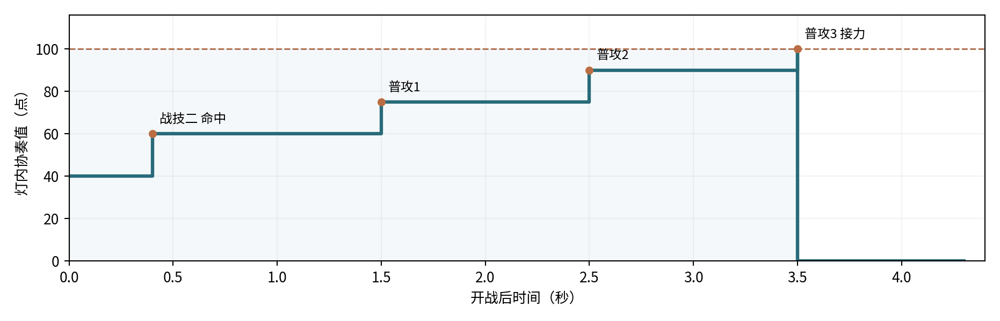

图  理想三人同步命中的首次协奏触发时序

算例：每灯初始40点；0.4秒三人战技二首次命中，共采纳20点，协奏为60；1.0秒战技一落在同一3秒窗口内，共采纳0点；1.5、2.5、3.5秒三次普攻各采纳15点，余额为75、90、100；第3.5秒触发灯击并扣除100点。

接力生效条件逐帧验证，能量到达100后根据8秒触发间隔及当前动作结束时点提交。新波重置40点与①主奏序号；故障期间蓄能保持，驱动条件恢复后结算。

#### 四类模组统一参数

| 模组 | 射程与作用区 | 触发伤害 | 控制与功能 |
| --- | --- | --- | --- |
| 聚焰 | 选点18米，爆炸半径6米，灼烧4秒 | 爆炸600；每秒100×4；全中1000 | 适配聚敌、定身与持续灼烧；同名区域逐点取最大强度。 |
| 贯阵 | 光束28米×3米；波内固定方向 | 光束600；命中巨浪额外900 | 单轮额外集中打击至多作用于1名巨浪。 |
| 震域 | 灯座10米半径，0/1/2秒三震 | 每震330；全中990 | 首震推轻波3米，削巨浪最大共振度15点。 |
| 返照 | 主动射程18米，防护半径8米/6秒 | 主动3矢×250；拦箭反击250/次，基础3次 | 形成箭矢拦截区，清空拆解进度并维持防护。 |

灯击基础伤害和当前主奏的适配协同分别结算。协同追加采用单次240点预算，范围协同按每个被命中目标计240点上限；连锁追加结算1层。协奏产出仅由角色普攻与战技有效命中产生。

返照主动三矢依本灯目标优先级分配，单体场景三矢集中命中；拦截到来的有效箭矢时立即销毁来袭弹体并发出反击光矢，标准上限为每次灯击3次。贯阵额外900点集中打击锁定本次光束命中的首名巨浪。

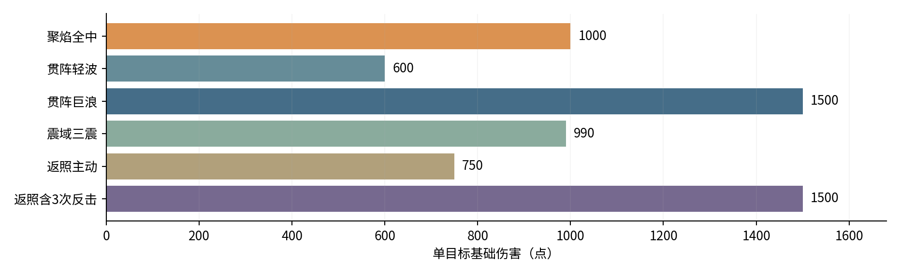

图  四类灯具各类命中情形的单目标基础伤害

#### 协同预算与状态叠加

每次主奏选取当前人物对应模组的协同条目，直接单体伤害总预算240点；范围或持续协同对每目标全段上限240点，多段均分；选敌、牵引与防护类协同按效果结算。

长离十字火带每秒60点、共4跳；安可回响爆破240点；炽霞追射3次、每次80点；白芷首次返照反击治疗队友15%最大生命即150点；维里奈在标准6秒护罩内每秒治疗2%即20点，总额每人120点。

同名持续区域重叠时逐时刻取较高强度；直接命中按各灯分别结算。共振触发受制时长2秒，强制打断保护8秒；保护窗口内保留至少1点共振，窗口结束后可触发下一轮受制。

#### 敌人参数与行为

| 单位 | 职责 | 70级生命 | 攻击/间隔 | 移速 | 行动接口 |
| --- | --- | --- | --- | --- | --- |
| 审判战士 | 轻波·突破 | 1000 | 80/2.0秒 | 2.0米/秒 | 近战2.5米；交战3秒后续行 |
| 鸣泣战士 | 轻波·突破 | 900 | 70/1.5秒 | 2.2米/秒 | 近战2.5米；交战3秒后续行 |
| 惊蛰猎手 | 轻波·牵制 | 800 | 90/3.0秒 | 2.0米/秒 | 射点停驻；射程14米；弹速16米/秒 |
| 冥渊守卫 | 巨浪·拆灯 | 3200 | 150/2.5秒 | 1.5米/秒 | 灯周3米拆解4秒；故障6秒 |
| 磐石守卫 | 巨浪·拆灯 | 3600 | 180/3.0秒 | 1.2米/秒 | 灯周3米拆解4秒；故障6秒 |

关卡等级为70、75、80、85、90、90、95、100、100。生命倍率H(L)=H70×\[1+0.01×(L−70)\]；攻击倍率A(L)=A70×\[1+0.005×(L−70)\]。移速与攻击间隔采用固定底值，伤害计算保留小数、界面显示取整。

巨浪共振上限100点；普攻每动作削1点，战技每动作削4点，震域首震削15点，相里要协同额外削20点。归零后受制2秒并回满；强制打断保护期8秒。拆灯者进入灯座3米圈后启动4秒进度，成功触发6秒故障。

| 等级 | 审判战士生命 | 冥渊守卫生命 | 磐石守卫生命 |
| --- | --- | --- | --- |
| 70 | 1000 | 3200 | 3600 |
| 75 | 1050 | 3360 | 3780 |
| 80 | 1100 | 3520 | 3960 |
| 85 | 1150 | 3680 | 4140 |
| 90 | 1200 | 3840 | 4320 |
| 95 | 1250 | 4000 | 4500 |
| 100 | 1300 | 4160 | 4680 |

#### 击杀窗口与拆解压力核算

案例一：70级审判战士1000生命，聚焰直接命中600点、每秒灼烧100点。持续停留2秒总伤害800点；控制将火区驻留延长至4秒时总伤害达到1000点。

案例二：90级磐石守卫生命4320点，贯阵对巨浪单轮1500点，两轮共3000点，队员还需提供1320点。目标距离灯10米，移速1.2米/秒、拆解半径3米、拆解需4秒，预计故障时刻为(10−3)/1.2+4≈9.83秒，需在此之前配置打断与邻灯集火。

#### 角色技能与灯具适配清单

活动提供25名人物与26套战斗配置。全角色生命1000点，普攻及战技伤害采用统一底值；技能文字所述控制与选敌条件在统一动作模板上实现。

| 角色 | 适配灯型 | 两项战技 | 主奏协同 |
| --- | --- | --- | --- |
| 漂泊者·衍射 | 聚焰/贯阵 | 战技一90/6秒；凝光扫：扇形斩击，轻波定身2秒 战技二150/10秒；破隙：标记出口最近敌人6秒 | 聚焰：爆心追踪标记；贯阵：命中标记追加光刃 |
| 今汐 | 贯阵/返照 | 战技一90/6秒；浮光：直线贯穿 战技二150/10秒；点曜：标记巨浪，优先拆灯者 | 贯阵：标记目标追加龙息；返照：首矢命中标记产生3米溅射 |
| 长离 | 聚焰/震域 | 战技一90/6秒；炎步：突进斩击前沿轻波 战技二150/10秒；截翎：重斩打断拆灯者 | 聚焰：附带4秒十字火带；震域：末震沿来向追加回斩 |
| 秧秧 | 聚焰/贯阵 | 战技一90/6秒；回风：牵引4米内轻波 战技二150/10秒；风线：风刃附带40%减速2秒 | 聚焰：爆炸前牵引；贯阵：光束内调整密集目标 |
| 炽霞 | 贯阵/返照 | 战技一90/6秒；压枪：压制射手2秒 战技二150/10秒；燃印：命中巨浪并标记 | 贯阵：引爆燃印；返照：追射3发各80 |
| 白芷 | 聚焰/返照 | 战技一90/6秒；冻尘：轻波减速40%持续2秒 战技二150/10秒；羽袭：打断最近敌人 | 聚焰：生成2秒冷凝区域；返照：首次反击恢复本队15%生命 |
| 散华 | 聚焰/贯阵 | 战技一90/6秒；霜棘：形成4米冰线并减速 战技二150/10秒；碎冰：引爆冰棘并打断 | 聚焰：引爆冰棘；贯阵：沿冰线延展短光束 |
| 桃祈 | 震域/返照 | 战技一90/6秒；御反：近战反斩并推轻波3米 战技二150/10秒；破阵：重斩中止拆解 | 震域：首震清空拆解进度；返照：防护延长2秒 |
| 渊武 | 震域/贯阵 | 战技一90/6秒；楔震：4秒雷击区域 战技二150/10秒；断雷：优先打断拆灯者 | 震域：每震追击一名巨浪；贯阵：命中雷楔内目标产生电爆 |
| 忌炎 | 聚焰/震域 | 战技一90/6秒；横阵：横扫并推轻波3米 战技二150/10秒；龙势：贯刺本路前沿目标 | 聚焰：将边缘轻波推向爆心；震域：末震推回6米 |
| 鉴心 | 聚焰/返照 | 战技一90/6秒；回掌：反击并推轻波3米 战技二150/10秒；归涡：牵引4米内轻波 | 聚焰：爆炸前聚敌；返照：反击上限增至5次 |
| 吟霖 | 贯阵/震域 | 战技一90/6秒；缚丝：轻波定身2秒 战技二150/10秒；罚雷：标记至多两名敌人 | 贯阵：两标记间传导；震域：末震使标记轻波定身2秒 |
| 莫特斐 | 聚焰/返照 | 战技一90/6秒；火羽：远程点射射手 战技二150/10秒；爆签：攻击巨浪并附着爆签 | 聚焰：爆签连锁爆炸；返照：光矢附带火羽至多3次 |
| 相里要 | 贯阵/震域 | 战技一90/6秒；重拳：打断拆灯者 战技二150/10秒；解构：标记最近巨浪破绽 | 贯阵：标记目标追加集中打击；震域：额外削减巨浪20点共振 |
| 凌阳 | 震域/返照 | 战技一90/6秒；跃击：跃至突破者前沿攻击 战技二150/10秒；狮踏：连击并推轻波3米 | 震域：末震留下4秒减速径；返照：防护前缘追加撞击 |
| 丹瑾 | 聚焰/贯阵 | 战技一90/6秒；绯锋：优先攻击低生命目标 战技二150/10秒；追刃：标记本路巨浪 | 聚焰：优先密集残血敌群；贯阵：低于30%生命的标记目标追斩 |
| 折枝 | 聚焰/贯阵 | 战技一90/6秒；飞鹤：优先攻击射手 战技二150/10秒；墨痕：标记本路最前沿敌人 | 聚焰：标记位置附加3米爆破；贯阵：追击次近目标 |
| 维里奈 | 聚焰/返照 | 战技一90/6秒；藤拍：缠住轻波2秒 战技二150/10秒；叶矢：标记本灯近处敌人 | 聚焰：燃区进入者首次定身2秒；返照：防护每秒回复本队2%生命 |
| 釉瑚 | 震域/返照 | 战技一90/6秒；鼎击：冰器砸击并减速 战技二150/10秒；如意：挥击打断单体 | 震域：末震附加范围碎冰；返照：拦箭触发冰刺至多2次 |
| 灯灯 | 贯阵/返照 | 战技一90/6秒；闪行：迎击轻波并归位 战技二150/10秒；追光：优先射击侧路射手 | 贯阵：束端追加追光弹；返照：主动矢分配两路目标 |
| 卜灵 | 聚焰/贯阵 | 战技一90/6秒；落雷：标记最近巨浪 战技二150/10秒；雷符：攻击轻波并定身2秒 | 聚焰：爆炸后2秒追加落雷；贯阵：命中雷符后分出雷束 |
| 秋水 | 聚焰/返照 | 战技一90/6秒；雾弹：射手失准2秒 战技二150/10秒；雾饵：诱导轻波3秒后爆炸 | 聚焰：爆炸前短暂引敌；返照：首矢使射手失准2秒 |
| 安可 | 聚焰/震域 | 战技一90/6秒；白咩弹：小范围爆破 战技二150/10秒；黑咩踏：打断近处敌人 | 聚焰：1.5秒后回响爆破；震域：第二震设延时2秒爆点 |
| 椿 | 聚焰/震域 | 战技一90/6秒；缠枝：轻波牵引至灯侧 战技二150/10秒；花旋：4秒旋转攻击区域 | 聚焰：燃烧结束时藤花爆破；震域：末震牵引轻波 |
| 卡卡罗 | 贯阵/返照 | 战技一90/6秒；影斩：优先追击巨浪 战技二150/10秒；逐猎：标记正在拆灯的目标 | 贯阵：束端投影斩击；返照：标记命中后追反斩 |
| 秧秧·玄翎 | 贯阵/震域 | 战技一90/6秒；苍剑：横斩并打断拆灯者 战技二150/10秒；羽剑：轻波牵引至攻击线 | 贯阵：同线羽刃追击；震域：末震沿路线羽刃追击 |

### 关卡压力与资源预算

九关合计29波、610名敌人，其中主线17波318名、险境12波292名。关卡量级以波次敌人总生命、每灯名义负荷、同时在场数量与任务停滞时长四项分别统计。

| 阶段 | 关卡等级 | 波数 | 敌人数量 | 调试目标 |
| --- | --- | --- | --- | --- |
| 主线1 | 70 | 2 | 22 | 角色与模组学习 |
| 主线2 | 75 | 3 | 52 | 角色与模组学习 |
| 主线3 | 80 | 3 | 62 | 协防任务与故障 |
| 主线4 | 85 | 3 | 57 | 协防任务与故障 |
| 主线5 | 90 | 3 | 60 | 协防任务与故障 |
| 主线6 | 90 | 3 | 65 | 协防任务与故障 |
| 险境1 | 95 | 4 | 96 | 多路与并行压力 |
| 险境2 | 100 | 4 | 92 | 多路与并行压力 |
| 险境3 | 100 | 4 | 104 | 多路与并行压力 |

### 九关关卡与出敌制作表

场景统一采用局部平面坐标，X轴向右、Y轴向前，原点位于画面后方左角；1坐标单位对应1米。地图展示固定灯座、入口、任务节点与障碍，敌人沿各入口路径折点行进。

#### 主线1  断哨留火  双灯教学

70级敌人  &#124;  2盏灯  &#124;  6名上场角色  &#124;  2波  &#124;  22名敌人

程望在哨仓后门修复线路，漂泊者以两盏灯建立第一道拦截区。教学环节通过固定三人展示协奏触发，随后开放正式配队。

入关教学：以漂泊者·衍射①、今汐②、长离③驻守聚焰灯，对固定生命训练投影演示协奏积累与一次灯击；训练投影完成后自动打开双灯配队界面，教学演示独立于正式29波出敌记录。

开放角色：第一批：漂泊者·衍射、今汐、长离、秧秧、炽霞、白芷、散华、桃祈、渊武

开放模组：聚焰、贯阵。各灯座均可选已开放模组，支持同型重复；下表为可直接试玩的首波预设。

图  主线1灯位、入口与任务示意图

灯座：L1(28,36)、L2(72,36)

入口：E1(10,58)、E2(90,58)

任务点：T1(50,20)；出口：(50, 5)

阻挡体：矩形(43,35)至(57,48)

敌人行进路线：E1：(10,58)→(18,45)→(32,27)→(50,5)；E2：(90,58)→(82,45)→(68,27)→(50,5)。路线走廊宽6米；巨浪靠近驻灯区时转为拆解子目标。

射手驻射点：E1(18,44)、E2(82,44)。惊蛰猎手沿本入口路径抵达对应驻射点后锁定射击；出怪同入口依表内顺序每隔0.35秒生成1名，多入口批次并行执行。

| 灯位 | 首波模组 | 上场①②③及接力顺序 | 索敌与方向 |
| --- | --- | --- | --- |
| L1 | 聚焰 | 漂泊者·衍射／长离／秧秧 | 突破优先 |
| L2 | 贯阵 | 今汐／散华／炽霞 | 远程优先；贯阵方位80° |

任务：逐波完成校线；灯1与灯2分别承担10秒作业。 任务累计计时；所需灯持续点亮且任务点3米范围完成清场时推进。

| 波次 | 目标与事件 | 出敌时间、入口和种类 | 敌量 |
| --- | --- | --- | --- |
| 1 | 灯1校线 需亮灯L1，任务10秒 | 0秒：E1 审判战士×6；E2 鸣泣战士×4 | 10 |
| 2 | 灯2校线 需亮灯L2，任务10秒 | 0秒：E2 惊蛰猎手×4 10秒：E1 审判战士×8 | 12 |

| 波次 | 敌人数 | 名义生命总量 | 每灯名义负荷 |
| --- | --- | --- | --- |
| 1 | 10 | 9,600 | 4,800 |
| 2 | 12 | 11,200 | 5,600 |

名义负荷按敌人该关等级生命总和除以灯数计算，用于定位关卡量级；实战结果同时受到路线覆盖、控制、任务与故障影响。

波间调度：第2波将炽霞调整为灯2的首位主奏，贯阵方向转向东侧射点。

关卡推进：开放4灯、震域灯及第二批9名角色。

#### 主线2  桥头让路  双桥接力

75级敌人  &#124;  4盏灯  &#124;  12名上场角色  &#124;  3波  &#124;  52名敌人

两桥担架依序撤离；前排灯负责入口清场，后排灯照顾越过前排的目标。

开放角色：第一批：漂泊者·衍射、今汐、长离、秧秧、炽霞、白芷、散华、桃祈、渊武；第二批：忌炎、鉴心、吟霖、莫特斐、相里要、凌阳、丹瑾、折枝、维里奈

开放模组：聚焰、贯阵、震域。各灯座均可选已开放模组，支持同型重复；下表为可直接试玩的首波预设。

图  主线2灯位、入口与任务示意图

灯座：L1(18,40)、L2(82,40)、L3(32,22)、L4(68,22)

入口：E1(18,58)、E2(82,58)、E3(98,36)

任务点：TW(30,47)、TE(70,47)；出口：(50, 5)

阻挡体：矩形(45,29)至(55,54)

敌人行进路线：E1：(18,58)→(18,35)→(32,20)→(50,5)；E2：(82,58)→(82,35)→(68,20)→(50,5)；E3：(98,36)→(79,29)→(68,20)→(50,5)。路线走廊宽6米；巨浪靠近驻灯区时转为拆解子目标。

射手驻射点：E1(19,47)、E2(81,47)、E3(79,29)。惊蛰猎手沿本入口路径抵达对应驻射点后锁定射击；出怪同入口依表内顺序每隔0.35秒生成1名，多入口批次并行执行。

| 灯位 | 首波模组 | 上场①②③及接力顺序 | 索敌与方向 |
| --- | --- | --- | --- |
| L1 | 聚焰 | 秧秧／长离／白芷 | 突破优先 |
| L2 | 贯阵 | 今汐／相里要／散华 | 拆灯优先；贯阵方位90° |
| L3 | 震域 | 忌炎／凌阳／桃祈 | 突破优先 |
| L4 | 贯阵 | 漂泊者·衍射／吟霖／折枝 | 远程优先；贯阵方位25° |

任务：西桥、东桥、西桥依次完成12秒撤离；西桥使用灯1与3，东桥使用灯2与4。 任务累计计时；所需灯持续点亮且任务点3米范围完成清场时推进。

| 波次 | 目标与事件 | 出敌时间、入口和种类 | 敌量 |
| --- | --- | --- | --- |
| 1 | 西桥撤离 需亮灯L1+L3，任务12秒 | 0秒：E1 审判战士×8；E3 惊蛰猎手×2 12秒：E2 鸣泣战士×8 | 18 |
| 2 | 东桥撤离 需亮灯L2+L4，任务12秒 | 0秒：E2 鸣泣战士×8；E1 审判战士×6；E3 冥渊守卫×1 12秒：E3 惊蛰猎手×3 | 18 |
| 3 | 西桥撤离 需亮灯L1+L3，任务12秒 | 0秒：E1 审判战士×6；E2 鸣泣战士×6 10秒：E3 惊蛰猎手×4 | 16 |

| 波次 | 敌人数 | 名义生命总量 | 每灯名义负荷 |
| --- | --- | --- | --- |
| 1 | 18 | 17,640 | 4,410 |
| 2 | 18 | 19,740 | 4,935 |
| 3 | 16 | 15,330 | 3,832 |

名义负荷按敌人该关等级生命总和除以灯数计算，用于定位关卡量级；实战结果同时受到路线覆盖、控制、任务与故障影响。

波间调度：第2波将单体打断角色转向东桥；第3波由灯3衔接返身敌人。

关卡推进：开放6灯、返照灯、第三批角色及秧秧的玄翎形态。

#### 主线3  仓前十步  六灯协防

80级敌人  &#124;  6盏灯  &#124;  18名上场角色  &#124;  3波  &#124;  62名敌人

程望分三批搬运线缆，前排负责拆灯者，后排清理突破残敌。

开放角色：第一批：漂泊者·衍射、今汐、长离、秧秧、炽霞、白芷、散华、桃祈、渊武；第二批：忌炎、鉴心、吟霖、莫特斐、相里要、凌阳、丹瑾、折枝、维里奈；第三批：釉瑚、灯灯、卜灵、秋水、安可、椿、卡卡罗、秧秧·玄翎

开放模组：聚焰、贯阵、震域、返照。各灯座均可选已开放模组，支持同型重复；下表为可直接试玩的首波预设。

图  主线3灯位、入口与任务示意图

灯座：L1(17,40)、L2(50,40)、L3(83,40)、L4(29,22)、L5(50,22)、L6(71,22)

入口：E1(12,58)、E2(88,58)、E3(50,58)

任务点：T(50,31)；出口：(50, 5)

阻挡体：矩形(30,47)至(40,54)、矩形(60,47)至(70,54)

敌人行进路线：E1：(12,58)→(17,37)→(29,20)→(50,5)；E2：(88,58)→(83,37)→(71,20)→(50,5)；E3：(50,58)→(50,41)→(50,22)→(50,5)。路线走廊宽6米；巨浪靠近驻灯区时转为拆解子目标。

射手驻射点：E1(15,48)、E2(85,48)、E3(50,50)。惊蛰猎手沿本入口路径抵达对应驻射点后锁定射击；出怪同入口依表内顺序每隔0.35秒生成1名，多入口批次并行执行。

| 灯位 | 首波模组 | 上场①②③及接力顺序 | 索敌与方向 |
| --- | --- | --- | --- |
| L1 | 聚焰 | 秧秧／长离／白芷 | 突破优先 |
| L2 | 贯阵 | 今汐／相里要／散华 | 拆灯优先；贯阵方位90° |
| L3 | 震域 | 忌炎／凌阳／桃祈 | 突破优先 |
| L4 | 返照 | 鉴心／炽霞／秋水 | 远程优先 |
| L5 | 聚焰 | 安可／椿／莫特斐 | 突破优先 |
| L6 | 贯阵 | 卡卡罗／吟霖／折枝 | 拆灯优先；贯阵方位90° |

任务：每波搬运1箱；灯2与5点亮、作业点清场后累积10秒。 任务累计计时；所需灯持续点亮且任务点3米范围完成清场时推进。

| 波次 | 目标与事件 | 出敌时间、入口和种类 | 敌量 |
| --- | --- | --- | --- |
| 1 | 第1箱 需亮灯L2+L5，任务10秒 | 0秒：E1 审判战士×8；E3 惊蛰猎手×4 12秒：E2 鸣泣战士×8 | 20 |
| 2 | 第2箱 需亮灯L2+L5，任务10秒 | 0秒：E1 磐石守卫×1；E2 冥渊守卫×1；E3 惊蛰猎手×4 14秒：E1 审判战士×8；E2 鸣泣战士×6 | 20 |
| 3 | 第3箱 需亮灯L2+L5，任务10秒 | 0秒：E2 冥渊守卫×2；E1 审判战士×8 12秒：E2 鸣泣战士×8；E3 惊蛰猎手×4 | 22 |

| 波次 | 敌人数 | 名义生命总量 | 每灯名义负荷 |
| --- | --- | --- | --- |
| 1 | 20 | 20,240 | 3,373 |
| 2 | 20 | 25,740 | 4,290 |
| 3 | 22 | 27,280 | 4,547 |

名义负荷按敌人该关等级生命总和除以灯数计算，用于定位关卡量级；实战结果同时受到路线覆盖、控制、任务与故障影响。

波间调度：第2波将灯4与灯3的队员、模组和索敌优先级同步交换，保留灯5的范围清场能力。

关卡推进：开放阵容预设存档及主线4。

#### 主线4  隔岸应答  故障补位

85级敌人  &#124;  6盏灯  &#124;  18名上场角色  &#124;  3波  &#124;  57名敌人

桥南终端重新发送分段灯码，玩家通过邻灯交叉火力覆盖预定故障缺口。

开放角色：第一批：漂泊者·衍射、今汐、长离、秧秧、炽霞、白芷、散华、桃祈、渊武；第二批：忌炎、鉴心、吟霖、莫特斐、相里要、凌阳、丹瑾、折枝、维里奈；第三批：釉瑚、灯灯、卜灵、秋水、安可、椿、卡卡罗、秧秧·玄翎

开放模组：聚焰、贯阵、震域、返照。各灯座均可选已开放模组，支持同型重复；下表为可直接试玩的首波预设。

图  主线4灯位、入口与任务示意图

灯座：L1(18,40)、L2(82,40)、L3(27,27)、L4(73,27)、L5(38,15)、L6(62,15)

入口：E1(15,58)、E2(85,58)、E3(98,36)

任务点：T(50,12)；出口：(50, 5)

阻挡体：矩形(45,30)至(55,54)

敌人行进路线：E1：(15,58)→(18,39)→(38,15)→(50,5)；E2：(85,58)→(82,39)→(62,15)→(50,5)；E3：(98,36)→(84,29)→(62,15)→(50,5)。路线走廊宽6米；巨浪靠近驻灯区时转为拆解子目标。

射手驻射点：E1(17,49)、E2(83,49)、E3(84,30)。惊蛰猎手沿本入口路径抵达对应驻射点后锁定射击；出怪同入口依表内顺序每隔0.35秒生成1名，多入口批次并行执行。

| 灯位 | 首波模组 | 上场①②③及接力顺序 | 索敌与方向 |
| --- | --- | --- | --- |
| L1 | 贯阵 | 今汐／相里要／卡卡罗 | 拆灯优先；贯阵方位90° |
| L2 | 聚焰 | 秧秧／长离／安可 | 突破优先 |
| L3 | 返照 | 桃祈／炽霞／白芷 | 拆灯优先 |
| L4 | 震域 | 忌炎／凌阳／渊武 | 突破优先 |
| L5 | 返照 | 维里奈／莫特斐／秋水 | 远程优先 |
| L6 | 贯阵 | 散华／吟霖／折枝 | 突破优先；贯阵方位90° |

任务：三波依次以灯1、2，灯3、4，灯5、6发送灯码，每波12秒。 任务累计计时；所需灯持续点亮且任务点3米范围完成清场时推进。

| 波次 | 目标与事件 | 出敌时间、入口和种类 | 敌量 |
| --- | --- | --- | --- |
| 1 | 灯1与2发信 需亮灯L1+L2，任务12秒 | 0秒：E1 审判战士×8；E3 惊蛰猎手×6 12秒：E2 鸣泣战士×6 | 20 |
| 2 | 灯3与4发信 需亮灯L3+L4，任务12秒；第12秒L3故障6秒 | 0秒：E1 冥渊守卫×2；E2 鸣泣战士×6；E3 惊蛰猎手×4 14秒：E2 审判战士×8 | 20 |
| 3 | 灯5与6发信 需亮灯L5+L6，任务12秒 | 0秒：E1 磐石守卫×2；E2 冥渊守卫×1 10秒：E2 鸣泣战士×8；E3 惊蛰猎手×6 | 17 |

预定故障：对应波开战第12秒触发L3故障，持续6秒，第9秒显示灯号预告；故障结束后按协奏条件重新点亮。

| 波次 | 敌人数 | 名义生命总量 | 每灯名义负荷 |
| --- | --- | --- | --- |
| 1 | 20 | 20,930 | 3,488 |
| 2 | 20 | 26,450 | 4,408 |
| 3 | 17 | 25,760 | 4,293 |

名义负荷按敌人该关等级生命总和除以灯数计算，用于定位关卡量级；实战结果同时受到路线覆盖、控制、任务与故障影响。

波间调度：第2波以灯1与5交叉覆盖灯3区域；第3波将主力转向灯5与6。

关卡推进：开放主线5的分段转运。

#### 主线5  灯火接力  转运换防

90级敌人  &#124;  6盏灯  &#124;  18名上场角色  &#124;  3波  &#124;  60名敌人

程望护送最后一车伤员，车辆分段停靠，每波整备完成一次换防。

开放角色：第一批：漂泊者·衍射、今汐、长离、秧秧、炽霞、白芷、散华、桃祈、渊武；第二批：忌炎、鉴心、吟霖、莫特斐、相里要、凌阳、丹瑾、折枝、维里奈；第三批：釉瑚、灯灯、卜灵、秋水、安可、椿、卡卡罗、秧秧·玄翎

开放模组：聚焰、贯阵、震域、返照。各灯座均可选已开放模组，支持同型重复；下表为可直接试玩的首波预设。

图  主线5灯位、入口与任务示意图

灯座：L1(20,42)、L2(20,24)、L3(50,42)、L4(50,24)、L5(80,42)、L6(80,24)

入口：E1(12,58)、E2(50,58)、E3(88,58)

任务点：S1(20,12)、S2(50,12)、S3(80,12)；出口：(95, 5)

阻挡体：空地

敌人行进路线：E1：(12,58)→(20,40)→(50,18)→(95,5)；E2：(50,58)→(50,39)→(70,18)→(95,5)；E3：(88,58)→(80,40)→(87,17)→(95,5)。路线走廊宽6米；巨浪靠近驻灯区时转为拆解子目标。

射手驻射点：E1(17,50)、E2(50,50)、E3(83,50)。惊蛰猎手沿本入口路径抵达对应驻射点后锁定射击；出怪同入口依表内顺序每隔0.35秒生成1名，多入口批次并行执行。

| 灯位 | 首波模组 | 上场①②③及接力顺序 | 索敌与方向 |
| --- | --- | --- | --- |
| L1 | 聚焰 | 秧秧／长离／安可 | 突破优先 |
| L2 | 返照 | 桃祈／白芷／秋水 | 远程优先 |
| L3 | 贯阵 | 今汐／相里要／散华 | 拆灯优先；贯阵方位90° |
| L4 | 震域 | 忌炎／凌阳／渊武 | 突破优先 |
| L5 | 贯阵 | 灯灯／卡卡罗／吟霖 | 拆灯优先；贯阵方位90° |
| L6 | 返照 | 莫特斐／维里奈／釉瑚 | 远程优先 |

任务：沿停靠1→2→3→后方逐段行进，每段16秒；对应灯组为1、2，3、4，5、6。 任务累计计时；所需灯持续点亮且任务点3米范围完成清场时推进。

| 波次 | 目标与事件 | 出敌时间、入口和种类 | 敌量 |
| --- | --- | --- | --- |
| 1 | 停靠1→2 需亮灯L1+L2，任务16秒 | 0秒：E1 审判战士×8；E2 惊蛰猎手×4 12秒：E2 鸣泣战士×6 | 18 |
| 2 | 停靠2→3 需亮灯L3+L4，任务16秒 | 0秒：E3 冥渊守卫×2；E2 鸣泣战士×8；E3 惊蛰猎手×4 14秒：E1 审判战士×6 | 20 |
| 3 | 停靠3→后方 需亮灯L5+L6，任务16秒 | 0秒：E3 磐石守卫×1；E2 冥渊守卫×1；E1 审判战士×8 12秒：E2 鸣泣战士×8；E3 惊蛰猎手×4 | 22 |

| 波次 | 敌人数 | 名义生命总量 | 每灯名义负荷 |
| --- | --- | --- | --- |
| 1 | 18 | 19,920 | 3,320 |
| 2 | 20 | 27,360 | 4,560 |
| 3 | 22 | 30,240 | 5,040 |

名义负荷按敌人该关等级生命总和除以灯数计算，用于定位关卡量级；实战结果同时受到路线覆盖、控制、任务与故障影响。

波间调度：第2波将灯1、2与灯3、4的队员、模组及优先级同步交换；第3波将主力转向灯5、6，前段保留范围火力。

关卡推进：开放主线6的交接结局。

#### 主线6  最后一束信号  信号交接

90级敌人  &#124;  6盏灯  &#124;  18名上场角色  &#124;  3波  &#124;  65名敌人

程望核对伤员人数，完成三路灯码并获得后方回应。

开放角色：第一批：漂泊者·衍射、今汐、长离、秧秧、炽霞、白芷、散华、桃祈、渊武；第二批：忌炎、鉴心、吟霖、莫特斐、相里要、凌阳、丹瑾、折枝、维里奈；第三批：釉瑚、灯灯、卜灵、秋水、安可、椿、卡卡罗、秧秧·玄翎

开放模组：聚焰、贯阵、震域、返照。各灯座均可选已开放模组，支持同型重复；下表为可直接试玩的首波预设。

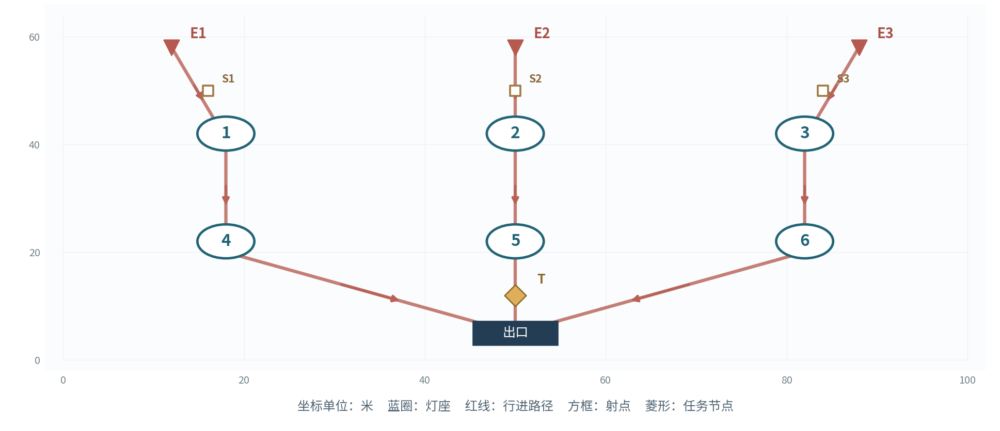

图  主线6灯位、入口与任务示意图

灯座：L1(18,42)、L2(50,42)、L3(82,42)、L4(18,22)、L5(50,22)、L6(82,22)

入口：E1(12,58)、E2(50,58)、E3(88,58)

任务点：T(50,12)；出口：(50, 5)

阻挡体：空地

敌人行进路线：E1：(12,58)→(18,41)→(18,20)→(50,5)；E2：(50,58)→(50,41)→(50,20)→(50,5)；E3：(88,58)→(82,41)→(82,20)→(50,5)。路线走廊宽6米；巨浪靠近驻灯区时转为拆解子目标。

射手驻射点：E1(16,50)、E2(50,50)、E3(84,50)。惊蛰猎手沿本入口路径抵达对应驻射点后锁定射击；出怪同入口依表内顺序每隔0.35秒生成1名，多入口批次并行执行。

| 灯位 | 首波模组 | 上场①②③及接力顺序 | 索敌与方向 |
| --- | --- | --- | --- |
| L1 | 贯阵 | 今汐／相里要／散华 | 拆灯优先；贯阵方位90° |
| L2 | 聚焰 | 秧秧／长离／安可 | 突破优先 |
| L3 | 震域 | 忌炎／凌阳／渊武 | 突破优先 |
| L4 | 返照 | 桃祈／白芷／秋水 | 远程优先 |
| L5 | 聚焰 | 椿／莫特斐／维里奈 | 突破优先 |
| L6 | 贯阵 | 卡卡罗／吟霖／折枝 | 拆灯优先；贯阵方位90° |

任务：三波依次以灯1、4，灯2、5，灯3、6发送灯码，各12秒。 任务累计计时；所需灯持续点亮且任务点3米范围完成清场时推进。

| 波次 | 目标与事件 | 出敌时间、入口和种类 | 敌量 |
| --- | --- | --- | --- |
| 1 | 灯1与4灯码 需亮灯L1+L4，任务12秒 | 0秒：E1 审判战士×8；E2 鸣泣战士×8 12秒：E3 惊蛰猎手×4 | 20 |
| 2 | 灯2与5灯码 需亮灯L2+L5，任务12秒 | 0秒：E1 冥渊守卫×2；E2 磐石守卫×1；E3 惊蛰猎手×4 14秒：E1 审判战士×8；E2 鸣泣战士×6 | 21 |
| 3 | 灯3与6灯码 需亮灯L3+L6，任务12秒；第12秒L6故障6秒 | 0秒：E1 磐石守卫×2；E3 冥渊守卫×2 10秒：E1 审判战士×8；E2 鸣泣战士×8；E3 惊蛰猎手×4 | 24 |

预定故障：对应波开战第12秒触发L6故障，持续6秒，第9秒显示灯号预告；故障结束后按协奏条件重新点亮。

| 波次 | 敌人数 | 名义生命总量 | 每灯名义负荷 |
| --- | --- | --- | --- |
| 1 | 20 | 22,080 | 3,680 |
| 2 | 21 | 31,920 | 5,320 |
| 3 | 24 | 38,400 | 6,400 |

名义负荷按敌人该关等级生命总和除以灯数计算，用于定位关卡量级；实战结果同时受到路线覆盖、控制、任务与故障影响。

波间调度：巨浪波为贯阵重新定向，灯6故障时由灯5的聚焰覆盖出口。

关卡推进：同时开放全部3关险境复演。

#### 险境1  双桥叠压  双路撤离

95级敌人  &#124;  6盏灯  &#124;  18名上场角色  &#124;  4波  &#124;  96名敌人

复演双桥记录，加入中桥交汇区与两侧射台。

开放角色：第一批：漂泊者·衍射、今汐、长离、秧秧、炽霞、白芷、散华、桃祈、渊武；第二批：忌炎、鉴心、吟霖、莫特斐、相里要、凌阳、丹瑾、折枝、维里奈；第三批：釉瑚、灯灯、卜灵、秋水、安可、椿、卡卡罗、秧秧·玄翎

开放模组：聚焰、贯阵、震域、返照。各灯座均可选已开放模组，支持同型重复；下表为可直接试玩的首波预设。

图  险境1灯位、入口与任务示意图

灯座：L1(18,42)、L2(82,42)、L3(50,41)、L4(28,22)、L5(72,22)、L6(50,19)

入口：E1(13,58)、E2(87,58)、E3(2,37)、E4(98,37)

任务点：TW(30,48)、TE(70,48)；出口：(50, 5)

阻挡体：矩形(45,26)至(55,36)

敌人行进路线：E1：(13,58)→(18,41)→(28,22)→(50,5)；E2：(87,58)→(82,41)→(72,22)→(50,5)；E3：(2,37)→(23,32)→(35,18)→(50,5)；E4：(98,37)→(77,32)→(65,18)→(50,5)。路线走廊宽6米；巨浪靠近驻灯区时转为拆解子目标。

射手驻射点：E1(16,50)、E2(84,50)、E3(18,33)、E4(82,33)。惊蛰猎手沿本入口路径抵达对应驻射点后锁定射击；出怪同入口依表内顺序每隔0.35秒生成1名，多入口批次并行执行。

| 灯位 | 首波模组 | 上场①②③及接力顺序 | 索敌与方向 |
| --- | --- | --- | --- |
| L1 | 贯阵 | 今汐／相里要／卡卡罗 | 拆灯优先；贯阵方位90° |
| L2 | 贯阵 | 散华／吟霖／折枝 | 拆灯优先；贯阵方位90° |
| L3 | 聚焰 | 秧秧／长离／安可 | 突破优先 |
| L4 | 返照 | 桃祈／炽霞／白芷 | 远程优先 |
| L5 | 返照 | 维里奈／莫特斐／秋水 | 远程优先 |
| L6 | 聚焰 | 椿／卜灵／丹瑾 | 突破优先 |

任务：依次完成西桥、东桥、双路、双路撤离；西桥依赖灯1、4，东桥依赖灯2、5；每路12秒。 任务累计计时；所需灯持续点亮且任务点3米范围完成清场时推进。

| 波次 | 目标与事件 | 出敌时间、入口和种类 | 敌量 |
| --- | --- | --- | --- |
| 1 | 西桥撤离 需亮灯L1+L4，任务12秒 | 0秒：E1 审判战士×10；E3 惊蛰猎手×4 10秒：E2 鸣泣战士×10 | 24 |
| 2 | 东桥撤离 需亮灯L2+L5，任务12秒 | 0秒：E1 冥渊守卫×2；E2 磐石守卫×2 10秒：E2 鸣泣战士×12；E4 惊蛰猎手×4 | 20 |
| 3 | 双路撤离 需亮灯L1+L4,L2+L5，任务12秒,12秒 | 0秒：E1 审判战士×10；E2 鸣泣战士×10 8秒：E3 惊蛰猎手×4；E4 惊蛰猎手×4 | 28 |
| 4 | 双路终段 需亮灯L1+L4,L2+L5，任务12秒,12秒 | 0秒：E1 冥渊守卫×2；E2 磐石守卫×2 8秒：E1 审判战士×10；E2 鸣泣战士×10 | 24 |

| 波次 | 敌人数 | 名义生命总量 | 每灯名义负荷 |
| --- | --- | --- | --- |
| 1 | 24 | 27,750 | 4,625 |
| 2 | 20 | 34,500 | 5,750 |
| 3 | 28 | 31,750 | 5,292 |
| 4 | 24 | 40,750 | 6,792 |

名义负荷按敌人该关等级生命总和除以灯数计算，用于定位关卡量级；实战结果同时受到路线覆盖、控制、任务与故障影响。

波间调度：在双路波分别保留贯阵与返照，交汇灯6优先处理集群。

关卡推进：首次完成后开放左右撤离目标镜像变体。

#### 险境2  断线重发  故障与拆灯

100级敌人  &#124;  6盏灯  &#124;  18名上场角色  &#124;  4波  &#124;  92名敌人

复演分段发信，增加背面入口与前移终端。

开放角色：第一批：漂泊者·衍射、今汐、长离、秧秧、炽霞、白芷、散华、桃祈、渊武；第二批：忌炎、鉴心、吟霖、莫特斐、相里要、凌阳、丹瑾、折枝、维里奈；第三批：釉瑚、灯灯、卜灵、秋水、安可、椿、卡卡罗、秧秧·玄翎

开放模组：聚焰、贯阵、震域、返照。各灯座均可选已开放模组，支持同型重复；下表为可直接试玩的首波预设。

图  险境2灯位、入口与任务示意图

灯座：L1(25,42)、L2(75,42)、L3(25,24)、L4(75,24)、L5(42,14)、L6(58,14)

入口：E1(12,58)、E2(88,58)、E3(2,36)、E4(98,36)

任务点：T(50,28)；出口：(50, 5)

阻挡体：空地

敌人行进路线：E1：(12,58)→(25,42)→(42,14)→(50,5)；E2：(88,58)→(75,42)→(58,14)→(50,5)；E3：(2,36)→(25,28)→(42,14)→(50,5)；E4：(98,36)→(75,28)→(58,14)→(50,5)。路线走廊宽6米；巨浪靠近驻灯区时转为拆解子目标。

射手驻射点：E1(22,50)、E2(78,50)、E3(16,35)、E4(84,35)。惊蛰猎手沿本入口路径抵达对应驻射点后锁定射击；出怪同入口依表内顺序每隔0.35秒生成1名，多入口批次并行执行。

| 灯位 | 首波模组 | 上场①②③及接力顺序 | 索敌与方向 |
| --- | --- | --- | --- |
| L1 | 贯阵 | 今汐／相里要／卡卡罗 | 拆灯优先；贯阵方位90° |
| L2 | 聚焰 | 秧秧／长离／安可 | 突破优先 |
| L3 | 返照 | 桃祈／炽霞／白芷 | 远程优先 |
| L4 | 震域 | 忌炎／凌阳／渊武 | 突破优先 |
| L5 | 返照 | 维里奈／莫特斐／秋水 | 远程优先 |
| L6 | 贯阵 | 散华／吟霖／折枝 | 突破优先；贯阵方位90° |

任务：四波依次由灯1、2，灯3、4，灯5、6，灯1、6发送灯码，各12秒。 任务累计计时；所需灯持续点亮且任务点3米范围完成清场时推进。

| 波次 | 目标与事件 | 出敌时间、入口和种类 | 敌量 |
| --- | --- | --- | --- |
| 1 | 灯1与2发信 需亮灯L1+L2，任务12秒 | 0秒：E1 审判战士×10；E3 惊蛰猎手×4 8秒：E4 鸣泣战士×10 | 24 |
| 2 | 灯3与4发信 需亮灯L3+L4，任务12秒；第12秒L3故障6秒 | 0秒：E1 冥渊守卫×2；E2 磐石守卫×2 10秒：E4 鸣泣战士×12；E3 惊蛰猎手×4 | 20 |
| 3 | 灯5与6发信 需亮灯L5+L6，任务12秒；第12秒L5故障6秒 | 0秒：E2 审判战士×10；E4 鸣泣战士×10 8秒：E3 惊蛰猎手×6；E1 冥渊守卫×2 | 28 |
| 4 | 灯1与6终报 需亮灯L1+L6，任务12秒 | 0秒：E1 磐石守卫×2；E4 冥渊守卫×2 8秒：E2 审判战士×10；E3 惊蛰猎手×6 | 20 |

预定故障：对应波开战第12秒触发L3故障，持续6秒，第9秒显示灯号预告；故障结束后按协奏条件重新点亮。

预定故障：对应波开战第12秒触发L5故障，持续6秒，第9秒显示灯号预告；故障结束后按协奏条件重新点亮。

| 波次 | 敌人数 | 名义生命总量 | 每灯名义负荷 |
| --- | --- | --- | --- |
| 1 | 24 | 28,860 | 4,810 |
| 2 | 20 | 35,880 | 5,980 |
| 3 | 28 | 39,260 | 6,543 |
| 4 | 20 | 36,920 | 6,153 |

名义负荷按敌人该关等级生命总和除以灯数计算，用于定位关卡量级；实战结果同时受到路线覆盖、控制、任务与故障影响。

波间调度：故障波将震域小队靠近预定故障灯，返照处理边侧箭矢。

关卡推进：首次完成后开放故障灯号镜像变体：L3→L4，L5→L6。

#### 险境3  长夜接班  前后双任务

100级敌人  &#124;  6盏灯  &#124;  18名上场角色  &#124;  4波  &#124;  104名敌人

车辆沿仓外三段推进，后方终端同时向接应部队发送信号。

开放角色：第一批：漂泊者·衍射、今汐、长离、秧秧、炽霞、白芷、散华、桃祈、渊武；第二批：忌炎、鉴心、吟霖、莫特斐、相里要、凌阳、丹瑾、折枝、维里奈；第三批：釉瑚、灯灯、卜灵、秋水、安可、椿、卡卡罗、秧秧·玄翎

开放模组：聚焰、贯阵、震域、返照。各灯座均可选已开放模组，支持同型重复；下表为可直接试玩的首波预设。

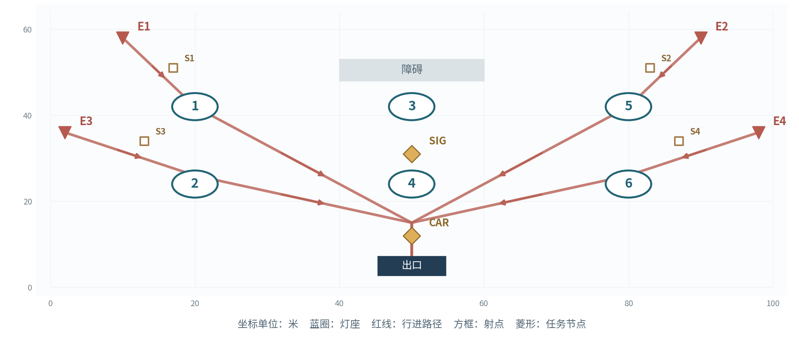

图  险境3灯位、入口与任务示意图

灯座：L1(20,42)、L2(20,24)、L3(50,42)、L4(50,24)、L5(80,42)、L6(80,24)

入口：E1(10,58)、E2(90,58)、E3(2,36)、E4(98,36)

任务点：CAR(50,12)、SIG(50,31)；出口：(50, 5)

阻挡体：矩形(40,48)至(60,53)

敌人行进路线：E1：(10,58)→(20,42)→(50,15)→(50,5)；E2：(90,58)→(80,42)→(50,15)→(50,5)；E3：(2,36)→(20,26)→(50,15)→(50,5)；E4：(98,36)→(80,26)→(50,15)→(50,5)。路线走廊宽6米；巨浪靠近驻灯区时转为拆解子目标。

射手驻射点：E1(17,51)、E2(83,51)、E3(13,34)、E4(87,34)。惊蛰猎手沿本入口路径抵达对应驻射点后锁定射击；出怪同入口依表内顺序每隔0.35秒生成1名，多入口批次并行执行。

| 灯位 | 首波模组 | 上场①②③及接力顺序 | 索敌与方向 |
| --- | --- | --- | --- |
| L1 | 聚焰 | 秧秧／长离／安可 | 突破优先 |
| L2 | 返照 | 桃祈／白芷／秋水 | 远程优先 |
| L3 | 贯阵 | 今汐／相里要／散华 | 拆灯优先；贯阵方位90° |
| L4 | 震域 | 忌炎／凌阳／渊武 | 突破优先 |
| L5 | 贯阵 | 灯灯／卡卡罗／吟霖 | 拆灯优先；贯阵方位90° |
| L6 | 返照 | 莫特斐／维里奈／釉瑚 | 远程优先 |

任务：第1波护送；第2、3波护送与发信并行；第4波发送终报码。护送16秒，发信12秒。 任务累计计时；所需灯持续点亮且任务点3米范围完成清场时推进。

| 波次 | 目标与事件 | 出敌时间、入口和种类 | 敌量 |
| --- | --- | --- | --- |
| 1 | 灯1与2护送 需亮灯L1+L2，任务16秒 | 0秒：E1 审判战士×12；E2 鸣泣战士×10 8秒：E3 惊蛰猎手×4 | 26 |
| 2 | 灯3与4护送＋灯5与6发信 需亮灯L3+L4,L5+L6，任务16秒,12秒 | 0秒：E3 冥渊守卫×2；E4 磐石守卫×2 8秒：E1 审判战士×12；E2 惊蛰猎手×6 | 22 |
| 3 | 灯5与6护送＋灯1与2发信 需亮灯L5+L6,L1+L2，任务16秒,12秒 | 0秒：E2 鸣泣战士×12；E4 审判战士×12 8秒：E3 冥渊守卫×2；E1 惊蛰猎手×4 | 30 |
| 4 | 灯1与6终报码 需亮灯L1+L6，任务12秒 | 0秒：E1 磐石守卫×2；E4 冥渊守卫×2 8秒：E2 审判战士×12；E3 鸣泣战士×10 | 26 |

| 波次 | 敌人数 | 名义生命总量 | 每灯名义负荷 |
| --- | --- | --- | --- |
| 1 | 26 | 31,460 | 5,243 |
| 2 | 22 | 39,520 | 6,587 |
| 3 | 30 | 42,120 | 7,020 |
| 4 | 26 | 44,980 | 7,497 |

名义负荷按敌人该关等级生命总和除以灯数计算，用于定位关卡量级；实战结果同时受到路线覆盖、控制、任务与故障影响。

波间调度：护送小队沿前中后逐波调整，终端保留两灯反制射手与拆灯者。

关卡推进：首次完成后开放反向转运及灯组镜像任务。

#### 活动开放与一次性奖励

活动周期21天。玩家按前置顺序推进六关主线，完成主线6后解锁三个险境；进关与重试消耗设为0，活动内战斗属性由统一配置提供。

| 领取条件 | 份数 | 每份星声 | 每份贝币 | 合计 |
| --- | --- | --- | --- | --- |
| 主线各关首通 | 6 | 80 | 40,000 | 星声480 / 贝币240,000 |
| 主线六关全部完成 | 1 | 120 | 30,000 | 星声120 / 贝币30,000 |
| 险境各关首通 | 3 | 0 | 10,000 | 星声0 / 贝币30,000 |
| 账号总计 | 10 | — | — | 星声600 / 贝币300,000 |

奖励表为活动经济设计规格。以账号、活动、条件ID建立领取记录；主线辅助模式与标准模式共用条件ID；险境变体沿用所属关卡的首通条件。

#### 数据接口与制作交付

| 配表实体 | 字段与制作口径 |
| --- | --- |
| StageConfig | 关卡ID、等级、开放角色池、模块池、灯座坐标、入口坐标、路径折点、障碍、任务点、镜头边界 |
| LampConfig | 灯座ID、可选模组集合、首波模块、选敌优先、贯阵方位角、有效射程、区域参数、故障状态 |
| TeamConfig | 人物ID、形态ID、灯座归属、①②③顺序、基础伤害、技能ID、适配模块集合 |
| WaveConfig | 关卡ID、波次、批次秒数、入口、单位ID、数量、所需灯组、任务秒数、预定故障事件 |
| BattleLog | 时间、灯号、动作、目标、命中、产能接受值、协奏余额、灯击主奏、故障原因、任务进度 |
| RewardConfig | 账号条件ID、星声、贝币、首通标记、领取状态、关卡解锁条件 |

配表采用关卡ID加波次ID作联合键，出敌批次按秒数升序执行；伤害、协奏、冷却和奖励以单一配置来源驱动战斗服务及UI，所有算例在测试日志中保留输入与输出。

#### 首轮标定与数值敏感性验证

| 验证维度 | 目标与记录 |
| --- | --- |
| 接力节奏 | 记录每次命中时间、协奏采纳值、扣能与等待原因，初次触发目标3至5秒。 |
| 主线容错 | 推荐阵容完成主线1时剩余耐久目标≥80，主线6目标≥60。 |
| 险境策略 | 每关至少2套模组与分工差异明显的阵容达到剩余耐久≥20。 |
| 生命敏感性 | 以敌人生命倍率0.9、1.0、1.1分别重放，统计击杀跨接力次数与突破数。 |
| 时间敏感性 | 批次时点调整±2秒，核对场上峰值、延批与任务停滞时长。 |
| 奖励闭环 | 按关卡与账号核对600星声、300000贝币，辅助、重试与险境变体共用领取条件。 |

[返回文档选择](#document-navigation)

---

## 战斗设计

角色3C、自动战斗AI、动作提交、命中与状态时序、敌人反制及战斗制作接口。

[下载战斗设计 Word 原文](documents/%E9%95%BF%E5%A4%9C%E5%AE%88%E7%81%AF_%E6%88%98%E6%96%97%E8%AE%BE%E8%AE%A1%E6%96%87%E6%A1%A3.docx?raw=1) · [返回文档选择](#document-navigation)

展开本篇目录

- [战斗体验与三项控制规格](#combat-01)
  - [AI行为树与动作提交](#combat-02)
  - [技能命中、状态与自动闪避](#combat-03)
  - [通用战斗与任务规则](#combat-04)
  - [主奏提交与空场点灯](#combat-05)
  - [四类模组统一参数](#combat-06)
  - [敌人参数与行为](#combat-07)
  - [敌人行为与玩家反制](#combat-08)
  - [角色技能与灯具适配清单](#combat-09)
- [九关关卡与出敌制作表](#combat-10)
  - [主线1  断哨留火  双灯教学](#combat-11)
  - [主线2  桥头让路  双桥接力](#combat-12)
  - [主线3  仓前十步  六灯协防](#combat-13)
  - [主线4  隔岸应答  故障补位](#combat-14)
  - [主线5  灯火接力  转运换防](#combat-15)
  - [主线6  最后一束信号  信号交接](#combat-16)
  - [险境1  双桥叠压  双路撤离](#combat-17)
  - [险境2  断线重发  故障与拆灯](#combat-18)
  - [险境3  长夜接班  前后双任务](#combat-19)
- [战斗信息层级与美术制作](#combat-20)
  - [数据接口与制作交付](#combat-21)
  - [战斗验收方案](#combat-22)

闫哲祯  &#124;  游戏策划投递作品  &#124;  2026年10月

细化驻灯自动战斗、角色3C、攻击承诺、命中与状态时序、协奏接力、敌人反制与战斗表现制作接口。

作品定位：基于《鸣潮》夜归背景创作的限时战术守线活动。本文完整定义活动规则、九关配置、复现所需字段与验收指标。

### 战斗体验与三项控制规格

玩家通过提前安排灯组、队员和接力序号，观察自动战斗产生的可解释结果；各类敌人以突破、远程压制和拆灯构成差异化威胁。

| 3C环节 | 执行标准 |
| --- | --- |
| Character | 角色站位固定在所属灯周6米内，近战追至8米后回位；远程攻击上限14米；移速4.5米/秒。 |
| Camera | 俯视镜头35°，高度42米，支持两档缩放与灯座聚焦；敌人突破、拆解与故障保持屏幕边缘灯号提示。 |
| Control | 波前设定队伍、模组、贯阵角度及目标优先，战斗中提供观察、暂停、镜头控制与退出，波间开放调整。 |

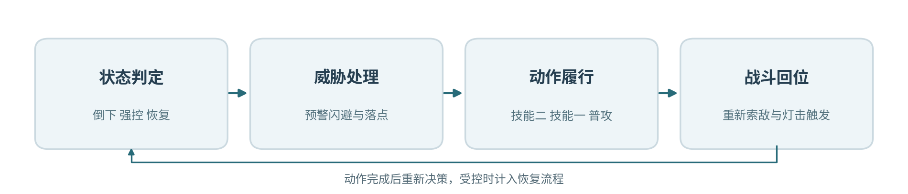

图  自动战斗行为决策链

#### AI行为树与动作提交

每0.1秒执行一次决策采样。先检查生命与控制，再响应公开预警与安全落点，随后检查当前动作状态；空闲时依次处理接力准备、战技二、战技一、普攻与归位。技能的专属目标规则优先于灯组优先级，同层目标按距离出口的路径长度排序。

目标过滤顺序为生存状态、可受击状态、14米索敌距离、动作可达范围、墙体遮挡。动作接受时锁定目标，生效前允许原地转向；生效帧确定打击方向，动作结束后重新选择。近战出手距离2.5米，范围技能按各自几何体检测。

| 动作 | 起手 | 生效与后摇 | 冷却 | 取消与打断 |
| --- | --- | --- | --- | --- |
| 普攻 | 0.3秒 | 0.3秒命中，0.7秒收招 | 动作循环1秒 | 起手与收招接入闪避；生效段保留伤害提交。 |
| 战技一 | 0.4秒 | 0.4秒命中，0.2秒收招 | 接受后6秒 | 起手与收招响应强控，生效段锁定方向。 |
| 战技二 | 0.4秒 | 0.4秒命中，0.2秒收招 | 接受后10秒 | 起手与收招响应强控，生效段锁定方向。 |
| 闪避 | 即时 | 全长0.35秒，前0.2秒免伤 | 4秒 | 向合法落点位移2米，完成后回归决策。 |

#### 技能命中、状态与自动闪避

普通近战以120°扇形、半径3米测试；直线技以长12米、宽2米检测；小型区域以半径4米检测；单目标远程动作在14米内判定。特别标注的牵引、推退与聚敌范围按技能配置，场景碰撞优先于最终位移。

技能名含聚敌、牵引时，范围内轻波朝标记点位移3米；含定身时持续2秒；含减速时移速乘0.6持续2秒；标记持续6秒。新标记刷新持续秒数；范围控制由同名状态ID统一管理。

自动闪避响应已出现的危险预警，在预计0.2秒内命中、闪避冷却完成且灯周6米存在安全落点时接受动作。落点路径与墙体进行导航检测；相应提示以闪避光效、角色短位移与音频确认。

角色生命归零后进入8秒恢复状态，当前动作终止；已生成的弹体与区域继续按实体生命周期结算。敌人重击产生0.3秒硬直，同一角色硬直保护时长2秒；巨浪强制打断保护为8秒。

#### 通用战斗与任务规则

| 对象 | 规则与参数 |
| --- | --- |
| 配置 | 每灯配1种模组与3名角色；同一人物在全场占1个名额，秧秧及玄翎形态共享人物名额；站位①②③决定主奏顺序。 |
| 动作 | 角色自动完成普攻、战技一、战技二及闪避。普攻30点/1秒；战技一90点/6秒冷却；战技二150点/10秒冷却。 |
| 协奏 | 每灯独立0至100点；每波初始40点；普攻命中5点、战技命中10点；普攻15点/秒、战技20点/3秒滚动上限。 |
| 灯击 | 满100、灯具运行、至少2名队员可行动并具备合法目标时按①②③主奏轮换，消耗100点；相邻灯击至少8秒。 |
| 故障 | 拆灯者靠近灯座3米连续作业4秒，造成6秒故障；故障结束后由协奏再次点亮。 |
| 任务 | 所需灯点亮且任务点3米半径清场时累计任务秒数；波次全批次离场且任务达成后进入整备。 |
| 结算 | 防线100点，轻波突破扣10点、巨浪扣20点；防线剩余1点起满足通关条件；主线辅助模式突破扣除系数0.5。 |
| 恢复 | 角色倒下8秒后满生命归队；波间全员生命与冷却复位，协奏设为40点，防线耐久继承。 |
| 节奏 | 批次提前5秒预告；主线同时在场上限24名，险境上限32名，超额批次整体顺延并重新预告。 |

接力提交优先检查生命状态、强控状态、有效目标、故障与8秒间隔。任务灯等待点亮且全场敌人清空时，本灯每秒自动获得20点协奏。合法目标包括攻击范围内敌人、飞行箭矢与当前任务灯。

每名角色以灯座为中心布阵，标准位置偏移依次为(-2,0)、(0,-2)、(2,0)米。普通战斗驻守半径6米，近战追击最远8米，远程攻击最远14米，角色移动速度4.5米/秒。

拆解目标采用可达路径距离最短的运行灯，同距依灯号升序选择；每灯同时接收1名拆解者，其余巨浪改选下一盏可达灯。全灯拆解名额占用时，巨浪沿所在路径推进出口。

图  共享协奏与主奏轮换

#### 主奏提交与空场点灯

协奏达到80点后，下一主奏优先施放可用的标记或聚敌动作；达到100点后等待其已在进行的动作完成，等待上限1秒。提交时再次判定灯状态、队员数量、目标与8秒间隔，成功后推进①②③序号。

当敌人全部离场、待点亮任务灯仍在等待时，本灯每秒自动累计20点协奏；满100即执行点灯动作。活动灯具的攻击触发与角色动作队列分离，单次驱动同步播放灯具攻击和本次主奏协同。

#### 四类模组统一参数

| 模组 | 射程与作用区 | 触发伤害 | 控制与功能 |
| --- | --- | --- | --- |
| 聚焰 | 选点18米，爆炸半径6米，灼烧4秒 | 爆炸600；每秒100×4；全中1000 | 适配聚敌、定身与持续灼烧；同名区域逐点取最大强度。 |
| 贯阵 | 光束28米×3米；波内固定方向 | 光束600；命中巨浪额外900 | 单轮额外集中打击至多作用于1名巨浪。 |
| 震域 | 灯座10米半径，0/1/2秒三震 | 每震330；全中990 | 首震推轻波3米，削巨浪最大共振度15点。 |
| 返照 | 主动射程18米，防护半径8米/6秒 | 主动3矢×250；拦箭反击250/次，基础3次 | 形成箭矢拦截区，清空拆解进度并维持防护。 |

灯击基础伤害和当前主奏的适配协同分别结算。协同追加采用单次240点预算，范围协同按每个被命中目标计240点上限；连锁追加结算1层。协奏产出仅由角色普攻与战技有效命中产生。

返照主动三矢依本灯目标优先级分配，单体场景三矢集中命中；拦截到来的有效箭矢时立即销毁来袭弹体并发出反击光矢，标准上限为每次灯击3次。贯阵额外900点集中打击锁定本次光束命中的首名巨浪。

图  拆灯、故障和重新点亮状态

#### 敌人参数与行为

| 单位 | 职责 | 70级生命 | 攻击/间隔 | 移速 | 行动接口 |
| --- | --- | --- | --- | --- | --- |
| 审判战士 | 轻波·突破 | 1000 | 80/2.0秒 | 2.0米/秒 | 近战2.5米；交战3秒后续行 |
| 鸣泣战士 | 轻波·突破 | 900 | 70/1.5秒 | 2.2米/秒 | 近战2.5米；交战3秒后续行 |
| 惊蛰猎手 | 轻波·牵制 | 800 | 90/3.0秒 | 2.0米/秒 | 射点停驻；射程14米；弹速16米/秒 |
| 冥渊守卫 | 巨浪·拆灯 | 3200 | 150/2.5秒 | 1.5米/秒 | 灯周3米拆解4秒；故障6秒 |
| 磐石守卫 | 巨浪·拆灯 | 3600 | 180/3.0秒 | 1.2米/秒 | 灯周3米拆解4秒；故障6秒 |

关卡等级为70、75、80、85、90、90、95、100、100。生命倍率H(L)=H70×\[1+0.01×(L−70)\]；攻击倍率A(L)=A70×\[1+0.005×(L−70)\]。移速与攻击间隔采用固定底值，伤害计算保留小数、界面显示取整。

巨浪共振上限100点；普攻每动作削1点，战技每动作削4点，震域首震削15点，相里要协同额外削20点。归零后受制2秒并回满；强制打断保护期8秒。拆灯者进入灯座3米圈后启动4秒进度，成功触发6秒故障。

#### 敌人行为与玩家反制

轻波突破者沿入口路径前进，接近角色2.5米后执行至多3秒交战再续行。惊蛰猎手沿路径到达可攻击灯组的14米射点后驻足射击，弓箭投射物以16米/秒移动。巨浪朝最近运行灯具寻路，进入3米拆解圈后执行4秒读条，同灯同时容纳1名拆解者。

拆解受到打断时进度归零并进入1秒恢复；返照防护覆盖时主动清空拆解进度。故障灯熄灭6秒，当前灯效移除，能量继续保留；状态恢复后经过正常接力条件点亮。

#### 角色技能与灯具适配清单

活动提供25名人物与26套战斗配置。全角色生命1000点，普攻及战技伤害采用统一底值；技能文字所述控制与选敌条件在统一动作模板上实现。

| 角色 | 适配灯型 | 两项战技 | 主奏协同 |
| --- | --- | --- | --- |
| 漂泊者·衍射 | 聚焰/贯阵 | 凝光扫：扇形斩击，轻波定身2秒 破隙：标记出口最近敌人6秒 | 聚焰：爆心追踪标记；贯阵：命中标记追加光刃 |
| 今汐 | 贯阵/返照 | 浮光：直线贯穿 点曜：标记巨浪，优先拆灯者 | 贯阵：标记目标追加龙息；返照：首矢命中标记产生3米溅射 |
| 长离 | 聚焰/震域 | 炎步：突进斩击前沿轻波 截翎：重斩打断拆灯者 | 聚焰：附带4秒十字火带；震域：末震沿来向追加回斩 |
| 秧秧 | 聚焰/贯阵 | 回风：牵引4米内轻波 风线：风刃附带40%减速2秒 | 聚焰：爆炸前牵引；贯阵：光束内调整密集目标 |
| 炽霞 | 贯阵/返照 | 压枪：压制射手2秒 燃印：命中巨浪并标记 | 贯阵：引爆燃印；返照：追射3发各80 |
| 白芷 | 聚焰/返照 | 冻尘：轻波减速40%持续2秒 羽袭：打断最近敌人 | 聚焰：生成2秒冷凝区域；返照：首次反击恢复本队15%生命 |
| 散华 | 聚焰/贯阵 | 霜棘：形成4米冰线并减速 碎冰：引爆冰棘并打断 | 聚焰：引爆冰棘；贯阵：沿冰线延展短光束 |
| 桃祈 | 震域/返照 | 御反：近战反斩并推轻波3米 破阵：重斩中止拆解 | 震域：首震清空拆解进度；返照：防护延长2秒 |
| 渊武 | 震域/贯阵 | 楔震：4秒雷击区域 断雷：优先打断拆灯者 | 震域：每震追击一名巨浪；贯阵：命中雷楔内目标产生电爆 |
| 忌炎 | 聚焰/震域 | 横阵：横扫并推轻波3米 龙势：贯刺本路前沿目标 | 聚焰：将边缘轻波推向爆心；震域：末震推回6米 |
| 鉴心 | 聚焰/返照 | 回掌：反击并推轻波3米 归涡：牵引4米内轻波 | 聚焰：爆炸前聚敌；返照：反击上限增至5次 |
| 吟霖 | 贯阵/震域 | 缚丝：轻波定身2秒 罚雷：标记至多两名敌人 | 贯阵：两标记间传导；震域：末震使标记轻波定身2秒 |
| 莫特斐 | 聚焰/返照 | 火羽：远程点射射手 爆签：攻击巨浪并附着爆签 | 聚焰：爆签连锁爆炸；返照：光矢附带火羽至多3次 |
| 相里要 | 贯阵/震域 | 重拳：打断拆灯者 解构：标记最近巨浪破绽 | 贯阵：标记目标追加集中打击；震域：额外削减巨浪20点共振 |
| 凌阳 | 震域/返照 | 跃击：跃至突破者前沿攻击 狮踏：连击并推轻波3米 | 震域：末震留下4秒减速径；返照：防护前缘追加撞击 |
| 丹瑾 | 聚焰/贯阵 | 绯锋：优先攻击低生命目标 追刃：标记本路巨浪 | 聚焰：优先密集残血敌群；贯阵：低于30%生命的标记目标追斩 |
| 折枝 | 聚焰/贯阵 | 飞鹤：优先攻击射手 墨痕：标记本路最前沿敌人 | 聚焰：标记位置附加3米爆破；贯阵：追击次近目标 |
| 维里奈 | 聚焰/返照 | 藤拍：缠住轻波2秒 叶矢：标记本灯近处敌人 | 聚焰：燃区进入者首次定身2秒；返照：防护每秒回复本队2%生命 |
| 釉瑚 | 震域/返照 | 鼎击：冰器砸击并减速 如意：挥击打断单体 | 震域：末震附加范围碎冰；返照：拦箭触发冰刺至多2次 |
| 灯灯 | 贯阵/返照 | 闪行：迎击轻波并归位 追光：优先射击侧路射手 | 贯阵：束端追加追光弹；返照：主动矢分配两路目标 |
| 卜灵 | 聚焰/贯阵 | 落雷：标记最近巨浪 雷符：攻击轻波并定身2秒 | 聚焰：爆炸后2秒追加落雷；贯阵：命中雷符后分出雷束 |
| 秋水 | 聚焰/返照 | 雾弹：射手失准2秒 雾饵：诱导轻波3秒后爆炸 | 聚焰：爆炸前短暂引敌；返照：首矢使射手失准2秒 |
| 安可 | 聚焰/震域 | 白咩弹：小范围爆破 黑咩踏：打断近处敌人 | 聚焰：1.5秒后回响爆破；震域：第二震设延时2秒爆点 |
| 椿 | 聚焰/震域 | 缠枝：轻波牵引至灯侧 花旋：4秒旋转攻击区域 | 聚焰：燃烧结束时藤花爆破；震域：末震牵引轻波 |
| 卡卡罗 | 贯阵/返照 | 影斩：优先追击巨浪 逐猎：标记正在拆灯的目标 | 贯阵：束端投影斩击；返照：标记命中后追反斩 |
| 秧秧·玄翎 | 贯阵/震域 | 苍剑：横斩并打断拆灯者 羽剑：轻波牵引至攻击线 | 贯阵：同线羽刃追击；震域：末震沿路线羽刃追击 |

### 九关关卡与出敌制作表

场景统一采用局部平面坐标，X轴向右、Y轴向前，原点位于画面后方左角；1坐标单位对应1米。地图展示固定灯座、入口、任务节点与障碍，敌人沿各入口路径折点行进。

#### 主线1  断哨留火  双灯教学

70级敌人  &#124;  2盏灯  &#124;  6名上场角色  &#124;  2波  &#124;  22名敌人

程望在哨仓后门修复线路，漂泊者以两盏灯建立第一道拦截区。教学环节通过固定三人展示协奏触发，随后开放正式配队。

入关教学：以漂泊者·衍射①、今汐②、长离③驻守聚焰灯，对固定生命训练投影演示协奏积累与一次灯击；训练投影完成后自动打开双灯配队界面，教学演示独立于正式29波出敌记录。

开放角色：第一批：漂泊者·衍射、今汐、长离、秧秧、炽霞、白芷、散华、桃祈、渊武

开放模组：聚焰、贯阵。各灯座均可选已开放模组，支持同型重复；下表为可直接试玩的首波预设。

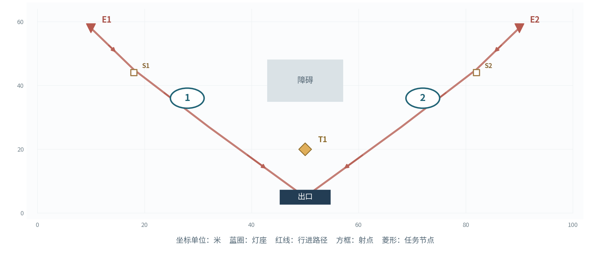

图  主线1灯位、入口与任务示意图

灯座：L1(28,36)、L2(72,36)

入口：E1(10,58)、E2(90,58)

任务点：T1(50,20)；出口：(50, 5)

阻挡体：矩形(43,35)至(57,48)

敌人行进路线：E1：(10,58)→(18,45)→(32,27)→(50,5)；E2：(90,58)→(82,45)→(68,27)→(50,5)。路线走廊宽6米；巨浪靠近驻灯区时转为拆解子目标。

射手驻射点：E1(18,44)、E2(82,44)。惊蛰猎手沿本入口路径抵达对应驻射点后锁定射击；出怪同入口依表内顺序每隔0.35秒生成1名，多入口批次并行执行。

| 灯位 | 首波模组 | 上场①②③及接力顺序 | 索敌与方向 |
| --- | --- | --- | --- |
| L1 | 聚焰 | 漂泊者·衍射／长离／秧秧 | 突破优先 |
| L2 | 贯阵 | 今汐／散华／炽霞 | 远程优先；贯阵方位80° |

任务：逐波完成校线；灯1与灯2分别承担10秒作业。 任务累计计时；所需灯持续点亮且任务点3米范围完成清场时推进。

| 波次 | 目标与事件 | 出敌时间、入口和种类 | 敌量 |
| --- | --- | --- | --- |
| 1 | 灯1校线 需亮灯L1，任务10秒 | 0秒：E1 审判战士×6；E2 鸣泣战士×4 | 10 |
| 2 | 灯2校线 需亮灯L2，任务10秒 | 0秒：E2 惊蛰猎手×4 10秒：E1 审判战士×8 | 12 |

战斗执行：战前公开入口、批次、预定故障和任务灯号；自动索敌按每灯配置的优先级执行。远程射手沿路线进入驻射点，拆灯者按就近有效灯号尝试拆解。

波间调度：第2波将炽霞调整为灯2的首位主奏，贯阵方向转向东侧射点。

关卡推进：开放4灯、震域灯及第二批9名角色。

#### 主线2  桥头让路  双桥接力

75级敌人  &#124;  4盏灯  &#124;  12名上场角色  &#124;  3波  &#124;  52名敌人

两桥担架依序撤离；前排灯负责入口清场，后排灯照顾越过前排的目标。

开放角色：第一批：漂泊者·衍射、今汐、长离、秧秧、炽霞、白芷、散华、桃祈、渊武；第二批：忌炎、鉴心、吟霖、莫特斐、相里要、凌阳、丹瑾、折枝、维里奈

开放模组：聚焰、贯阵、震域。各灯座均可选已开放模组，支持同型重复；下表为可直接试玩的首波预设。

图  主线2灯位、入口与任务示意图

灯座：L1(18,40)、L2(82,40)、L3(32,22)、L4(68,22)

入口：E1(18,58)、E2(82,58)、E3(98,36)

任务点：TW(30,47)、TE(70,47)；出口：(50, 5)

阻挡体：矩形(45,29)至(55,54)

敌人行进路线：E1：(18,58)→(18,35)→(32,20)→(50,5)；E2：(82,58)→(82,35)→(68,20)→(50,5)；E3：(98,36)→(79,29)→(68,20)→(50,5)。路线走廊宽6米；巨浪靠近驻灯区时转为拆解子目标。

射手驻射点：E1(19,47)、E2(81,47)、E3(79,29)。惊蛰猎手沿本入口路径抵达对应驻射点后锁定射击；出怪同入口依表内顺序每隔0.35秒生成1名，多入口批次并行执行。

| 灯位 | 首波模组 | 上场①②③及接力顺序 | 索敌与方向 |
| --- | --- | --- | --- |
| L1 | 聚焰 | 秧秧／长离／白芷 | 突破优先 |
| L2 | 贯阵 | 今汐／相里要／散华 | 拆灯优先；贯阵方位90° |
| L3 | 震域 | 忌炎／凌阳／桃祈 | 突破优先 |
| L4 | 贯阵 | 漂泊者·衍射／吟霖／折枝 | 远程优先；贯阵方位25° |

任务：西桥、东桥、西桥依次完成12秒撤离；西桥使用灯1与3，东桥使用灯2与4。 任务累计计时；所需灯持续点亮且任务点3米范围完成清场时推进。

| 波次 | 目标与事件 | 出敌时间、入口和种类 | 敌量 |
| --- | --- | --- | --- |
| 1 | 西桥撤离 需亮灯L1+L3，任务12秒 | 0秒：E1 审判战士×8；E3 惊蛰猎手×2 12秒：E2 鸣泣战士×8 | 18 |
| 2 | 东桥撤离 需亮灯L2+L4，任务12秒 | 0秒：E2 鸣泣战士×8；E1 审判战士×6；E3 冥渊守卫×1 12秒：E3 惊蛰猎手×3 | 18 |
| 3 | 西桥撤离 需亮灯L1+L3，任务12秒 | 0秒：E1 审判战士×6；E2 鸣泣战士×6 10秒：E3 惊蛰猎手×4 | 16 |

战斗执行：战前公开入口、批次、预定故障和任务灯号；自动索敌按每灯配置的优先级执行。远程射手沿路线进入驻射点，拆灯者按就近有效灯号尝试拆解。

波间调度：第2波将单体打断角色转向东桥；第3波由灯3衔接返身敌人。

关卡推进：开放6灯、返照灯、第三批角色及秧秧的玄翎形态。

#### 主线3  仓前十步  六灯协防

80级敌人  &#124;  6盏灯  &#124;  18名上场角色  &#124;  3波  &#124;  62名敌人

程望分三批搬运线缆，前排负责拆灯者，后排清理突破残敌。

开放角色：第一批：漂泊者·衍射、今汐、长离、秧秧、炽霞、白芷、散华、桃祈、渊武；第二批：忌炎、鉴心、吟霖、莫特斐、相里要、凌阳、丹瑾、折枝、维里奈；第三批：釉瑚、灯灯、卜灵、秋水、安可、椿、卡卡罗、秧秧·玄翎

开放模组：聚焰、贯阵、震域、返照。各灯座均可选已开放模组，支持同型重复；下表为可直接试玩的首波预设。

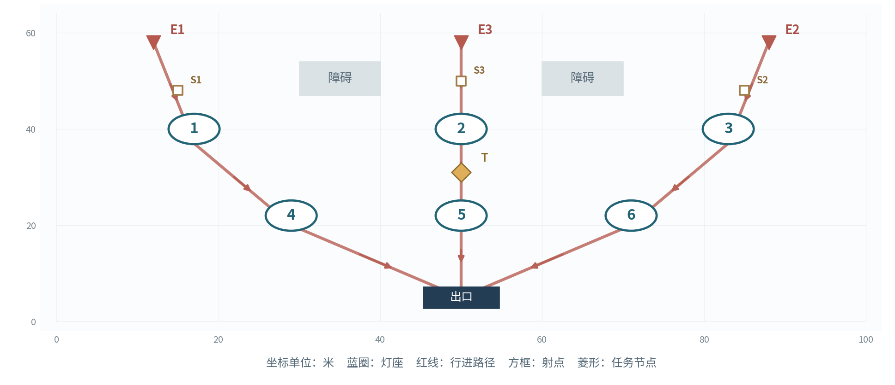

图  主线3灯位、入口与任务示意图

灯座：L1(17,40)、L2(50,40)、L3(83,40)、L4(29,22)、L5(50,22)、L6(71,22)

入口：E1(12,58)、E2(88,58)、E3(50,58)

任务点：T(50,31)；出口：(50, 5)

阻挡体：矩形(30,47)至(40,54)、矩形(60,47)至(70,54)

敌人行进路线：E1：(12,58)→(17,37)→(29,20)→(50,5)；E2：(88,58)→(83,37)→(71,20)→(50,5)；E3：(50,58)→(50,41)→(50,22)→(50,5)。路线走廊宽6米；巨浪靠近驻灯区时转为拆解子目标。

射手驻射点：E1(15,48)、E2(85,48)、E3(50,50)。惊蛰猎手沿本入口路径抵达对应驻射点后锁定射击；出怪同入口依表内顺序每隔0.35秒生成1名，多入口批次并行执行。

| 灯位 | 首波模组 | 上场①②③及接力顺序 | 索敌与方向 |
| --- | --- | --- | --- |
| L1 | 聚焰 | 秧秧／长离／白芷 | 突破优先 |
| L2 | 贯阵 | 今汐／相里要／散华 | 拆灯优先；贯阵方位90° |
| L3 | 震域 | 忌炎／凌阳／桃祈 | 突破优先 |
| L4 | 返照 | 鉴心／炽霞／秋水 | 远程优先 |
| L5 | 聚焰 | 安可／椿／莫特斐 | 突破优先 |
| L6 | 贯阵 | 卡卡罗／吟霖／折枝 | 拆灯优先；贯阵方位90° |

任务：每波搬运1箱；灯2与5点亮、作业点清场后累积10秒。 任务累计计时；所需灯持续点亮且任务点3米范围完成清场时推进。

| 波次 | 目标与事件 | 出敌时间、入口和种类 | 敌量 |
| --- | --- | --- | --- |
| 1 | 第1箱 需亮灯L2+L5，任务10秒 | 0秒：E1 审判战士×8；E3 惊蛰猎手×4 12秒：E2 鸣泣战士×8 | 20 |
| 2 | 第2箱 需亮灯L2+L5，任务10秒 | 0秒：E1 磐石守卫×1；E2 冥渊守卫×1；E3 惊蛰猎手×4 14秒：E1 审判战士×8；E2 鸣泣战士×6 | 20 |
| 3 | 第3箱 需亮灯L2+L5，任务10秒 | 0秒：E2 冥渊守卫×2；E1 审判战士×8 12秒：E2 鸣泣战士×8；E3 惊蛰猎手×4 | 22 |

战斗执行：战前公开入口、批次、预定故障和任务灯号；自动索敌按每灯配置的优先级执行。远程射手沿路线进入驻射点，拆灯者按就近有效灯号尝试拆解。

波间调度：第2波将灯4与灯3的队员、模组和索敌优先级同步交换，保留灯5的范围清场能力。

关卡推进：开放阵容预设存档及主线4。

#### 主线4  隔岸应答  故障补位

85级敌人  &#124;  6盏灯  &#124;  18名上场角色  &#124;  3波  &#124;  57名敌人

桥南终端重新发送分段灯码，玩家通过邻灯交叉火力覆盖预定故障缺口。

开放角色：第一批：漂泊者·衍射、今汐、长离、秧秧、炽霞、白芷、散华、桃祈、渊武；第二批：忌炎、鉴心、吟霖、莫特斐、相里要、凌阳、丹瑾、折枝、维里奈；第三批：釉瑚、灯灯、卜灵、秋水、安可、椿、卡卡罗、秧秧·玄翎

开放模组：聚焰、贯阵、震域、返照。各灯座均可选已开放模组，支持同型重复；下表为可直接试玩的首波预设。

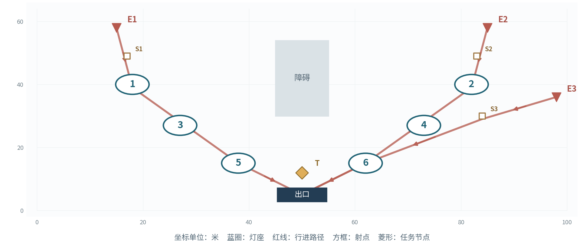

图  主线4灯位、入口与任务示意图

灯座：L1(18,40)、L2(82,40)、L3(27,27)、L4(73,27)、L5(38,15)、L6(62,15)

入口：E1(15,58)、E2(85,58)、E3(98,36)

任务点：T(50,12)；出口：(50, 5)

阻挡体：矩形(45,30)至(55,54)

敌人行进路线：E1：(15,58)→(18,39)→(38,15)→(50,5)；E2：(85,58)→(82,39)→(62,15)→(50,5)；E3：(98,36)→(84,29)→(62,15)→(50,5)。路线走廊宽6米；巨浪靠近驻灯区时转为拆解子目标。

射手驻射点：E1(17,49)、E2(83,49)、E3(84,30)。惊蛰猎手沿本入口路径抵达对应驻射点后锁定射击；出怪同入口依表内顺序每隔0.35秒生成1名，多入口批次并行执行。

| 灯位 | 首波模组 | 上场①②③及接力顺序 | 索敌与方向 |
| --- | --- | --- | --- |
| L1 | 贯阵 | 今汐／相里要／卡卡罗 | 拆灯优先；贯阵方位90° |
| L2 | 聚焰 | 秧秧／长离／安可 | 突破优先 |
| L3 | 返照 | 桃祈／炽霞／白芷 | 拆灯优先 |
| L4 | 震域 | 忌炎／凌阳／渊武 | 突破优先 |
| L5 | 返照 | 维里奈／莫特斐／秋水 | 远程优先 |
| L6 | 贯阵 | 散华／吟霖／折枝 | 突破优先；贯阵方位90° |

任务：三波依次以灯1、2，灯3、4，灯5、6发送灯码，每波12秒。 任务累计计时；所需灯持续点亮且任务点3米范围完成清场时推进。

| 波次 | 目标与事件 | 出敌时间、入口和种类 | 敌量 |
| --- | --- | --- | --- |
| 1 | 灯1与2发信 需亮灯L1+L2，任务12秒 | 0秒：E1 审判战士×8；E3 惊蛰猎手×6 12秒：E2 鸣泣战士×6 | 20 |
| 2 | 灯3与4发信 需亮灯L3+L4，任务12秒；第12秒L3故障6秒 | 0秒：E1 冥渊守卫×2；E2 鸣泣战士×6；E3 惊蛰猎手×4 14秒：E2 审判战士×8 | 20 |
| 3 | 灯5与6发信 需亮灯L5+L6，任务12秒 | 0秒：E1 磐石守卫×2；E2 冥渊守卫×1 10秒：E2 鸣泣战士×8；E3 惊蛰猎手×6 | 17 |

预定故障：对应波开战第12秒触发L3故障，持续6秒，第9秒显示灯号预告；故障结束后按协奏条件重新点亮。

战斗执行：战前公开入口、批次、预定故障和任务灯号；自动索敌按每灯配置的优先级执行。远程射手沿路线进入驻射点，拆灯者按就近有效灯号尝试拆解。

波间调度：第2波以灯1与5交叉覆盖灯3区域；第3波将主力转向灯5与6。

关卡推进：开放主线5的分段转运。

#### 主线5  灯火接力  转运换防

90级敌人  &#124;  6盏灯  &#124;  18名上场角色  &#124;  3波  &#124;  60名敌人

程望护送最后一车伤员，车辆分段停靠，每波整备完成一次换防。

开放角色：第一批：漂泊者·衍射、今汐、长离、秧秧、炽霞、白芷、散华、桃祈、渊武；第二批：忌炎、鉴心、吟霖、莫特斐、相里要、凌阳、丹瑾、折枝、维里奈；第三批：釉瑚、灯灯、卜灵、秋水、安可、椿、卡卡罗、秧秧·玄翎

开放模组：聚焰、贯阵、震域、返照。各灯座均可选已开放模组，支持同型重复；下表为可直接试玩的首波预设。

图  主线5灯位、入口与任务示意图

灯座：L1(20,42)、L2(20,24)、L3(50,42)、L4(50,24)、L5(80,42)、L6(80,24)

入口：E1(12,58)、E2(50,58)、E3(88,58)

任务点：S1(20,12)、S2(50,12)、S3(80,12)；出口：(95, 5)

阻挡体：空地

敌人行进路线：E1：(12,58)→(20,40)→(50,18)→(95,5)；E2：(50,58)→(50,39)→(70,18)→(95,5)；E3：(88,58)→(80,40)→(87,17)→(95,5)。路线走廊宽6米；巨浪靠近驻灯区时转为拆解子目标。

射手驻射点：E1(17,50)、E2(50,50)、E3(83,50)。惊蛰猎手沿本入口路径抵达对应驻射点后锁定射击；出怪同入口依表内顺序每隔0.35秒生成1名，多入口批次并行执行。

| 灯位 | 首波模组 | 上场①②③及接力顺序 | 索敌与方向 |
| --- | --- | --- | --- |
| L1 | 聚焰 | 秧秧／长离／安可 | 突破优先 |
| L2 | 返照 | 桃祈／白芷／秋水 | 远程优先 |
| L3 | 贯阵 | 今汐／相里要／散华 | 拆灯优先；贯阵方位90° |
| L4 | 震域 | 忌炎／凌阳／渊武 | 突破优先 |
| L5 | 贯阵 | 灯灯／卡卡罗／吟霖 | 拆灯优先；贯阵方位90° |
| L6 | 返照 | 莫特斐／维里奈／釉瑚 | 远程优先 |

任务：沿停靠1→2→3→后方逐段行进，每段16秒；对应灯组为1、2，3、4，5、6。 任务累计计时；所需灯持续点亮且任务点3米范围完成清场时推进。

| 波次 | 目标与事件 | 出敌时间、入口和种类 | 敌量 |
| --- | --- | --- | --- |
| 1 | 停靠1→2 需亮灯L1+L2，任务16秒 | 0秒：E1 审判战士×8；E2 惊蛰猎手×4 12秒：E2 鸣泣战士×6 | 18 |
| 2 | 停靠2→3 需亮灯L3+L4，任务16秒 | 0秒：E3 冥渊守卫×2；E2 鸣泣战士×8；E3 惊蛰猎手×4 14秒：E1 审判战士×6 | 20 |
| 3 | 停靠3→后方 需亮灯L5+L6，任务16秒 | 0秒：E3 磐石守卫×1；E2 冥渊守卫×1；E1 审判战士×8 12秒：E2 鸣泣战士×8；E3 惊蛰猎手×4 | 22 |

战斗执行：战前公开入口、批次、预定故障和任务灯号；自动索敌按每灯配置的优先级执行。远程射手沿路线进入驻射点，拆灯者按就近有效灯号尝试拆解。

波间调度：第2波将灯1、2与灯3、4的队员、模组及优先级同步交换；第3波将主力转向灯5、6，前段保留范围火力。

关卡推进：开放主线6的交接结局。

#### 主线6  最后一束信号  信号交接

90级敌人  &#124;  6盏灯  &#124;  18名上场角色  &#124;  3波  &#124;  65名敌人

程望核对伤员人数，完成三路灯码并获得后方回应。

开放角色：第一批：漂泊者·衍射、今汐、长离、秧秧、炽霞、白芷、散华、桃祈、渊武；第二批：忌炎、鉴心、吟霖、莫特斐、相里要、凌阳、丹瑾、折枝、维里奈；第三批：釉瑚、灯灯、卜灵、秋水、安可、椿、卡卡罗、秧秧·玄翎

开放模组：聚焰、贯阵、震域、返照。各灯座均可选已开放模组，支持同型重复；下表为可直接试玩的首波预设。

图  主线6灯位、入口与任务示意图

灯座：L1(18,42)、L2(50,42)、L3(82,42)、L4(18,22)、L5(50,22)、L6(82,22)

入口：E1(12,58)、E2(50,58)、E3(88,58)

任务点：T(50,12)；出口：(50, 5)

阻挡体：空地

敌人行进路线：E1：(12,58)→(18,41)→(18,20)→(50,5)；E2：(50,58)→(50,41)→(50,20)→(50,5)；E3：(88,58)→(82,41)→(82,20)→(50,5)。路线走廊宽6米；巨浪靠近驻灯区时转为拆解子目标。

射手驻射点：E1(16,50)、E2(50,50)、E3(84,50)。惊蛰猎手沿本入口路径抵达对应驻射点后锁定射击；出怪同入口依表内顺序每隔0.35秒生成1名，多入口批次并行执行。

| 灯位 | 首波模组 | 上场①②③及接力顺序 | 索敌与方向 |
| --- | --- | --- | --- |
| L1 | 贯阵 | 今汐／相里要／散华 | 拆灯优先；贯阵方位90° |
| L2 | 聚焰 | 秧秧／长离／安可 | 突破优先 |
| L3 | 震域 | 忌炎／凌阳／渊武 | 突破优先 |
| L4 | 返照 | 桃祈／白芷／秋水 | 远程优先 |
| L5 | 聚焰 | 椿／莫特斐／维里奈 | 突破优先 |
| L6 | 贯阵 | 卡卡罗／吟霖／折枝 | 拆灯优先；贯阵方位90° |

任务：三波依次以灯1、4，灯2、5，灯3、6发送灯码，各12秒。 任务累计计时；所需灯持续点亮且任务点3米范围完成清场时推进。

| 波次 | 目标与事件 | 出敌时间、入口和种类 | 敌量 |
| --- | --- | --- | --- |
| 1 | 灯1与4灯码 需亮灯L1+L4，任务12秒 | 0秒：E1 审判战士×8；E2 鸣泣战士×8 12秒：E3 惊蛰猎手×4 | 20 |
| 2 | 灯2与5灯码 需亮灯L2+L5，任务12秒 | 0秒：E1 冥渊守卫×2；E2 磐石守卫×1；E3 惊蛰猎手×4 14秒：E1 审判战士×8；E2 鸣泣战士×6 | 21 |
| 3 | 灯3与6灯码 需亮灯L3+L6，任务12秒；第12秒L6故障6秒 | 0秒：E1 磐石守卫×2；E3 冥渊守卫×2 10秒：E1 审判战士×8；E2 鸣泣战士×8；E3 惊蛰猎手×4 | 24 |

预定故障：对应波开战第12秒触发L6故障，持续6秒，第9秒显示灯号预告；故障结束后按协奏条件重新点亮。

战斗执行：战前公开入口、批次、预定故障和任务灯号；自动索敌按每灯配置的优先级执行。远程射手沿路线进入驻射点，拆灯者按就近有效灯号尝试拆解。

波间调度：巨浪波为贯阵重新定向，灯6故障时由灯5的聚焰覆盖出口。

关卡推进：同时开放全部3关险境复演。

#### 险境1  双桥叠压  双路撤离

95级敌人  &#124;  6盏灯  &#124;  18名上场角色  &#124;  4波  &#124;  96名敌人

复演双桥记录，加入中桥交汇区与两侧射台。

开放角色：第一批：漂泊者·衍射、今汐、长离、秧秧、炽霞、白芷、散华、桃祈、渊武；第二批：忌炎、鉴心、吟霖、莫特斐、相里要、凌阳、丹瑾、折枝、维里奈；第三批：釉瑚、灯灯、卜灵、秋水、安可、椿、卡卡罗、秧秧·玄翎

开放模组：聚焰、贯阵、震域、返照。各灯座均可选已开放模组，支持同型重复；下表为可直接试玩的首波预设。

图  险境1灯位、入口与任务示意图

灯座：L1(18,42)、L2(82,42)、L3(50,41)、L4(28,22)、L5(72,22)、L6(50,19)

入口：E1(13,58)、E2(87,58)、E3(2,37)、E4(98,37)

任务点：TW(30,48)、TE(70,48)；出口：(50, 5)

阻挡体：矩形(45,26)至(55,36)

敌人行进路线：E1：(13,58)→(18,41)→(28,22)→(50,5)；E2：(87,58)→(82,41)→(72,22)→(50,5)；E3：(2,37)→(23,32)→(35,18)→(50,5)；E4：(98,37)→(77,32)→(65,18)→(50,5)。路线走廊宽6米；巨浪靠近驻灯区时转为拆解子目标。

射手驻射点：E1(16,50)、E2(84,50)、E3(18,33)、E4(82,33)。惊蛰猎手沿本入口路径抵达对应驻射点后锁定射击；出怪同入口依表内顺序每隔0.35秒生成1名，多入口批次并行执行。

| 灯位 | 首波模组 | 上场①②③及接力顺序 | 索敌与方向 |
| --- | --- | --- | --- |
| L1 | 贯阵 | 今汐／相里要／卡卡罗 | 拆灯优先；贯阵方位90° |
| L2 | 贯阵 | 散华／吟霖／折枝 | 拆灯优先；贯阵方位90° |
| L3 | 聚焰 | 秧秧／长离／安可 | 突破优先 |
| L4 | 返照 | 桃祈／炽霞／白芷 | 远程优先 |
| L5 | 返照 | 维里奈／莫特斐／秋水 | 远程优先 |
| L6 | 聚焰 | 椿／卜灵／丹瑾 | 突破优先 |

任务：依次完成西桥、东桥、双路、双路撤离；西桥依赖灯1、4，东桥依赖灯2、5；每路12秒。 任务累计计时；所需灯持续点亮且任务点3米范围完成清场时推进。

| 波次 | 目标与事件 | 出敌时间、入口和种类 | 敌量 |
| --- | --- | --- | --- |
| 1 | 西桥撤离 需亮灯L1+L4，任务12秒 | 0秒：E1 审判战士×10；E3 惊蛰猎手×4 10秒：E2 鸣泣战士×10 | 24 |
| 2 | 东桥撤离 需亮灯L2+L5，任务12秒 | 0秒：E1 冥渊守卫×2；E2 磐石守卫×2 10秒：E2 鸣泣战士×12；E4 惊蛰猎手×4 | 20 |
| 3 | 双路撤离 需亮灯L1+L4,L2+L5，任务12秒,12秒 | 0秒：E1 审判战士×10；E2 鸣泣战士×10 8秒：E3 惊蛰猎手×4；E4 惊蛰猎手×4 | 28 |
| 4 | 双路终段 需亮灯L1+L4,L2+L5，任务12秒,12秒 | 0秒：E1 冥渊守卫×2；E2 磐石守卫×2 8秒：E1 审判战士×10；E2 鸣泣战士×10 | 24 |

战斗执行：战前公开入口、批次、预定故障和任务灯号；自动索敌按每灯配置的优先级执行。远程射手沿路线进入驻射点，拆灯者按就近有效灯号尝试拆解。

波间调度：在双路波分别保留贯阵与返照，交汇灯6优先处理集群。

关卡推进：首次完成后开放左右撤离目标镜像变体。

#### 险境2  断线重发  故障与拆灯

100级敌人  &#124;  6盏灯  &#124;  18名上场角色  &#124;  4波  &#124;  92名敌人

复演分段发信，增加背面入口与前移终端。

开放角色：第一批：漂泊者·衍射、今汐、长离、秧秧、炽霞、白芷、散华、桃祈、渊武；第二批：忌炎、鉴心、吟霖、莫特斐、相里要、凌阳、丹瑾、折枝、维里奈；第三批：釉瑚、灯灯、卜灵、秋水、安可、椿、卡卡罗、秧秧·玄翎

开放模组：聚焰、贯阵、震域、返照。各灯座均可选已开放模组，支持同型重复；下表为可直接试玩的首波预设。

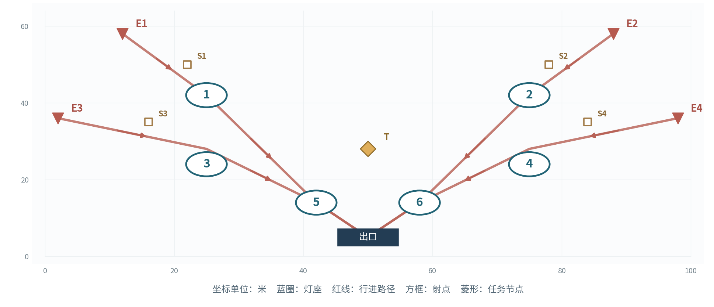

图  险境2灯位、入口与任务示意图

灯座：L1(25,42)、L2(75,42)、L3(25,24)、L4(75,24)、L5(42,14)、L6(58,14)

入口：E1(12,58)、E2(88,58)、E3(2,36)、E4(98,36)

任务点：T(50,28)；出口：(50, 5)

阻挡体：空地

敌人行进路线：E1：(12,58)→(25,42)→(42,14)→(50,5)；E2：(88,58)→(75,42)→(58,14)→(50,5)；E3：(2,36)→(25,28)→(42,14)→(50,5)；E4：(98,36)→(75,28)→(58,14)→(50,5)。路线走廊宽6米；巨浪靠近驻灯区时转为拆解子目标。

射手驻射点：E1(22,50)、E2(78,50)、E3(16,35)、E4(84,35)。惊蛰猎手沿本入口路径抵达对应驻射点后锁定射击；出怪同入口依表内顺序每隔0.35秒生成1名，多入口批次并行执行。

| 灯位 | 首波模组 | 上场①②③及接力顺序 | 索敌与方向 |
| --- | --- | --- | --- |
| L1 | 贯阵 | 今汐／相里要／卡卡罗 | 拆灯优先；贯阵方位90° |
| L2 | 聚焰 | 秧秧／长离／安可 | 突破优先 |
| L3 | 返照 | 桃祈／炽霞／白芷 | 远程优先 |
| L4 | 震域 | 忌炎／凌阳／渊武 | 突破优先 |
| L5 | 返照 | 维里奈／莫特斐／秋水 | 远程优先 |
| L6 | 贯阵 | 散华／吟霖／折枝 | 突破优先；贯阵方位90° |

任务：四波依次由灯1、2，灯3、4，灯5、6，灯1、6发送灯码，各12秒。 任务累计计时；所需灯持续点亮且任务点3米范围完成清场时推进。

| 波次 | 目标与事件 | 出敌时间、入口和种类 | 敌量 |
| --- | --- | --- | --- |
| 1 | 灯1与2发信 需亮灯L1+L2，任务12秒 | 0秒：E1 审判战士×10；E3 惊蛰猎手×4 8秒：E4 鸣泣战士×10 | 24 |
| 2 | 灯3与4发信 需亮灯L3+L4，任务12秒；第12秒L3故障6秒 | 0秒：E1 冥渊守卫×2；E2 磐石守卫×2 10秒：E4 鸣泣战士×12；E3 惊蛰猎手×4 | 20 |
| 3 | 灯5与6发信 需亮灯L5+L6，任务12秒；第12秒L5故障6秒 | 0秒：E2 审判战士×10；E4 鸣泣战士×10 8秒：E3 惊蛰猎手×6；E1 冥渊守卫×2 | 28 |
| 4 | 灯1与6终报 需亮灯L1+L6，任务12秒 | 0秒：E1 磐石守卫×2；E4 冥渊守卫×2 8秒：E2 审判战士×10；E3 惊蛰猎手×6 | 20 |

预定故障：对应波开战第12秒触发L3故障，持续6秒，第9秒显示灯号预告；故障结束后按协奏条件重新点亮。

预定故障：对应波开战第12秒触发L5故障，持续6秒，第9秒显示灯号预告；故障结束后按协奏条件重新点亮。

战斗执行：战前公开入口、批次、预定故障和任务灯号；自动索敌按每灯配置的优先级执行。远程射手沿路线进入驻射点，拆灯者按就近有效灯号尝试拆解。

波间调度：故障波将震域小队靠近预定故障灯，返照处理边侧箭矢。

关卡推进：首次完成后开放故障灯号镜像变体：L3→L4，L5→L6。

#### 险境3  长夜接班  前后双任务

100级敌人  &#124;  6盏灯  &#124;  18名上场角色  &#124;  4波  &#124;  104名敌人

车辆沿仓外三段推进，后方终端同时向接应部队发送信号。

开放角色：第一批：漂泊者·衍射、今汐、长离、秧秧、炽霞、白芷、散华、桃祈、渊武；第二批：忌炎、鉴心、吟霖、莫特斐、相里要、凌阳、丹瑾、折枝、维里奈；第三批：釉瑚、灯灯、卜灵、秋水、安可、椿、卡卡罗、秧秧·玄翎

开放模组：聚焰、贯阵、震域、返照。各灯座均可选已开放模组，支持同型重复；下表为可直接试玩的首波预设。

图  险境3灯位、入口与任务示意图

灯座：L1(20,42)、L2(20,24)、L3(50,42)、L4(50,24)、L5(80,42)、L6(80,24)

入口：E1(10,58)、E2(90,58)、E3(2,36)、E4(98,36)

任务点：CAR(50,12)、SIG(50,31)；出口：(50, 5)

阻挡体：矩形(40,48)至(60,53)

敌人行进路线：E1：(10,58)→(20,42)→(50,15)→(50,5)；E2：(90,58)→(80,42)→(50,15)→(50,5)；E3：(2,36)→(20,26)→(50,15)→(50,5)；E4：(98,36)→(80,26)→(50,15)→(50,5)。路线走廊宽6米；巨浪靠近驻灯区时转为拆解子目标。

射手驻射点：E1(17,51)、E2(83,51)、E3(13,34)、E4(87,34)。惊蛰猎手沿本入口路径抵达对应驻射点后锁定射击；出怪同入口依表内顺序每隔0.35秒生成1名，多入口批次并行执行。

| 灯位 | 首波模组 | 上场①②③及接力顺序 | 索敌与方向 |
| --- | --- | --- | --- |
| L1 | 聚焰 | 秧秧／长离／安可 | 突破优先 |
| L2 | 返照 | 桃祈／白芷／秋水 | 远程优先 |
| L3 | 贯阵 | 今汐／相里要／散华 | 拆灯优先；贯阵方位90° |
| L4 | 震域 | 忌炎／凌阳／渊武 | 突破优先 |
| L5 | 贯阵 | 灯灯／卡卡罗／吟霖 | 拆灯优先；贯阵方位90° |
| L6 | 返照 | 莫特斐／维里奈／釉瑚 | 远程优先 |

任务：第1波护送；第2、3波护送与发信并行；第4波发送终报码。护送16秒，发信12秒。 任务累计计时；所需灯持续点亮且任务点3米范围完成清场时推进。

| 波次 | 目标与事件 | 出敌时间、入口和种类 | 敌量 |
| --- | --- | --- | --- |
| 1 | 灯1与2护送 需亮灯L1+L2，任务16秒 | 0秒：E1 审判战士×12；E2 鸣泣战士×10 8秒：E3 惊蛰猎手×4 | 26 |
| 2 | 灯3与4护送＋灯5与6发信 需亮灯L3+L4,L5+L6，任务16秒,12秒 | 0秒：E3 冥渊守卫×2；E4 磐石守卫×2 8秒：E1 审判战士×12；E2 惊蛰猎手×6 | 22 |
| 3 | 灯5与6护送＋灯1与2发信 需亮灯L5+L6,L1+L2，任务16秒,12秒 | 0秒：E2 鸣泣战士×12；E4 审判战士×12 8秒：E3 冥渊守卫×2；E1 惊蛰猎手×4 | 30 |
| 4 | 灯1与6终报码 需亮灯L1+L6，任务12秒 | 0秒：E1 磐石守卫×2；E4 冥渊守卫×2 8秒：E2 审判战士×12；E3 鸣泣战士×10 | 26 |

战斗执行：战前公开入口、批次、预定故障和任务灯号；自动索敌按每灯配置的优先级执行。远程射手沿路线进入驻射点，拆灯者按就近有效灯号尝试拆解。

波间调度：护送小队沿前中后逐波调整，终端保留两灯反制射手与拆灯者。

关卡推进：首次完成后开放反向转运及灯组镜像任务。

### 战斗信息层级与美术制作

#### 数据接口与制作交付

| 配表实体 | 字段与制作口径 |
| --- | --- |
| StageConfig | 关卡ID、等级、开放角色池、模块池、灯座坐标、入口坐标、路径折点、障碍、任务点、镜头边界 |
| LampConfig | 灯座ID、可选模组集合、首波模块、选敌优先、贯阵方位角、有效射程、区域参数、故障状态 |
| TeamConfig | 人物ID、形态ID、灯座归属、①②③顺序、基础伤害、技能ID、适配模块集合 |
| WaveConfig | 关卡ID、波次、批次秒数、入口、单位ID、数量、所需灯组、任务秒数、预定故障事件 |
| BattleLog | 时间、灯号、动作、目标、命中、产能接受值、协奏余额、灯击主奏、故障原因、任务进度 |
| RewardConfig | 账号条件ID、星声、贝币、首通标记、领取状态、关卡解锁条件 |

美术资源：统一灯座主体4套发光模块；入侵入口警示4式、任务灯号亮灭、拆解进度、预定故障、箭矢拦截、共振破防、波间整备共9类UI反馈。每类制作待机、触发、持续、结束四段状态。

镜头默认俯视35°、视角高度42米，允许2档缩放与灯座聚焦；HUD固定显示防线耐久、任务倒计时、六灯协奏与主奏编号。关键音效分离开战预告、灯击、拆解、故障、校线完成和交接六类事件。

| 战斗表现 | 动画与特效落地标准 |
| --- | --- |
| 敌人预警 | 入口图标在实际刷怪前5秒显示；拆解读条、越线风险与故障灯号采用三种独立形状编码。 |
| 角色动作 | 每角色至少保留普攻、两战技、闪避、受击、倒下、复归七类动作，生效帧通过事件轨直接提交。 |
| 四类灯效 | 聚焰爆心及4秒火区、贯阵28米束线、震域三次波纹、返照8米拦箭边界与反击弹道。 |
| 主奏提示 | 协奏条达到80与100时分别出现准备与可触发反馈；当前主奏角色编号跟随灯号变化。 |
| 结算复盘 | 波后展示突破路线、故障次数、伤害命中、接力次数、任务停滞时间和角色倒下时刻。 |

#### 战斗验收方案

| 测试对象 | 可复现通过条件 |
| --- | --- |
| 动作一致 | 逐帧对比生效帧、武器碰撞、目标转向锁定和实际伤害日志；连续动作保持站位约束。 |
| 接力边界 | 满能、故障、全员倒下、主奏倒下、目标死亡和8秒间隔均有唯一事件轨迹。 |
| 状态链 | 拆解被打断、返照护灯、故障后恢复、共振耗尽及强控保护均按秒级规则执行。 |
| 规模上限 | 双灯到六灯逐级压测；主线在场24、险境32，同帧伤害、弹体和区域判定保持稳定。 |
| 可读性 | 面向5名游戏经验覆盖多个层次的观察者开展理解测试，至少4人准确复述漏怪与熄灯原因。 |

[返回文档选择](#document-navigation)
